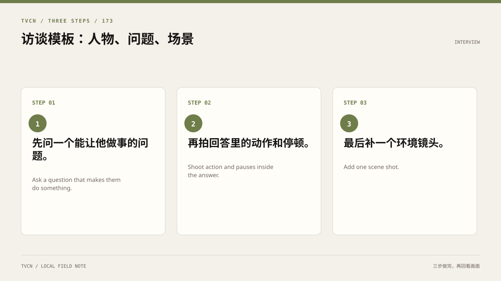

现场里先看：人物、问题、场景；先拍他能做事的地方，再坐下来。

<!-- DIAGRAM_START -->
<h2>图解</h2>
<figure>
  
  <figcaption>看“选一个他能做事的地方”和“先拍做事，再坐下来访谈”两处，判断前三秒给出的理由，能不能撑到结尾。</figcaption>
</figure>
<!-- DIAGRAM_END -->
<section><h2 id="section-1">可套用的 60 秒分段表</h2>
<table class="template-table"><thead><tr><th>段落</th><th>时间</th><th>画面</th><th>声音/通过线</th></tr></thead><tbody><tr><td>场景动作</td><td>0–10 秒</td><td>人物在真正做事的地方，手上有动作</td><td>环境声；不先问履历</td></tr><tr><td>做事</td><td>10–25 秒</td><td>一个完整工作动作，能看出难度</td><td>同期声；采访不盖动作</td></tr><tr><td>问题 1</td><td>25–40 秒</td><td>坐下访谈，背景仍有工作痕迹</td><td>问题围绕刚才的动作</td></tr><tr><td>问题 2</td><td>40–50 秒</td><td>反应镜头和手部细节</td><td>追问代价，不追问出生地</td></tr><tr><td>收尾</td><td>50–60 秒</td><td>人物回到工作，或看向空间</td><td>一句具体话；不总结人生</td></tr></tbody></table>
<h2 id="section-2">开机前先填三行</h2><ul><li><strong>地方：</strong>他真正做事的地方在哪？为什么不是会议室？</li><li><strong>动作：</strong>开机后先拍他做哪件事？必须完整。</li><li><strong>问题：</strong>三个问题都围绕这个动作；删掉履历题。</li></ul></section><section><h2 id="section-3">现场</h2>
人物、问题、场景；先拍他能做事的地方，再坐下来。
</section><section><h2 id="section-4">怎么做</h2><ol><li>选一个他能做事的地方。</li><li>先拍做事，再坐下来访谈。</li><li>问题围绕一个具体动作，不围绕履历。</li></ol></section><section><h2 id="section-5">别踩</h2>
别让被访者念简历；简历没有画面。
</section><section><h2>判断</h2>
这一页的判断只看三条可观察的验收，不靠口号：
<ul><li><strong>1.</strong> 场景是他真正做事的地方，不是空会议室。</li><li><strong>2.</strong> 坐下访谈前已经拍到他做一件事。</li><li><strong>3.</strong> 问题围绕动作，没有问出生地和履历。</li></ul></section><section><h2>失败</h2>
下面任一条出现，先停，不要靠后期补：
<ul><li><strong>1.</strong> 只做到“场景是他真正做事的地方，不是空会议室”的形式，换一个机位或场景就重现不了。</li><li><strong>2.</strong> 把“坐下访谈前已经拍到他做一件事”留到后期或口头解释，现场没有留下能复查的记录。</li><li><strong>3.</strong> 别让被访者念简历；简历没有画面。</li></ul></section><section><h2>延伸</h2>
<strong>10 分钟练习：</strong>拆一条 30 秒参考片，标出“选一个他能做事的地方”和“先拍做事，再坐下来访谈”的时间点；再写一句：如果删掉其中一个，片子还成立吗？
</section>
<h2>验收</h2><ul><li>场景是他真正做事的地方，不是空会议室。</li><li>坐下访谈前已经拍到他做一件事。</li><li>问题围绕动作，没有问出生地和履历。</li></ul>

> 意图分工：本页负责「访谈模板：人物、问题、场景」的可执行细节；同集群先读 <a href="https://formats.tvcn.org/article/interview-structure/">访谈结构：问题比机位重要</a> 建立总判断，再回到本页。

<!-- INTENT_SCOPE -->

<section><h2>边界</h2>
本页只解决「访谈模板：人物、问题、场景」这一个问题；不替代 直播播客拉片：六个段落怎么落地、直播播客结构：六个拍点、采访别问“你有什么感受”：把问题换成动作。如果现场问题属于后者，先读对应页，不要在本页继续加参数。
</section>
<!-- SOURCES_START -->
## 经验说明

经验说明：本页来自 7 个同类型成片项目的片型拆解，成片 30 秒–5 分钟、单平台交付；只讨论「访谈模板：人物、问题、场景」的结构与判断顺序，不含外部实验室测试，也不适用于多机位直播、影院交付或需要定制叙事的长片。
<!-- SOURCES_END -->

