<!-- DIAGRAM_START -->
<h2>图解</h2>
<figure>
  
  <figcaption>示意：时间、段落、画面、声音、作用，五列对齐看。</figcaption>
</figure>
<!-- DIAGRAM_END -->
<h2>样本说明：先别把它当真实客户</h2>
综合样例：一场双人播客，主题是“创作者要不要每周更新”。不是单一真实节目；人物、观点与数据均为合成示意。

拉片的目的不是背镜头，是看“每一拍靠什么成立”。如果你要交客户片，把示例里的数字、品牌、人物全部替换成你自己的素材与证据。
<h2>逐段拆解：五列对齐</h2>
先看时间，再看段落，最后看画面和声音是否服务同一个作用。任何一列对不上，这一段就会变成“好看但没用”。

<table class="data-table"><thead><tr><th>时间</th><th>段落</th><th>画面</th><th>声音</th><th>作用</th></tr></thead><tbody><tr><td>00:00–00:10</td><td>开场</td><td>直接抛问题</td><td>现场声</td><td>不念片头</td></tr><tr><td>00:10–03:00</td><td>一个问题</td><td>双人中景</td><td>对白</td><td>保留反应</td></tr><tr><td>03:00–06:00</td><td>一个故事</td><td>手部/物件</td><td>环境</td><td>故事完整</td></tr><tr><td>06:00–09:00</td><td>一个反例</td><td>换机位</td><td>对白</td><td>观点对抗</td></tr><tr><td>09:00–11:00</td><td>一个结论</td><td>近景</td><td>安静</td><td>只说一句</td></tr><tr><td>11:00–11:30</td><td>下一集</td><td>全景</td><td>环境</td><td>留问题</td></tr></tbody></table>
<h2>镜头与声音：哪些能学，哪些别学</h2>
<strong>能学</strong>：同一动作的前后对比、手部近景、环境声转场、固定机位拍重复。<strong>别学</strong>：为了煽情加慢动作、用音乐盖住现场声、把示例数字当成果。镜头可以借，证据不能借。
<h2>三个可复用动作</h2>
1. 用同一个动作拍两次：一次失败、一次成功，剪在一起，观众自己会比较。2. 每 15 秒给一个手部/物件近景，让抽象 information 落地。3. 结尾不总结，留一个动作或一个问题，让下一集有入口。
<h2>失败与验收：拉片不是抄片</h2>
最常见的失败是“镜头很像，但证据是假的”。验收时问三句：这一段删掉会怎样？声音是否独立成立？结果能否被核对？三句里有两句答不上，就重拍或重剪。
<h2>验收</h2><ul><li>已标注“综合样例”，不冒充真实客户。</li><li>每段画面与声音服务同一作用。</li><li>至少一个前后对比可核对。</li><li>没有用音乐盖住关键现场声。</li><li>结尾没有总结，留了动作/问题。</li><li>删掉任意一段，结构仍成立。</li></ul>

<!-- SOURCES_START -->
## 参考与延伸阅读

- [S14] [YouTube 社区准则](https://support.google.com/youtube/answer/2801973) — 2026-11-26 访问。用于核对首段“综合样例：把直播播客拆成六拍，逐段看画面、声音和通过线；示例数字只作示范，不是客户数据。”中的术语与公开背景（平台对误导、危险行为、版权与披露的现行规则）；不替代现场测试。
- [S15] [TikTok 社区准则](https://www.tiktok.com/community-guidelines/en/) — 2026-11-26 访问。用于核对首段“综合样例：把直播播客拆成六拍，逐段看画面、声音和通过线；示例数字只作示范，不是客户数据。”中的术语与公开背景（短视频平台的 content、AI 生成与商业披露规则）；不替代现场测试。
- [S16] [BBC 编辑准则](https://www.bbc.co.uk/editorialguidelines/) — 2026-11-26 访问。用于核对首段“综合样例：把直播播客拆成六拍，逐段看画面、声音和通过线；示例数字只作示范，不是客户数据。”中的术语与公开背景（准确性、公正、隐私与隐蔽拍摄的编辑标准）；不替代现场测试。
- [S29] [YouTube 上传规格](https://support.google.com/youtube/answer/1722171) — 2026-11-26 访问。用于核对首段“综合样例：把直播播客拆成六拍，逐段看画面、声音和通过线；示例数字只作示范，不是客户数据。”中的术语与公开背景（分辨率、码率、帧率与音频编码建议）；不替代现场测试。
<!-- SOURCES_END -->

