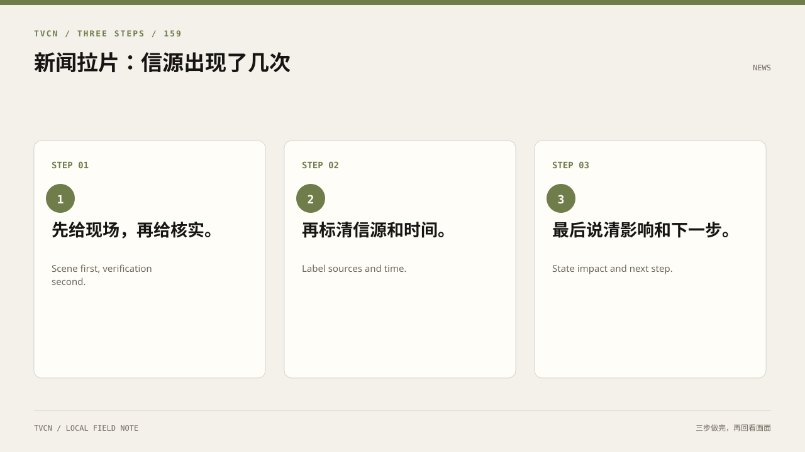

新闻拉片数信源：出现了几次、是谁、有没有二手转述。

<!-- DIAGRAM_START -->
<h2>图解</h2>
<figure>
  
  <figcaption>把三步按顺序做完，再回看画面或文件。</figcaption>
</figure>
<!-- DIAGRAM_END -->
<h2>现场</h2>

数信源：出镜几人、字幕几个、二手几处；二手画面必须角标。

<h2>怎么做</h2>

新闻拉片数信源：出现了几次、是谁、有没有二手转述。
<ol><li>数出镜信源几人。</li><li>数字幕信源几个。</li><li>数二手画面几处，检查有没有角标。</li></ol>
<h2>别踩</h2>

别把二手转述当一手；信源一混，整条片子都不可信。

<h2>验收</h2>
<ul><li>出镜、字幕、二手三类信源分别有数量。</li><li>每条关键事实能追到一个信源。</li><li>二手画面全部有角标，没有混为一手。</li></ul>
