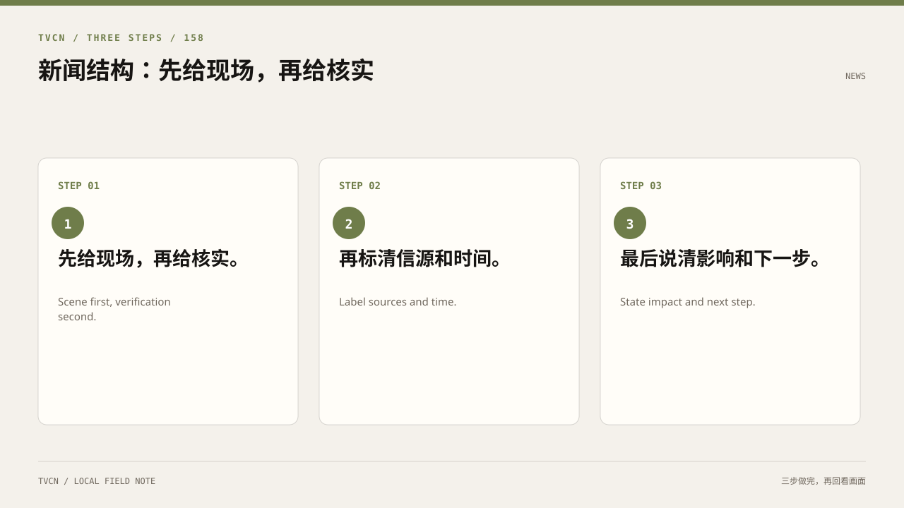

新闻结构先给现场，再给核实；先讲背景，观众已经走了。

<!-- DIAGRAM_START -->
<h2>图解</h2>
<figure>
  
  <figcaption>把三步按顺序做完，再回看画面或文件。</figcaption>
</figure>
<!-- DIAGRAM_END -->
<h2>现场</h2>

0 到 5 秒现场，5 到 15 秒核实，15 到 30 秒背景和影响；信源字幕标清。

<h2>怎么做</h2>

新闻结构先给现场，再给核实；先讲背景，观众已经走了。
<ol><li>0 到 5 秒给现场。</li><li>5 到 15 秒给核实。</li><li>15 到 30 秒给背景和影响，信源字幕标清。</li></ol>
<h2>别踩</h2>

别用二手画面当现场；那会毁掉可信度。

<h2>验收</h2>
<ul><li>前 5 秒是现场画面或现场声音，不是主播口播。</li><li>核实段有具体信源、时间和可查记录。</li><li>二手画面有角标，观众能分清。</li></ul>

<!-- DEEP_DIVE_START -->
## 深读

<strong>约 6 分钟。</strong> 新闻现场先给可核实的事实，再给背景；画面不能替事实下结论。

### 先给现场

开头十秒给时间、地点、人物和一个可验证的细节：封条、水位、时间戳、门牌。不要先让主持人站在门口念导语。

一手素材优先：自己拍的、原始文件、完整时间线。二手画面要标来源，截图要保留发布时间，不要把旧画面当今天。

### 信源

至少两个独立信源；匿名要说明为什么匿名、对方能提供什么。一个人重复说三遍，不等于三个信源。

把“谁说的”和“发生了什么”分开：事实用画面和文件，判断用采访。不要把推测写成标题。

### 结构与更正

发生了什么、证据是什么、谁在哪里、下一步是什么；四段答完就结束。不要用煽情音乐替观众判断，也不要剪掉对你不利的回答。

发布前留更正入口：错字、错时间、错人名都要能改，并在片尾或简介说明。新闻的可信度来自可更正，不是来自语气坚定。

### 五分钟练习：一条现场的三行事实

拿一条你拍的现场，写三行：几点几分发生了什么、谁在场、哪一件东西能证明。每行都要能被另一个镜头或文件核对。

再写一行“我还不知道什么”，把它放在片尾或简介里。不要把不知道的写成肯定句；能把未知说清，新闻才可信。

### 什么时候算完成

把片子里每一条事实单独拎出来，问：哪个镜头、哪份文件、哪个独立信源能核对它。每条都答得出，片子才算完成；有一条只能靠“有人说”，就把它降成判断，不要写成事实。

### 新闻现场，十项检查
<ul><li>十秒内给时间地点人物</li><li>有一个可验证细节</li><li>一手素材优先</li><li>二手画面标来源</li><li>截图保留发布时间</li><li>至少两个独立信源</li><li>匿名信源说明原因</li><li>事实与判断分开</li><li>没有煽情音乐代判</li><li>发布前有更正入口</li></ul>
新闻现场不是比谁拍得狠，是比谁敢把自己能核实的东西放到最前面。

<!-- DEEP_DIVE_END -->
