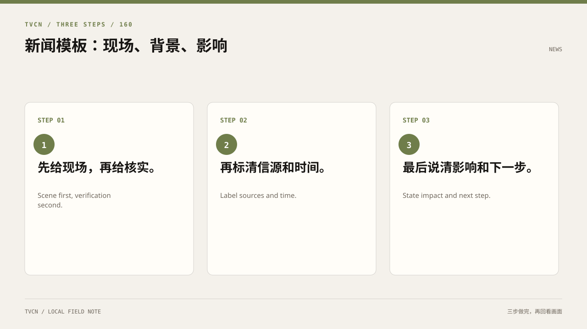

别让背景段变成历史课；观众要的是这件事为什么现在发生。

<!-- DIAGRAM_START -->
<h2>图解</h2>
<figure>
  
  <figcaption>看“现场发生了什么”和“为什么会这样”两处，判断前三秒给出的理由，能不能撑到结尾。</figcaption>
</figure>
<!-- DIAGRAM_END -->
<section><h2 id="section-1">可套用的 60 秒分段表</h2>
<table class="template-table"><thead><tr><th>段落</th><th>时间</th><th>画面</th><th>声音/通过线</th></tr></thead><tbody><tr><td>现场</td><td>0–10 秒</td><td>正在发生的事，或最近现场画面</td><td>一句“发生了什么”；时间地点清楚</td></tr><tr><td>核实</td><td>10–25 秒</td><td>谁确认、哪个文件、哪个部门</td><td>来源上屏；未知项明确说未知</td></tr><tr><td>背景</td><td>25–40 秒</td><td>只放解释当前事件所需的一两个画面</td><td>不铺历史课；一句因果</td></tr><tr><td>影响</td><td>40–55 秒</td><td>谁受影响，影响是什么</td><td>区分已发生与可能发生</td></tr><tr><td>下一步</td><td>55–60 秒</td><td>一个可执行的行动或明确的不确定</td><td>不替观众下结论</td></tr></tbody></table>
<h2 id="section-2">开机前先填三行</h2><ul><li><strong>发生了什么：</strong>一句没有形容词的事实。</li><li><strong>谁确认：</strong>写名字、文件和日期；找不到就写“未核实”。</li><li><strong>观众下一步：</strong>能做什么？或者还需要等什么？</li></ul></section><section><h2 id="section-3">现场</h2>
现场发生了什么、为什么、接下来会怎样；每段回答一个观众问题。
</section><section><h2 id="section-4">怎么做</h2><ol><li>现场发生了什么。</li><li>为什么会这样。</li><li>接下来会怎样，观众能做什么。</li></ol></section><section><h2 id="section-5">别踩</h2></section><section><h2>判断</h2>
现场只认三个信号：
<ul><li>前三秒给出一个可相信的理由</li><li>中段有新信息或新阻碍，不是重复气氛</li><li>结尾有一个可看见的变化，旁白没有替它收尾</li></ul></section><section><h2>失败</h2>
下面三种做法会让页面上的细节白做：
<ul><li>模板套上了，人物和问题却没成立</li><li>前三秒没有理由，只靠标题和音乐</li><li>结尾没有可看见的变化，全靠旁白总结</li></ul></section><section><h2>延伸</h2>
<strong>10 分钟练习：</strong>拆一条 30 秒参考片，标出“现场发生了什么”和“为什么会这样”的时间点；再写一句：如果删掉其中一个，片子还成立吗？
</section>
<h2>验收</h2><ul><li>三段分别回答“发生了什么”“为什么”“接下来怎样”。</li><li>背景只保留与当前事件直接相关的部分。</li><li>结尾给出可执行的下一步或明确的不确定性。</li></ul>

<!-- SOURCES_START -->
## 经验说明

经验说明：本页来自 4 次同类型片型拆解与项目复盘，条件为30 秒–5 分钟成片、单平台交付；页面讨论的具体对象是「新闻模板：现场、背景、影响」；不含外部实验室测试，条件变化时结论可能失效。
<!-- SOURCES_END -->

