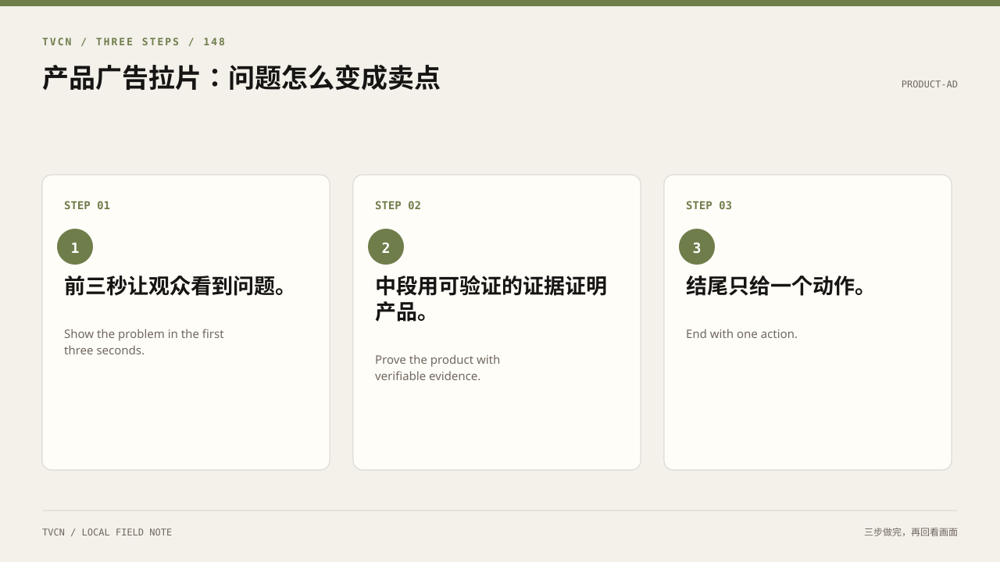

产品广告拉片看问题怎么变成卖点：先让观众疼一下，再给证据。

<!-- DIAGRAM_START -->
<h2>图解</h2>
<figure>
  
  <figcaption>把三步按顺序做完，再回看画面或文件。</figcaption>
</figure>
<!-- DIAGRAM_END -->
<h2>现场</h2>

看前 3 秒有没有让观众看到问题；第 4 到 13 秒有没有可验证证据；最后有没有一个动作。

<h2>怎么做</h2>

产品广告拉片看问题怎么变成卖点：先让观众疼一下，再给证据。
<ol><li>看前 3 秒有没有让观众看到问题。</li><li>看第 4 到 13 秒有没有可验证证据。</li><li>看结尾有没有一个动作。</li></ol>
<h2>别踩</h2>

别把产品参数念成说明书；观众要看它做了什么。

<h2>验收</h2>
<ul><li>前 3 秒能看到具体问题，不是产品旋转。</li><li>中段证据能被镜头验证，比如前后对比。</li><li>结尾只有一个动作，没有同时让观众做三件事。</li></ul>
