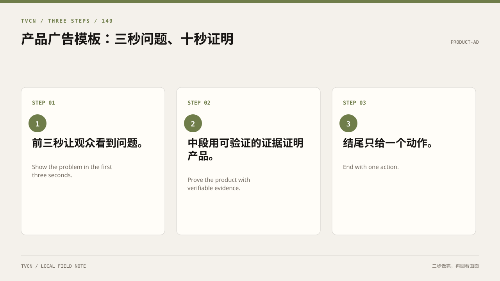

别在 13 秒里塞五个卖点；观众一个都记不住。

<!-- DIAGRAM_START -->
<h2>图解</h2>
<figure>
  
  <figcaption>看“0 到 3 秒：问题出现”和“3 到 13 秒：三个证据，每个都能…”两处，判断前三秒给出的理由，能不能撑到结尾。</figcaption>
</figure>
<!-- DIAGRAM_END -->
<section><h2 id="section-1">可套用的 18 秒分段表</h2>
<table class="template-table"><thead><tr><th>段落</th><th>时间</th><th>画面</th><th>声音/通过线</th></tr></thead><tbody><tr><td>问题</td><td>0–3 秒</td><td>使用现场的真实损失：溢出、卡住、耗时</td><td>一句具体问题；不出现品牌名</td></tr><tr><td>证据 1</td><td>3–7 秒</td><td>产品介入，问题停止；手部特写</td><td>动作声；能看清产品怎么用</td></tr><tr><td>证据 2</td><td>7–11 秒</td><td>换一个条件，证明不是偶然</td><td>一句条件说明；不夸大</td></tr><tr><td>证据 3</td><td>11–13 秒</td><td>结果可量化：时间、数量、前后对比</td><td>数字或对比；不靠形容词</td></tr><tr><td>动作</td><td>13–18 秒</td><td>产品回到生活场景，人物离开</td><td>只给一个下一步；不再加第二句口号</td></tr></tbody></table>
<h2 id="section-2">开机前先填三行</h2><ul><li><strong>问题：</strong>谁在什么场景损失了什么？必须是可视损失。</li><li><strong>三个证据：</strong>每个证据换一个条件；三个都一样，等于只有一个。</li><li><strong>动作：</strong>结尾让观众做什么？只能一个。</li></ul></section><section><h2 id="section-3">现场</h2>
0 到 3 秒问题，3 到 13 秒三个证据，13 到 18 秒一个动作；证据要能看清。
</section><section><h2 id="section-4">怎么做</h2><ol><li>0 到 3 秒：问题出现。</li><li>3 到 13 秒：三个证据，每个都能看清。</li><li>13 到 18 秒：只给一个动作。</li></ol></section><section><h2 id="section-5">别踩</h2></section><section><h2>判断</h2>
这一页的判断只看三条可观察的验收，不靠口号：
<ul><li><strong>1.</strong> 时间码按 0–3、3–13、13–18 分段，能对上。</li><li><strong>2.</strong> 三个证据都能被看清，不靠旁白补。</li><li><strong>3.</strong> 最后五秒只有一个动作，没有加第二句口号。</li></ul></section><section><h2>失败</h2>
下面任一条出现，先停，不要靠后期补：
<ul><li><strong>1.</strong> 只做到“时间码按 0–3、3–13、13–18 分段，能对上”的形式，换一个机位或场景就重现不了。</li><li><strong>2.</strong> 把“三个证据都能被看清，不靠旁白补”留到后期或口头解释，现场没有留下能复查的记录。</li><li><strong>3.</strong> 第 3 条验收“最后五秒只有一个动作，没有加第二句口号”没人复核，交片时才发现。</li></ul></section><section><h2>延伸</h2>
<strong>10 分钟练习：</strong>拆一条 30 秒参考片，标出“0 到 3 秒：问题出现”和“3 到 13 秒：三个证据，每个都能…”的时间点；再写一句：如果删掉其中一个，片子还成立吗？
</section>
<h2>验收</h2><ul><li>时间码按 0–3、3–13、13–18 分段，能对上。</li><li>三个证据都能被看清，不靠旁白补。</li><li>最后五秒只有一个动作，没有加第二句口号。</li></ul>

> 意图分工：本页负责「产品广告模板：三秒问题、十秒证明」的可执行细节；同集群先读 <a href="https://formats.tvcn.org/article/music-video-template/">MV 模板：主歌、副歌、记忆点</a> 建立总判断，再回到本页。

<!-- INTENT_SCOPE -->

<!-- SOURCES_START -->
## 经验说明

经验说明：本页来自 6 次同类型片型拆解与项目复盘，条件为30 秒–5 分钟成片、单平台交付；页面讨论的具体对象是「产品广告模板：三秒问题、十秒证明」；不含外部实验室测试，条件变化时结论可能失效。
<!-- SOURCES_END -->

