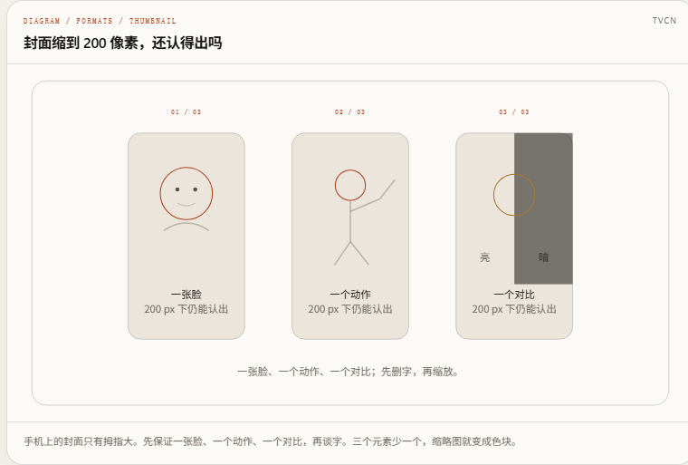

<!-- DIAGRAM_START -->
## 图解

<figure>
  
  <figcaption>手机上的封面只有拇指大。先保证一张脸、一个动作、一个对比，再谈字。三个元素少一个，缩略图就变成色块。</figcaption>
</figure>
<!-- DIAGRAM_END -->

## 先做黑白稿，缩到拇指大

把画面转成黑白，缩到 200 像素宽。认不出主体，就重拍或重裁。颜色和字救不了构图。很多封面在 1080 像素里好看，缩到手机列表里只剩一团颜色。

黑白稿还有一个好处：你会先看脸、看动作、看亮暗，而不是被滤镜骗过去。

## 一张脸，一个动作，一个反差

人脸比风景快，动作比摆拍快，亮暗对比比细节快。三个人以上，观众不知道看谁。留一个明确的中心，其他都退下去。

如果画面里没有脸，就给一个正在发生的事：手伸进画面、门被推开、东西掉下来。静止的空镜做封面，通常要靠字硬撑。

## 字只留 3 到 5 个

封面字是路牌，不是标题。写“她走了”比写“一个关于离开的故事”有用。小字在手机上会糊成一条线，尤其压在亮背景上。

同一支片子做三版封面，发出去看点击，不要问同事“哪个好看”。数据比审美快，也比审美诚实。

## 检查

- 黑白稿缩到 200 像素，主体仍然认得出。
- 画面里只有一个明确的中心。
- 封面字不超过 5 个，在手机上不糊。

<!-- DEEP_DIVE_START -->
## 深读

<strong>约 5 分钟。</strong> 封面不是海报的缩小版，是手机列表里两秒内要被认出的一个画面。

### 先认人，再认事

缩到拇指大，先看有没有一张脸或一个动作；没有，就只剩文字。人脸占画面三分之一以上，眼睛看镜头或看关键物。

标题不要和画面说同一句话；画面给情绪，标题给信息。

如果画面里有两个主体，观众会先找脸；把不重要的人虚化或裁掉，不要让他们抢焦点。

### 对比和留白

封面要有明暗或冷暖对比；背景干净，主体离边至少留 8%。不要把字压在人脸上，也不要把重要动作放在平台 UI 遮住的位置。

三种尺寸各看一次：16:9、1:1、9:16；裁切后主体还在，才叫封面。

文字最多两行；第一行给问题，第二行给结果，不要写成标题党。

### 测试而不是猜

做三版：人脸版、动作版、物件版；发到手机列表里，找五个人两秒内说看到什么。说不清，重做。

不要用点击率当唯一标准；封面承诺的内容，正片必须给。点进来又失望，下一次封面会失效。

把三版并排放在真实手机屏幕上比，不要在 27 寸显示器上判断拇指大小。

### 封面三版测试

同一条片做三版：人脸、动作、物件；放手机列表里找五个人两秒内说看到什么，记下第一眼词。

第一眼词不一致，说明画面没有主张；删掉装饰，只留一个主体。

把三版按平台真实尺寸导出，不要在电脑上放大看；拇指大小才是考卷。

### 封面发布前，十项检查
<ul><li>缩到拇指大还认得出</li><li>有一张脸或一个动作</li><li>人脸至少占三分之一</li><li>标题不重复画面</li><li>背景干净</li><li>主体留 8% 边距</li><li>文字最多两行</li><li>16:9、1:1、9:16 都不裁掉主体</li><li>手机列表找五个人测试</li><li>封面承诺正片能给</li></ul>
封面只负责让人停下来，正片才负责让人留下来。

<!-- DEEP_DIVE_END -->
