<!-- DIAGRAM_START -->
<h2>图解</h2>
<figure>
  
  <figcaption>示意：六列填完，才能开机；缺一列，现场就会靠猜。</figcaption>
</figure>
<!-- DIAGRAM_END -->
<h2>使用场景：什么时候填这张表</h2>
开机前 24 小时填完，发给导演、摄影、录音、制片各一份。表不是分镜的替代，是把分镜压缩成“今天必须拍到什么”。客户改需求时，先改表，再改预算。
<h2>表格：五列加通过线</h2>
每一行只写一个段落；画面写“观众看到什么”，不写“高级感”；声音写“观众听到什么”；通过线写“拍到什么才算过”。

<table class="data-table"><thead><tr><th>段落</th><th>画面</th><th>声音</th><th>时长</th><th>通过线</th></tr></thead><tbody><tr><td>门口</td><td>钥匙/鞋/快递</td><td>门锁</td><td>8–10 秒</td><td>有生活痕迹</td></tr><tr><td>动线</td><td>门到窗一镜</td><td>脚步</td><td>15–20 秒</td><td>不剪碎</td></tr><tr><td>功能</td><td>一个动作</td><td>物件声</td><td>15–20 秒</td><td>证明一个功能</td></tr><tr><td>细节</td><td>手/材质/收边</td><td>材质声</td><td>15–20 秒</td><td>工艺可感</td></tr><tr><td>光线</td><td>同空间早晚</td><td>环境</td><td>15–20 秒</td><td>不靠滤镜</td></tr><tr><td>离开</td><td>关灯/关门</td><td>关门</td><td>8–10 秒</td><td>留问题</td></tr></tbody></table>
<h2>填表示例：先填最难的</h2>
先把需要人、天气、场地许可的段落填掉，再填空镜。示例里的时长是上限，不是目标；拍到了通过线就停，不要为了凑时长重复。
<h2>现场执行：一张表怎么用</h2>
开机前 5 分钟对一遍表：今天拍哪几行、每行通过线是什么、谁负责。每拍完一行，在表上打勾并写“实际拍到的版本”。收工前拍一张表，和素材一起归档。
<h2>验收：表填完不等于拍完</h2>
收工验收只看：每一行的通过线是否有对应素材、声音是否有独立备份、最难的段落是否至少两条。缺一项，第二天补拍；不要等后期。
<h2>验收</h2><ul><li>每个段落一行，不合并。</li><li>画面写看到什么，不写形容词。</li><li>声音写听到什么，含环境声。</li><li>通过线可判断，不写“感觉对”。</li><li>最难的段落先拍。</li><li>收工前表与素材一起归档。</li></ul>

<!-- SOURCES_START -->
## 参考与延伸阅读

- [S16] [BBC：编辑准则](https://www.bbc.co.uk/editorialguidelines/) — 2026-11-26 访问。用于核对「使用场景：什么时候填这张表」一节的术语/方法/规则（BBC 编辑准则，不是平台流量规则）；不核对其中由本页经验得出的数字、型号与现场结论，也不替代测试。
- [S14] [YouTube：社区准则](https://support.google.com/youtube/answer/2801973) — 2026-11-26 访问。用于核对「表格：五列加通过线」一节的术语/方法/规则（YouTube 社区准则，不是内容创意标准）；不核对其中由本页经验得出的数字、型号与现场结论，也不替代测试。
<!-- SOURCES_END -->

