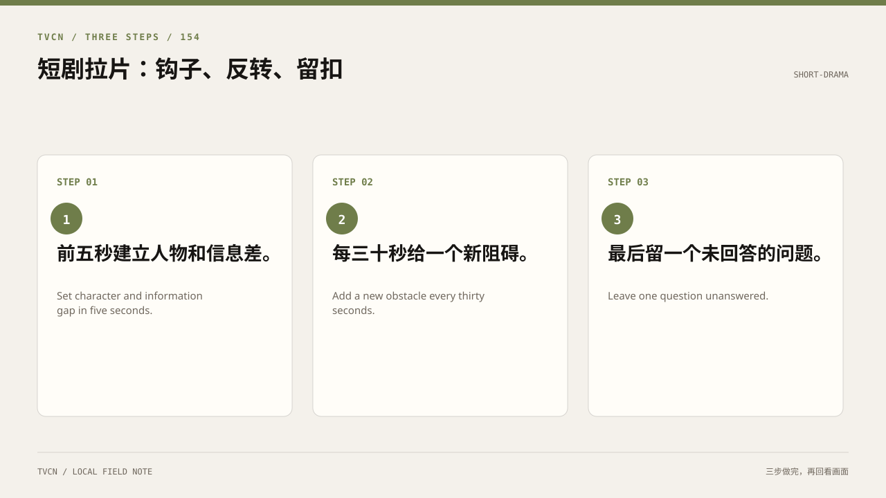

短剧拉片按钩子、反转、留扣拆；每一段都要改变人物处境。

<!-- DIAGRAM_START -->
<h2>图解</h2>
<figure>
  
  <figcaption>把三步按顺序做完，再回看画面或文件。</figcaption>
</figure>
<!-- DIAGRAM_END -->
<h2>现场</h2>

每 30 秒记一次处境变化：谁知道什么、谁失去什么；没有变化就是拖。

<h2>怎么做</h2>

短剧拉片按钩子、反转、留扣拆；每一段都要改变人物处境。
<ol><li>每 30 秒记一次处境变化：谁知道什么、谁失去什么。</li><li>标出反转前观众被误导的那个细节。</li><li>没有变化的段落就是拖，直接剪。</li></ol>
<h2>别踩</h2>

别让反转靠台词解释；反转要藏在画面里。

<h2>验收</h2>
<ul><li>每 30 秒有一次处境变化，能写出来。</li><li>反转前的误导细节在画面里出现过。</li><li>没有一段只是重复信息，拖长度。</li></ul>
