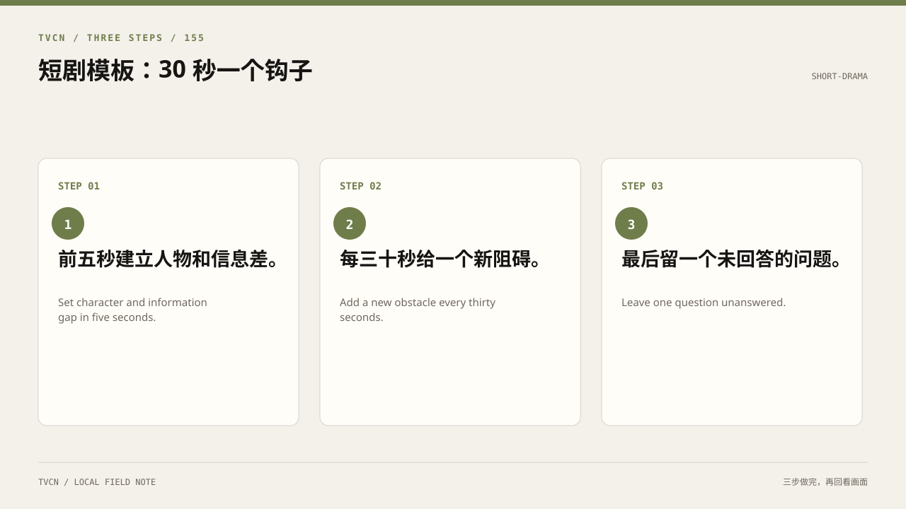

别让每段都靠新角色救场；人物没变，钩子就假。

<!-- DIAGRAM_START -->
<h2>图解</h2>
<figure>
  
  <figcaption>看“0 到 5 秒建立信息差”和“5 到 35 秒给新阻碍”两处，判断前三秒给出的理由，能不能撑到结尾。</figcaption>
</figure>
<!-- DIAGRAM_END -->
<section><h2 id="section-1">可套用的 60 秒分段表</h2>
<table class="template-table"><thead><tr><th>段落</th><th>时间</th><th>画面</th><th>声音/通过线</th></tr></thead><tbody><tr><td>信息差</td><td>0–5 秒</td><td>观众知道一件人物不知道的事</td><td>一句信息；不解释全部背景</td></tr><tr><td>新阻碍</td><td>5–20 秒</td><td>人物按错误信息行动，遇到第一个后果</td><td>动作和反应；不靠新角色救场</td></tr><tr><td>升级</td><td>20–35 秒</td><td>同一个误解决定更大的代价</td><td>一句代价；人物必须做选择</td></tr><tr><td>新代价</td><td>35–50 秒</td><td>选择发生，关系或位置改变</td><td>不解释对错；让结果说话</td></tr><tr><td>留问</td><td>50–60 秒</td><td>停在一个动作或一个没说完的话</td><td>问题能在前一分钟找到依据</td></tr></tbody></table>
<h2 id="section-2">开机前先填三行</h2><ul><li><strong>信息差：</strong>谁不知道什么？观众什么时候知道？</li><li><strong>代价：</strong>每次升级多失去什么？不能只是“更生气”。</li><li><strong>结尾问题：</strong>观众会问什么？答案必须在前一分钟里。</li></ul></section><section><h2 id="section-3">现场</h2>
0 到 5 秒信息差，5 到 35 秒新阻碍，35 到 60 秒新代价；每段结尾留问题。
</section><section><h2 id="section-4">怎么做</h2><ol><li>0 到 5 秒建立信息差。</li><li>5 到 35 秒给新阻碍。</li><li>35 到 60 秒给新代价，结尾留问题。</li></ol></section><section><h2 id="section-5">别踩</h2></section><section><h2>判断</h2>
这一页的判断只看三条可观察的验收，不靠口号：
<ul><li><strong>1.</strong> 0–5、5–35、35–60 三段各有一次新信息或新阻碍。</li><li><strong>2.</strong> 信息差在前五秒建立，观众知道谁不知道什么。</li><li><strong>3.</strong> 结尾留的问题能在前一分钟找到依据。</li></ul></section><section><h2>失败</h2>
下面任一条出现，先停，不要靠后期补：
<ul><li><strong>1.</strong> 只做到“0–5、5–35、35–60 三段各有一次新信息或新阻碍”的形式，换一个机位或场景就重现不了。</li><li><strong>2.</strong> 把“信息差在前五秒建立，观众知道谁不知道什么”留到后期或口头解释，现场没有留下能复查的记录。</li><li><strong>3.</strong> 第 3 条验收“结尾留的问题能在前一分钟找到依据”没人复核，交片时才发现。</li></ul></section><section><h2>延伸</h2>
<strong>10 分钟练习：</strong>拆一条 30 秒参考片，标出“0 到 5 秒建立信息差”和“5 到 35 秒给新阻碍”的时间点；再写一句：如果删掉其中一个，片子还成立吗？
</section>
<h2>验收</h2><ul><li>0–5、5–35、35–60 三段各有一次新信息或新阻碍。</li><li>信息差在前五秒建立，观众知道谁不知道什么。</li><li>结尾留的问题能在前一分钟找到依据。</li></ul>

> 意图分工：本页负责「短剧模板：30 秒一个钩子」的可执行细节；同集群先读 <a href="https://formats.tvcn.org/article/vertical-drama/">竖屏短剧：前三秒先让人物要东西</a> 建立总判断，再回到本页。

<!-- INTENT_SCOPE -->

<!-- SOURCES_START -->
## 经验说明

经验说明：本页来自 3 次同类型片型拆解与项目复盘，条件为30 秒–5 分钟成片、单平台交付；页面讨论的具体对象是「短剧模板：30 秒一个钩子」；不含外部实验室测试，条件变化时结论可能失效。
<!-- SOURCES_END -->

