<!-- DIAGRAM_START -->
<h2>图解</h2>
<figure>
  
  <figcaption>示意：六个拍点按顺序落地，缺一个就会变成素材堆。</figcaption>
</figure>
<!-- DIAGRAM_END -->
<h2>先判断：什么时候用</h2>
先别记结论：运动短片结构：六个拍点 这一页只回答一个现场问题——条件成立时怎么做，条件不成立时在哪一步停下。读完后拿自己的素材复述一次，能复述才算读懂。

适合：有一个明确对象、一个动作、一个能在成片里看见的变化。不适合：只有一句品牌口号、没有人物、也没有可拍过程的项目；那种项目先回去写 brief，不要先开机。
<h2>六拍结构：每一拍只做一件事</h2>
把六拍写成六句话，每句话都要能回答“观众此刻知道什么”。拍的时候按顺序拍，但剪辑时可以打乱；不要为了凑结构硬加空镜。
<ol><li>起跑前</li><li>第一次失败</li><li>重复训练</li><li>临界点</li><li>结果</li><li>余波</li></ol><h2>镜头怎么落：六个任务</h2>
每一拍至少一个主镜头，不要用一个机位拍完再靠跳剪。先拍不可替代的动作（手、脸、机器），再拍可补的空镜。
<ul><li>起跑前：手/鞋/呼吸近景</li><li>失败：同一动作，声音放大</li><li>训练：固定机位拍重复，不剪碎</li><li>临界点：近景 + 慢一点，不滥用慢动作</li><li>结果：终点/计分牌/身体反应</li><li>余波：坐在地上/走出场地</li></ul><h2>常见失败：三种拍法会塌</h2>
<strong>1. 先拍 logo/航拍</strong>：观众不知道自己在看谁。把第一拍换成问题或动作。<strong>2. 每拍都加旁白</strong>：画面没有承担信息。让一个动作自己说话。<strong>3. 结果不可验证</strong>：只说“效率提升”，没有前后对比/第三方。拍一个能核对的东西。
<h2>成本与验收：一天能不能拍完</h2>
这类片子通常 1 个拍摄日 + 2–3 个后期日：半天拍主镜头，半天拍空镜/补拍；后期先粗剪结构，再配声音。验收只看三件事：六拍是否完整、每一拍是否有主镜头、结果是否能被核对。不要用“感觉高级”当验收。
<h2>验收</h2><ul><li>六拍每一拍都能用一句话说清。</li><li>第一拍是问题/动作，不是 logo。</li><li>每拍至少一个主镜头。</li><li>结果有前后对比或第三方。</li><li>至少拍到一个不可替代的动作。</li><li>粗剪后六拍仍完整。</li></ul>
<!-- SOURCES_START -->
<h2>参考与延伸阅读</h2>

经验来源：TVCN 现场手册与项目复盘；实测来源：页面标注的复核环境与可复现练习；参考来源：以下公开链接。

<ul><li>[S14] YouTube 社区准则</li><li>[S15] TikTok 社区准则</li><li>[S16] BBC 编辑准则</li></ul>

<a href="../../about/">完整链接与用途见 SOURCES.md</a>

<!-- SOURCES_END -->
