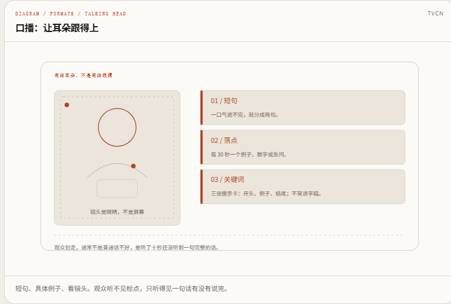

<!-- DIAGRAM_START -->
## 图解

<figure>
  
  <figcaption>短句、具体例子、看镜头。观众听不见标点，只听得见一句话有没有说完。</figcaption>
</figure>
<!-- DIAGRAM_END -->

口播不是把文章念出来。观众看不见标点，也看不见段落，只听得见一句话有没有说完。

## 先写能说出口的句子

把“因此”“综上所述”“值得注意的是”删掉。这些词在纸上连接段落，在嘴里只会打结。一句话只做一件事：给结论、举例子、转个弯。说完一件，再起一句。

每段开头先给结论，不要先铺背景。观众在刷手机，前三秒听不到“这跟我有什么关系”，后面就划走了。结论可以粗，但必须清楚：“口播最怕的不是普通话，是句子太长。”

用“你”，不用“用户”。用户是报告里的词，你是坐在对面的人。把“用户需要注意”改成“你要注意”，距离立刻近一步。

## 每三十秒给一个落点

口播没有画面帮忙，注意力全靠信息密度。每二三十秒给一个具体的东西：一个例子、一个数字、一个反问、一个能想象出来的场景。不要连续三句抽象名词，耳朵会累。

例子要小。不要“很多人拍摄时遇到困难”，要“你在客厅拍，灯一关，脸就黑了”。小到观众能看见自己，话才落地。

转折要早。不要铺垫四十秒才说“但是”，把转折放在前十秒，然后用后面的时间解释为什么。口播的节奏不是匀速，是一段一段给，给完就停一下。

## 身体也是台词

不要背逐字稿。背稿的人眼睛会往上找，嘴比脑子快，听起来像在朗读。把稿子压成三张关键词卡：开头、例子、结尾。中间的话，用你平时跟朋友讲的方式说出来。

看镜头，不看屏幕。镜头是人的眼睛，屏幕是你自己的脸。看镜头这件事，练十次就顺；一直看屏幕，观众会觉得你在跟另一个人说话。

手要看得见。手放在桌上、胸前或身体两侧，别藏在桌子下面。说到“这么大”“这么长”的时候，手会替你说话。说错就停一秒，重说这一句；不要用“嗯”拖过去，拖过去的声音剪不掉。

## 检查

- 每句话都能一口气说完，没有书面连接词。
- 每三十秒有一个具体例子或数字。
- 提示卡上只有关键词，不是逐字稿；眼睛看镜头。

<!-- DEEP_DIVE_START -->
## 深读

<strong>约 6 分钟。</strong> 口播不是把稿念顺，是每十秒给一个新东西，让观众愿意听完。

### 先写能听懂的句子

口播的句子是写给耳朵的：主谓宾清楚，一句只放一个信息；数字、例子、动作词优先，形容词和背景介绍往后放。观众每十秒要得到一个新东西，否则手指就会往上滑。

开头三秒先给判断或冲突，不要自我介绍，也不要从“今天我想聊聊”开始。把最反常识的一句放最前面，再用三个理由把它撑住。

### 用三种镜头维持注意力

主景别是眼睛高度的半身，手要能进画面；讲到具体例子时切手部、产品、屏幕或环境插入。跳切只用来删停顿，不要每隔两秒就跳一次。

每二十到三十秒换一次信息形态：口播、插入、屏幕录制、空镜。镜头变化要跟着句子走，不要为了热闹乱切；字幕最多两行，关键词加粗不如直接说清。

### 录一条完整的，再补证据

先从头到尾录一条完整的，确保逻辑能站住；再补例子、反例和结尾问题。不要一开始就抠字眼，录到第十遍还没录完。

交付前用手机小屏看一遍：前三秒有没有结论、每十秒有没有新信息、最后有没有一个可回答的问题。封面只放一句短话，不要放三行字。

### 五分钟练习：一条只讲一件事

拿手机录一条六十秒口播，只讲一个判断，配三个例子；不许自我介绍，不许铺背景。录完先删掉所有“我觉得、其实、就是说”，再删掉第一句客套话。

放回小屏看：前三秒有没有结论、每十秒有没有新信息、最后有没有一个问题。三处缺一处，重录一条，不要靠字幕补救。

### 口播执行，十项检查
<ul><li>三秒内给判断或冲突</li><li>一句只放一个信息</li><li>每十秒有一个新东西</li><li>至少三个具体例子或数字</li><li>主景别是眼睛高度半身</li><li>手或产品能进画面</li><li>每二十到三十秒换信息形态</li><li>跳切只删停顿</li><li>字幕最多两行</li><li>结尾有一个可回答的问题</li></ul>
口播不是念稿，是把一个观点拆成观众能一口一口吃下去的小块。

<!-- DEEP_DIVE_END -->
