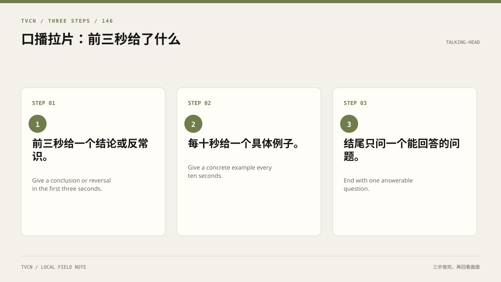

<!-- DIAGRAM_START -->
<h2>图解</h2>
<figure>
  
  <figcaption>图解是入口：先看时间码，再用文末验收表检查。</figcaption>
</figure>
<!-- DIAGRAM_END -->
<h2>拉片前先定三个变量</h2>
先定三个变量：60 秒、抖音/视频号、目标是“观众能复述一个结论”。口播不是“对着镜头念稿”；拉片时先看第一句是不是结论，再看每 10 秒有没有新信息。
<blockquote>
<strong>样本说明：</strong>下面的时间码是按该片型常见时长做的教学样本，不对应某一条具体作品，也不是逐帧鉴定。你拉片时按同样位置记，换成自己的片，不要把这里的节点当成唯一答案。
</blockquote><h2>时间码拆解：8 个节点</h2>
按顺序看，不要先看解说。每个节点只记四件事：画面、声音、作用、可偷或不可偷。
<ol class="timecode-list"><li><strong>0:00–0:03</strong>｜画面：人物已经在说，第一句就是结论。声音：同期声。作用：不给观众走开的机会。可偷：结论第一。不可偷：先感谢关注。</li><li><strong>0:03–0:10</strong>｜画面：中景，人物正面；手部入画。声音：一句原因。作用：让结论有依据。可偷：一个反常识原因。不可偷：三个观点塞一句。</li><li><strong>0:10–0:18</strong>｜画面：例子一：一个人/一个动作/一个结果。声音：同期声。作用：让抽象变具体。可偷：一个真实例子。不可偷：举例三个人。</li><li><strong>0:18–0:26</strong>｜画面：例子二：换场景/换人，结论不变。声音：一句过渡。作用：让证据不止一个。可偷：第二个场景。不可偷：重复第一个例子。</li><li><strong>0:26–0:34</strong>｜画面：反方：常见反对意见。声音：直接说出来。作用：先处理异议。可偷：承认反方有道理。不可偷： straw man。</li><li><strong>0:34–0:44</strong>｜画面：证据：数据/演示/前后对比。声音：关键数字。作用：让结论可信。可偷：一个可验证证据。不可偷：堆三个数字。</li><li><strong>0:44–0:52</strong>｜画面：应用：观众今天能怎么做。声音：一步动作。作用：让观众带走。可偷：一个具体动作。不可偷：给五步清单。</li><li><strong>0:52–1:00</strong>｜画面：回到人物，问一个具体问题。声音：同期声，留两秒。作用：让评论有方向。可偷：一个能回答的问题。不可偷： “评论区聊聊”。</li></ol><h2>结构判断</h2>
口播的骨架是“结论—原因—例子一—例子二—反方—证据—应用—问题”。它不是“讲完一个知识”，是“让观众带走一个能用的结论”。

看结构时只问三件事：前 10 秒给了什么证据；中段每 10–15 秒有没有新信息；结尾是否只落一个动作、一个变化或一个问题。这三件事任何一件缺失，60 秒的片子就会散。
<h2>预算量级</h2>
预算按中国大陆常见制作成本区间估算，不含媒介投放；它是量级，不是报价。同样一分钟，棚拍、演员、特效、音乐版权任何一项都能把成本翻倍。
<ul><li>低：¥1,000–5,000，1 人，1 机 + 1 麦，自然光，半天。</li><li>中：¥5,000–20,000，2–3 人，双机/提词/灯光，1 天。</li><li>高：¥20,000–80,000+，导演/摄影/灯光/后期，棚拍，1–2 天。</li></ul><h2>可偷的 3 个结构</h2>
偷结构，不偷画面。下面三条换成你的题材仍然成立。
<ol><li>第一句就是结论，不自我介绍。</li><li>每 10 秒一个新信息：原因/例子/反方/证据。</li><li>结尾问一个今天能回答的问题。</li></ol><h2>不能照搬的 3 个原因</h2>
不是“不好”，是条件和它不一样；照搬会暴露你的预算、平台和观众。
<ol><li>不能照搬“高频剪辑”：没有新信息，切得再快也是空。</li><li>不能照搬“金句体”：每句都像金句，观众记不住一句。</li><li>不能照搬“感谢关注开场”：前三秒是唯一注意力，别浪费。</li></ol><h2>拉片练习</h2>
做完再拍，不要只看。三个练习按顺序做，第三个必须落成一条 15 秒文件。
<ol><li>关声音看一遍，看第一句能不能用字幕复述结论。</li><li>数 10 秒内有没有新信息；没有就重写。</li><li>把 60 秒压成 15 秒：只留结论、一个例子、一个问题。</li></ol>
<h2>验收</h2><ul><li>第一句是结论，不是自我介绍。</li><li>10 秒内有一个原因。</li><li>两个例子各有一个具体人/动作/结果。</li><li>反方被直接说出来，不是稻草人。</li><li>证据可验证，不是三个数字。</li><li>应用只有一步动作。</li><li>结尾问题具体，能今天回答。</li></ul>

<section><h2>边界</h2>
本页只解决「口播拉片：60 秒怎么留住人」这一个问题；不替代 口播模板：一句话、三个例子、一个动作、封面缩到 200 像素，还认得出吗、一句话故事：谁想要什么，被什么挡住。如果现场问题属于后者，先读对应页，不要在本页继续加参数。
</section>
<!-- SOURCES_START -->
## 参考与延伸阅读

- [S14] [YouTube：社区准则](https://support.google.com/youtube/answer/2801973) — 2026-11-26 访问。用于核对「拉片前先定三个变量」一节的术语/方法/规则（YouTube 社区准则，不是内容创意标准）；不核对其中由本页经验得出的数字、型号与现场结论，也不替代测试。
- [S15] [TikTok：社区准则](https://www.tiktok.com/community-guidelines/en/) — 2026-11-26 访问。用于核对「时间码拆解：8 个节点」一节的术语/方法/规则（TikTok 社区准则，不是内容创意标准）；不核对其中由本页经验得出的数字、型号与现场结论，也不替代测试。
- [S29] [YouTube：上传编码建议](https://support.google.com/youtube/answer/1722171) — 2026-11-26 访问。用于核对「结构判断」一节的术语/方法/规则（YouTube 上传编码建议，不是创作标准）；不核对其中由本页经验得出的数字、型号与现场结论，也不替代测试。
<!-- SOURCES_END -->

