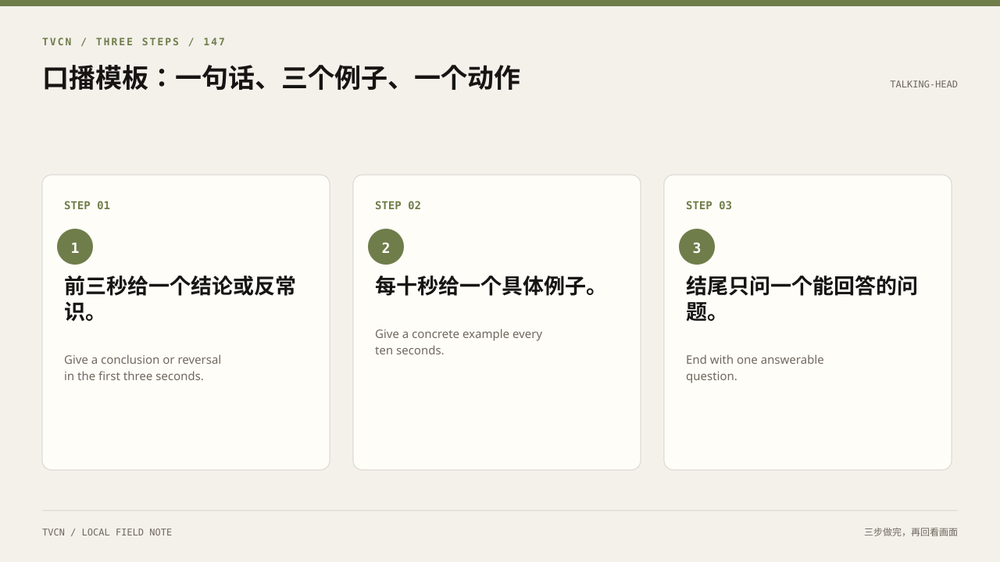

口播模板一句话主张、三个例子、一个动作；例子必须能被镜头看见。

<!-- DIAGRAM_START -->
<h2>图解</h2>
<figure>
  
  <figcaption>把三步按顺序做完，再回看画面或文件。</figcaption>
</figure>
<!-- DIAGRAM_END -->
<h2>现场</h2>

写一句主张、三个可拍例子、一个结尾动作；每个例子不超过 10 秒。

<h2>怎么做</h2>

口播模板一句话主张、三个例子、一个动作；例子必须能被镜头看见。
<ol><li>写一句主张，能用一句话说完。</li><li>配三个可拍例子，每个不超过 10 秒。</li><li>结尾给一个动作，比如现在打开设置。</li></ol>
<h2>别踩</h2>

别用三个形容词当例子；镜头拍不出来，观众记不住。

<h2>验收</h2>
<ul><li>主张能用一句话说完，没有第二个中心。</li><li>三个例子都能被镜头拍出来，每个不超过 10 秒。</li><li>结尾只有一个动作，观众知道下一步做什么。</li></ul>
