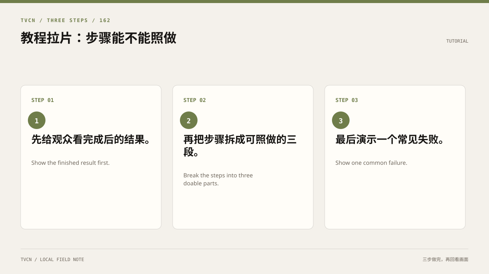

教程拉片只问一句：照着做能不能做出同样的结果。

<!-- DIAGRAM_START -->
<h2>图解</h2>
<figure>
  
  <figcaption>把三步按顺序做完，再回看画面或文件。</figcaption>
</figure>
<!-- DIAGRAM_END -->
<h2>现场</h2>

跟着做一遍：每一步是否能复现；若需要暂停三次以上，步骤太碎。

<h2>怎么做</h2>

教程拉片只问一句：照着做能不能做出同样的结果；不能复现，就不是教程。
<ol><li>跟着做一遍，把每次暂停的秒数记下来。</li><li>逐步核对按钮、参数和顺序是否能复现。</li><li>若需要暂停三次以上，说明步骤太碎，要合并。</li></ol>
<h2>别踩</h2>

别用“这里注意一下”代替步骤；观众不知道注意什么。

<h2>验收</h2>
<ul><li>跟着做能做出与成片一致的结果。</li><li>需要暂停的次数不超过三次。</li><li>每个“注意”都指向具体按钮、参数或动作。</li></ul>
