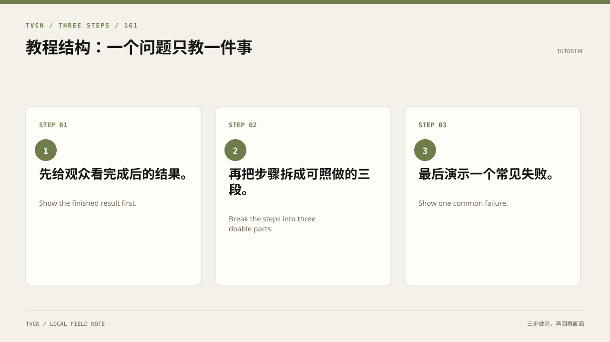

教程结构一个问题只教一件事；塞进三个技巧，观众一个也学不会。

<!-- DIAGRAM_START -->
<h2>图解</h2>
<figure>
  
  <figcaption>把三步按顺序做完，再回看画面或文件。</figcaption>
</figure>
<!-- DIAGRAM_END -->
<h2>现场</h2>

只教一个动作：如何把素材导入并设代理；不要同时讲调色和字幕。

<h2>怎么做</h2>

教程结构一个问题只教一件事；塞进三个技巧，观众一个也学不会。
<ol><li>只教一个动作：如何把素材导入并设代理。</li><li>先给完成后的结果，再拆步骤。</li><li>不要同时讲调色和字幕。</li></ol>
<h2>别踩</h2>

别边做边讲废话；观众要跟着做。

<h2>验收</h2>
<ul><li>全片只教一个动作，标题能说出它。</li><li>开头先给完成后的结果。</li><li>没有插入调色、字幕等第二个主题。</li></ul>

<!-- DEEP_DIVE_START -->
## 深读

<strong>约 6 分钟。</strong> 教程不是展示你会，是让观众跟着做出来。

### 先给结果

开头十秒展示成品和验收标准：能烤出什么、能导出什么、能测出什么。不要从“大家好，今天讲三个技巧”开始。

一个问题只教一件事；标题里出现两个目标，观众就不知道什么时候算学会。把最终检查写在开头，后面每一步都对着它。

### 三步演示

每一步只给一个动作、一个参数、一个失败点；近景拍手，屏幕录制拍界面，关键数字停在画面上三秒。不要一口气报十个参数。

先完整做一遍，再拆开讲；观众要看到连续流程，不是十个孤立技巧。重复的动作可以加速，但不要剪掉因果关系。

### 验收与模板

结尾给一个能自己检查的结果：声音有没有削波、字幕有没有超两行、文件能不能在目标机器打开。再给一个常见失败和改法。

能下载的清单、参数表、项目文件比口播更有用；不能给文件，就把参数和顺序写在画面上，别让观众反复暂停抄。

### 五分钟练习：教一个朋友做一遍

选一个三分钟能做完的小任务，只讲三步；把成品和验收标准放在开头。找一个没做过的朋友，按你的步骤做，不许你在旁边提示。

记下他停住的三个地方：哪一步听不懂、哪个参数没看见、哪个失败没预告。回去把这三处补进片子，教程才算写完。

### 什么时候算完成

找一个没看过片子的人，只给视频和材料，不许你说话。他能独立做出成品并通过片头的验收标准，教程才算完成；他卡在哪一步，就回去补哪一步的近景或参数。

### 教程，十项检查
<ul><li>开头十秒展示成品</li><li>一个问题只教一件事</li><li>开头写清验收标准</li><li>每步一个动作一个参数</li><li>近景或屏幕录制清楚</li><li>关键数字停留三秒</li><li>先完整再做拆解</li><li>不剪掉因果关系</li><li>结尾有可自检结果</li><li>提供清单或参数表</li></ul>
教程的成败不在你讲了多少，在观众关掉视频后能不能做出一个能检查的结果。

<!-- DEEP_DIVE_END -->
