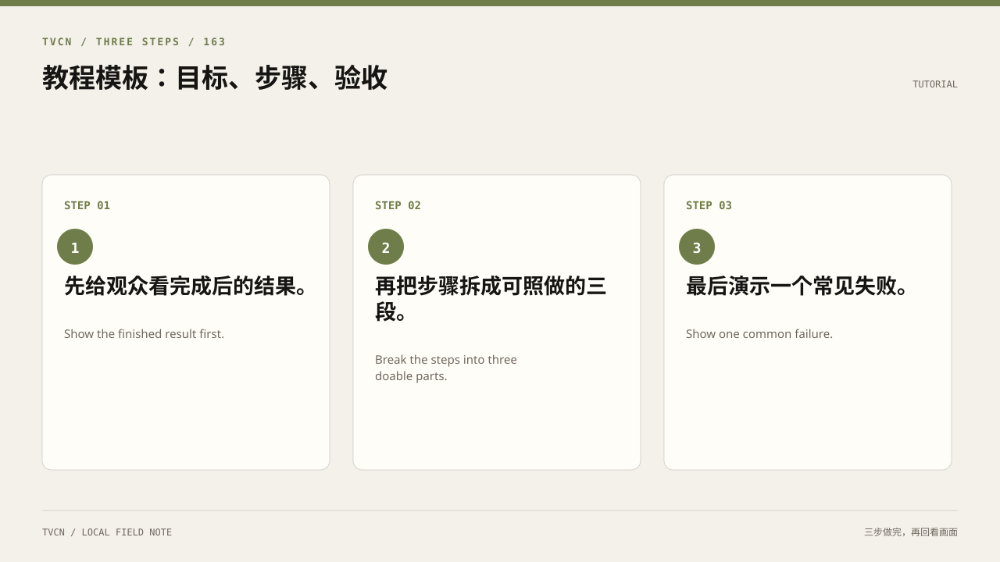

教程模板目标、步骤、验收；每一步都要有可观察的结果。

<!-- DIAGRAM_START -->
<h2>图解</h2>
<figure>
  
  <figcaption>把三步按顺序做完，再回看画面或文件。</figcaption>
</figure>
<!-- DIAGRAM_END -->
<h2>现场</h2>

目标、三步、验收；先给成品，再让观众照着做。

<h2>怎么做</h2>

教程模板目标、步骤、验收；每一步都要有可观察的结果。
<ol><li>先给目标：做完会得到什么。</li><li>拆成三步，每步有可观察结果。</li><li>给验收：观众怎么知道自己做对了。</li></ol>
<h2>别踩</h2>

别用“完成即可”当验收；观众不知道什么算完成。

<h2>验收</h2>
<ul><li>开头说清做完会得到什么。</li><li>三步各有一个可观察结果，比如画面出现某个提示。</li><li>验收标准能被观众自己检查，不靠感觉。</li></ul>
