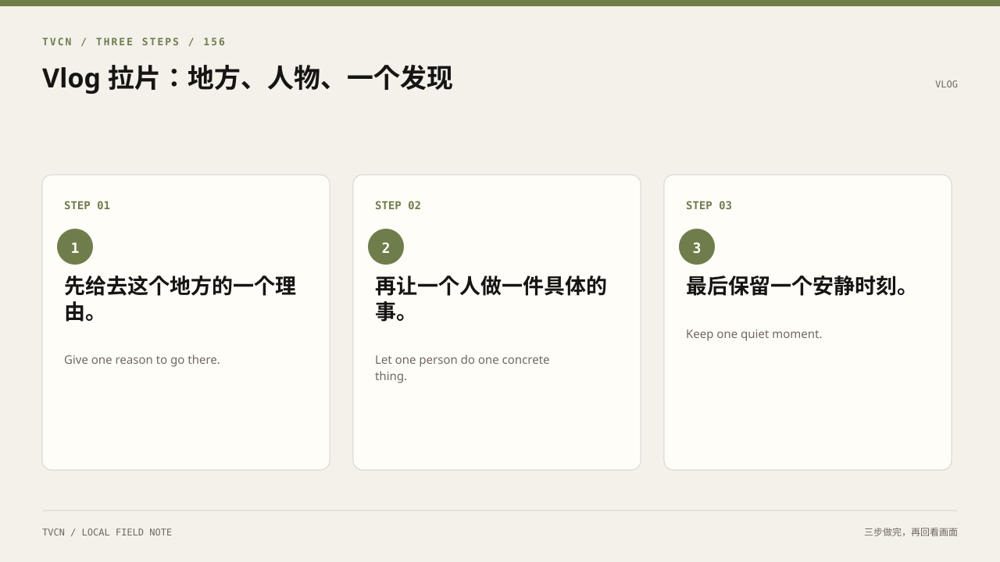

Vlog 拉片看三样：地方、人物、一个发现；缺一个，片子就散。

<!-- DIAGRAM_START -->
<h2>图解</h2>
<figure>
  
  <figcaption>把三步按顺序做完，再回看画面或文件。</figcaption>
</figure>
<!-- DIAGRAM_END -->
<h2>现场</h2>

看地方、人物、发现三样；如果只有风景没有人，剪成旅游宣传。

<h2>怎么做</h2>

Vlog 拉片看三样：地方、人物、一个发现；缺一个，片子就散。
<ol><li>看地方是否具体到一条街、一家店。</li><li>看人物有没有做一件可看见的事。</li><li>如果只有风景没有人，它更像旅游宣传。</li></ol>
<h2>别踩</h2>

别把风景当人物；没人做事，观众记不住这个地方。

<h2>验收</h2>
<ul><li>能指出片中的地方具体到哪条街或哪家店。</li><li>有一个人做了一件可看见的事，不只是走路。</li><li>能说出一个发现或改变，而不是只有好看。</li></ul>
