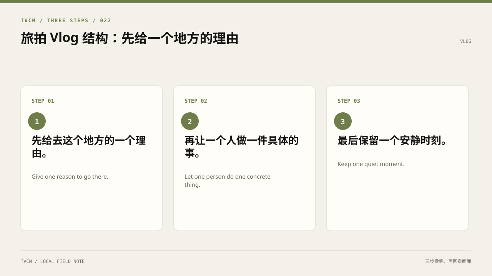

Vlog 的开场不是航拍风景，而是“我为什么来这里”。一句话交代理由，再接第一个动作；观众有了问题，才会容忍路上的空白。

<!-- DIAGRAM_START -->
<h2>图解</h2>
<figure>
  
  <figcaption>看“开头 10 秒给一个具体理由，比如朋…”和“让一个人做一件具体的事，不要只拍航拍…”两处，判断前三秒给出的理由，能不能撑到结尾。</figcaption>
</figure>
<!-- DIAGRAM_END -->
<section><h2 id="section-1">先给地方一个理由，再给风景</h2>
中段至少有一个计划外的人或事；结尾要有一个可看见的小改变，哪怕只是决定留下吃一顿饭。改变只发生在旁白里，观众不信。
<h2 id="section-2">边界</h2>
Vlog 不是流水账。每个段落都要回答“为什么现在拍这个”；回答不了，就删。
</section><section><h2 id="section-3">现场</h2>
开头 10 秒给一个具体理由：朋友在这家店等我；不要用航拍开场。
</section><section><h2 id="section-4">怎么做</h2><ol><li>开头 10 秒给一个具体理由，比如朋友在这家店等我。</li><li>让一个人做一件具体的事，不要只拍航拍空镜。</li><li>留一个安静时刻，让环境声自己说话。</li></ol></section><section><h2 id="section-5">别踩</h2>
别从头到尾配音乐；环境声才是地方。
</section><figure class="article-audio"><audio controls preload="none" src="../../assets/audio/zh/fmt-vlog.zh.mp3"></audio><figcaption>20 秒语音演示：一个检查点和最常见的失败。文字稿与步骤在正文里。</figcaption></figure><section><h2>判断</h2>
现场只认三个信号：
<ul><li>前三秒给出一个可相信的理由</li><li>中段有新信息或新阻碍，不是重复气氛</li><li>结尾有一个可看见的变化，旁白没有替它收尾</li></ul></section><section><h2>失败</h2>
下面三种做法会让页面上的细节白做：
<ul><li>模板套上了，人物和问题却没成立</li><li>前三秒没有理由，只靠标题和音乐</li><li>结尾没有可看见的变化，全靠旁白总结</li></ul></section><section><h2>延伸</h2>
<strong>10 分钟练习：</strong>拆一条 30 秒参考片，标出“开头 10 秒给一个具体理由，比如朋…”和“让一个人做一件具体的事，不要只拍航拍…”的时间点；再写一句：如果删掉其中一个，片子还成立吗？
</section>
<h2>验收</h2><ul><li>前 10 秒能说出去这个地方的具体理由。</li><li>片中至少有一个人做一件可看见的事，不只是风景。</li><li>有一段时间没有配乐，能听到现场环境声。</li></ul>

<!-- DEEP_DIVE_START -->
## 深读

<strong>约 6 分钟。</strong> 旅拍不是风景合集，是一个人在一个地方做一件事，最后有一个变化。

### 地点先给理由

开场别先航拍全景；先说为什么来、要做什么、可能失败什么。观众跟着一个具体任务走，风景才有位置。

地点要有可变条件：天气、人流、营业时间、体力。没有阻力的地方，只能拍成宣传片；给今天设一个必须完成的小目标。

### 五段结构

到达、第一个动作、意外、安静时刻、离开；每段不超过全片四分之一。意外不是事故，是计划被打断后人物的反应。

安静时刻让观众喘气：坐下、看海、擦汗、吃东西；不要配大段旁白。离开要回答开头的问题：这件事做成了没有，人物变了什么。

### 拍法

先拍动作，再拍空镜；每个地点至少一个主镜头、一个手部或脚部细节、一个环境声。转场用同一个动作或同一个声音，不要用花哨转场。

手持可以，但要走稳；运动镜头之前先问为什么动。成片六十到一百二十秒，字幕只留关键信息，音乐不要盖环境声。

### 五分钟练习：一个地点三条镜头

在同一个地点拍三条：到达时看见什么、做一件什么事、离开前安静十秒。每条只拍一个动作，不要航拍，不要旁白。

把三条按顺序接成三十秒，问自己：观众知不知道我为什么来、做成了什么、下一步去哪。答不出，补一个开头或结尾，不要加音乐糊过去。

### 什么时候算完成

剪完后让一个没去过现场的人复述三件事：今天来做什么、哪一步失败了、最后怎么离开。三件事说得出来，片子才算完成；说不出来，补一个动作，不要用旁白解释。

### 旅拍 Vlog，十项检查
<ul><li>开场先说为什么来</li><li>今天有一个具体任务</li><li>地点有可变条件</li><li>五段结构完整</li><li>意外是人物反应不是事故</li><li>安静时刻不配大段旁白</li><li>离开回答开头的问题</li><li>每个地点有主镜头和细节</li><li>转场用动作或声音</li><li>音乐不盖环境声</li></ul>
旅拍不是去过哪里，是今天在那里做成了什么。

<!-- DEEP_DIVE_END -->

<!-- SOURCES_START -->
## 参考与延伸阅读

- [S14] [YouTube 社区准则](https://support.google.com/youtube/answer/2801973) — 2026-11-26 访问。用于核对首段“旅拍 Vlog 先给一个去这里的理由，再拍好看；没有理由，风景只是屏保。”中的术语与公开背景（平台对误导、危险行为、版权与披露的现行规则）；不替代现场测试。
- [S15] [TikTok 社区准则](https://www.tiktok.com/community-guidelines/en/) — 2026-11-26 访问。用于核对首段“旅拍 Vlog 先给一个去这里的理由，再拍好看；没有理由，风景只是屏保。”中的术语与公开背景（短视频平台的 content、AI 生成与商业披露规则）；不替代现场测试。
- [S16] [BBC 编辑准则](https://www.bbc.co.uk/editorialguidelines/) — 2026-11-26 访问。用于核对首段“旅拍 Vlog 先给一个去这里的理由，再拍好看；没有理由，风景只是屏保。”中的术语与公开背景（准确性、公正、隐私与隐蔽拍摄的编辑标准）；不替代现场测试。
- [S29] [YouTube 上传规格](https://support.google.com/youtube/answer/1722171) — 2026-11-26 访问。用于核对首段“旅拍 Vlog 先给一个去这里的理由，再拍好看；没有理由，风景只是屏保。”中的术语与公开背景（分辨率、码率、帧率与音频编码建议）；不替代现场测试。
<!-- SOURCES_END -->

