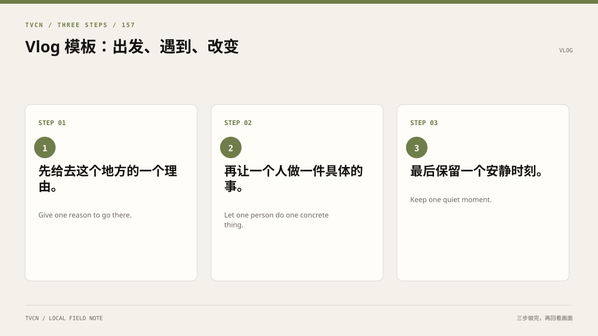

Vlog 模板出发、遇到、改变；改变可以很小，但必须发生。

<!-- DIAGRAM_START -->
<h2>图解</h2>
<figure>
  
  <figcaption>把三步按顺序做完，再回看画面或文件。</figcaption>
</figure>
<!-- DIAGRAM_END -->
<h2>现场</h2>

出发理由、遇到的人或事、一个小改变；改变可以是决定留下吃一顿饭。

<h2>怎么做</h2>

Vlog 模板出发、遇到、改变；改变可以很小，但必须发生。
<ol><li>用出发理由开场，交代为什么来。</li><li>拍遇到的人或事，让意外进来。</li><li>落在一个小改变，比如决定留下吃一顿饭。</li></ol>
<h2>别踩</h2>

别让改变只发生在旁白里；画面没有变化，观众不信。

<h2>验收</h2>
<ul><li>开头交代了出发理由，不是先放风景。</li><li>中段有一个计划外的人或事。</li><li>结尾有一个可看见的小改变，旁白没有替它说完。</li></ul>
