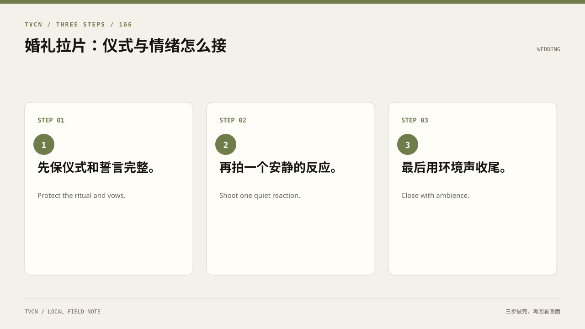

<!-- DIAGRAM_START -->
<h2>图解</h2>
<figure>
  
  <figcaption>图解是入口：先看时间码，再用文末验收表检查。</figcaption>
</figure>
<!-- DIAGRAM_END -->
<h2>拉片前先定三个变量</h2>
先定三个变量：6 分钟、私域/小红书、目标是“让观众看见两个人，而不是流程”。婚礼拉片先找誓言和反应，再找安静瞬间；慢动作不是结构。
<blockquote>
<strong>样本说明：</strong>下面的时间码是按该片型常见时长做的教学样本，不对应某一条具体作品，也不是逐帧鉴定。你拉片时按同样位置记，换成自己的片，不要把这里的节点当成唯一答案。
</blockquote><h2>时间码拆解：11 个节点</h2>
按顺序看，不要先看解说。每个节点只记四件事：画面、声音、作用、可偷或不可偷。
<ol class="timecode-list"><li><strong>0:00–0:10</strong>｜画面：准备时的小动作：手、衣服、门缝。声音：环境声/拉链声。作用：先拍人，不拍场地。可偷：一个手部动作。不可偷：用场地大景开场。</li><li><strong>0:10–0:25</strong>｜画面：到场：车、门、第一眼。声音：环境声。作用：让仪式开始。可偷：一个进门动作。不可偷：拍完整车队。</li><li><strong>0:25–0:45</strong>｜画面：仪式开始：通道、主婚人、宾客。声音：现场声。作用：交代空间。可偷：一个全景+一个反应。不可偷：切十个角度。</li><li><strong>0:45–1:15</strong>｜画面：誓言：两个人近景，原声。声音：誓言原声，音乐退后。作用：全片核心。可偷：保留呼吸/停顿。不可偷：用音乐盖住。</li><li><strong>1:15–1:35</strong>｜画面：戒指/宣布：手、宾客反应。声音：掌声/笑声。作用：给仪式落点。可偷：手部特写+一张脸。不可偷：只拍戒指。</li><li><strong>1:35–2:00</strong>｜画面：家人：父母/祖辈的反应。声音：环境声。作用：让两个人有来处。可偷：一张有年龄的脸。不可偷：摆拍合影。</li><li><strong>2:00–3:00</strong>｜画面：宴会：两桌有具体反应，不逐桌拍。声音：现场声。作用：让规模变成人。可偷：两桌具体的人。不可偷：每桌举杯。</li><li><strong>3:00–4:00</strong>｜画面：舞会：第一支舞/朋友起哄。声音：现场声/音乐。作用：给情绪峰值。可偷：一个动作+一个反应。不可偷：全程慢动作。</li><li><strong>4:00–5:00</strong>｜画面：安静：两个人在角落/走廊，没人看镜头。声音：环境声。作用：让片子有呼吸。可偷：一个无意识瞬间。不可偷：摆拍对视。</li><li><strong>5:00–5:30</strong>｜画面：肖像：两张人脸，不用滤镜。声音：环境声/一句誓言回响。作用：留下两个人。可偷：自然光近景。不可偷：磨皮到没有毛孔。</li><li><strong>5:30–6:00</strong>｜画面：离开：车/门/空场。声音：环境声收。作用：结束。可偷：一个离开动作。不可偷：加字幕总结。</li></ol><h2>结构判断</h2>
婚礼片的骨架是“准备—到场—仪式—誓言—戒指—家人—宴会—舞会—安静—肖像—离开”。它不需要拍完所有流程，它需要让观众看见两个人怎么在一天里变成一家人。

看结构时只问三件事：前 10 秒给了什么证据；中段每 10–15 秒有没有新信息；结尾是否只落一个动作、一个变化或一个问题。这三件事任何一件缺失，6 分钟的片子就会散。
<h2>预算量级</h2>
预算按中国大陆常见制作成本区间估算，不含媒介投放；它是量级，不是报价。同样一分钟，棚拍、演员、特效、音乐版权任何一项都能把成本翻倍。
<ul><li>低：¥8,000–20,000，2 人，双机 + 1 麦，1 天。</li><li>中：¥20,000–60,000，3–5 人，双机/三机 + 灯光/收音，1–2 天。</li><li>高：¥60,000–200,000+，导演/摄影/灯光/收音/后期，2–3 天。</li></ul><h2>可偷的 3 个结构</h2>
偷结构，不偷画面。下面三条换成你的题材仍然成立。
<ol><li>先列三件不能漏：入场、戒指、誓言。</li><li>誓言保留原声，音乐让位。</li><li>留一个没人看镜头的安静瞬间。</li></ol><h2>不能照搬的 3 个原因</h2>
不是“不好”，是条件和它不一样；照搬会暴露你的预算、平台和观众。
<ol><li>不能照搬“全程慢动作”：慢动作会遮掉真实反应。</li><li>不能照搬“逐桌敬酒”：每桌都一样，观众记不住。</li><li>不能照搬“磨皮滤镜”：两个人变成两张塑料脸。</li></ol><h2>拉片练习</h2>
做完再拍，不要只看。三个练习按顺序做，第三个必须落成一条 15 秒文件。
<ol><li>仪式前写三件不能漏的事，每件只用一个机位保底。</li><li>关声音看一遍，看誓言段是否还能感到情绪。</li><li>把 6 分钟压成 90 秒：准备、誓言、一个家人反应、安静、离开。</li></ol>
<h2>验收</h2><ul><li>入场/戒指/誓言三件都有保底机位。</li><li>誓言有独立录音，音乐没有盖住。</li><li>家人反应不是摆拍。</li><li>宴会只留两桌具体反应。</li><li>舞会有动作+反应，不是全程慢动作。</li><li>有一个没人看镜头的安静瞬间。</li><li>肖像没有磨皮到失真。</li></ul>
