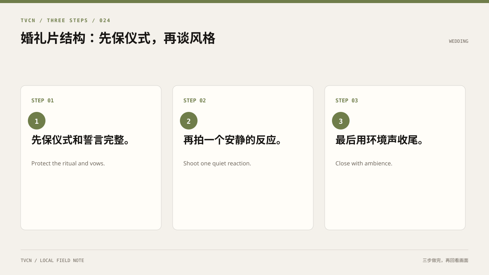

婚礼片的结构从“今天发生了什么”开始：早晨的一个动作、两个人各自准备、仪式完整发生、仪式后的第一个拥抱。每个段落只选一个动作，不要把所有环节平均收录。

<!-- DIAGRAM_START -->
<h2>图解</h2>
<figure>
  
  <figcaption>看“仪式用双机位：一台全景保流程，一台近…”和“誓言全程不切慢动作，先保完整”两处，判断前三秒给出的理由，能不能撑到结尾。</figcaption>
</figure>
<!-- DIAGRAM_END -->
<section><h2 id="section-1">用一天的动作，不用婚纱静物</h2>
誓言保留原声，音乐退后。观众要听清他们说了什么，而不是听一首歌。
<h2 id="section-2">边界</h2>
不要替新人写“永远幸福”。婚礼片可以温暖，但不能用旁白替他们总结人生；留一句他们自己的真话。
</section><section><h2 id="section-3">现场</h2>
仪式用双机位：一台全景保流程，一台近景拍手和戒指；誓言全程不切慢动作。
</section><section><h2 id="section-4">怎么做</h2><ol><li>仪式用双机位：一台全景保流程，一台近景拍手和戒指。</li><li>誓言全程不切慢动作，先保完整。</li><li>再补一个安静的反应镜头。</li></ol></section><section><h2 id="section-5">别踩</h2>
别用慢动作代替情绪；慢不等于深。
</section><figure class="article-audio"><audio controls preload="none" src="../../assets/audio/zh/fmt-wedding.zh.mp3"></audio><figcaption>20 秒语音演示：一个检查点和最常见的失败。文字稿与步骤在正文里。</figcaption></figure><section><h2>判断</h2>
现场只认三个信号：
<ul><li>前三秒给出一个可相信的理由</li><li>中段有新信息或新阻碍，不是重复气氛</li><li>结尾有一个可看见的变化，旁白没有替它收尾</li></ul></section><section><h2>失败</h2>
下面三种做法会让页面上的细节白做：
<ul><li>模板套上了，人物和问题却没成立</li><li>前三秒没有理由，只靠标题和音乐</li><li>结尾没有可看见的变化，全靠旁白总结</li></ul></section><section><h2>延伸</h2>
<strong>10 分钟练习：</strong>拆一条 30 秒参考片，标出“仪式用双机位：一台全景保流程，一台近…”和“誓言全程不切慢动作，先保完整”的时间点；再写一句：如果删掉其中一个，片子还成立吗？
</section>
<h2>验收</h2><ul><li>仪式有全景主机位，流程没有断。</li><li>誓言段完整，没有被慢动作或切歌打断。</li><li>至少有一个安静的反应镜头，不是摆拍笑脸。</li></ul>

<!-- DEEP_DIVE_START -->
## 深读

<strong>约 7 分钟。</strong> 婚礼片不是全天流水账，是先保仪式，再用一个安静瞬间讲两个人的关系。

### 先保仪式

誓言、交换戒指、父母反应，三件事不能漏；机位不要挡在过道中间，宁可退一步用长焦。仪式前先和司仪对一遍流程，知道哪一秒不能换卡。

声音比画面更容易毁：新郎新娘各别一个领夹，再放一个录音机在台口；誓言段一定要有备份。不要只靠机头麦。

### 找一个安静瞬间

仪式前后十分钟最容易出真东西：一个人帮另一个人整理衣领、找戒指、擦眼泪、在门口深呼吸。不要摆拍“看镜头笑一个”。

安静瞬间要有一个动作和一个关系：谁照顾谁、谁在等谁、谁先松手。拍到之后不要配大段音乐，让环境声留三秒。

### 结构

准备、仪式、安静瞬间、之后；三到八分钟。准备段不要超过全片三分之一，仪式段保留完整誓言，之后用两个动作收尾。

音乐不要盖誓言；如果誓言听不清，片子就只剩氛围。结尾不要用慢动作加字幕总结，让最后一个动作自己说话。

### 五分钟练习：誓言、戒指、父母各十秒

从现有婚礼素材里各剪十秒：誓言一句完整的话、戒指戴上的一刻、父母的一个反应。三段的收音都要能听清，不要靠音乐盖。

再把三段接起来，问新人：哪一段最像他们。答案往往不是最漂亮的镜头，而是最安静的那个反应；把它放到结尾附近。

### 什么时候算完成

让新人自己看一遍，问他们哪一刻最像他们、哪句话必须保留。他们能指着某一个安静的反应说出理由，片子才算完成；只能夸镜头漂亮，说明你拍的是婚礼流程，不是这两个人。

### 婚礼影像，十项检查
<ul><li>誓言完整录到</li><li>交换戒指有画面</li><li>父母反应有镜头</li><li>机位不挡过道</li><li>新人各有一个领夹</li><li>台口有独立录音</li><li>找到一个安静瞬间</li><li>安静瞬间有动作和关系</li><li>准备段不超过三分之一</li><li>音乐不盖誓言</li></ul>
婚礼片不是证明你拍到了多少，是证明你看见两个人怎么照顾彼此。

<!-- DEEP_DIVE_END -->
<!-- SOURCES_START -->
