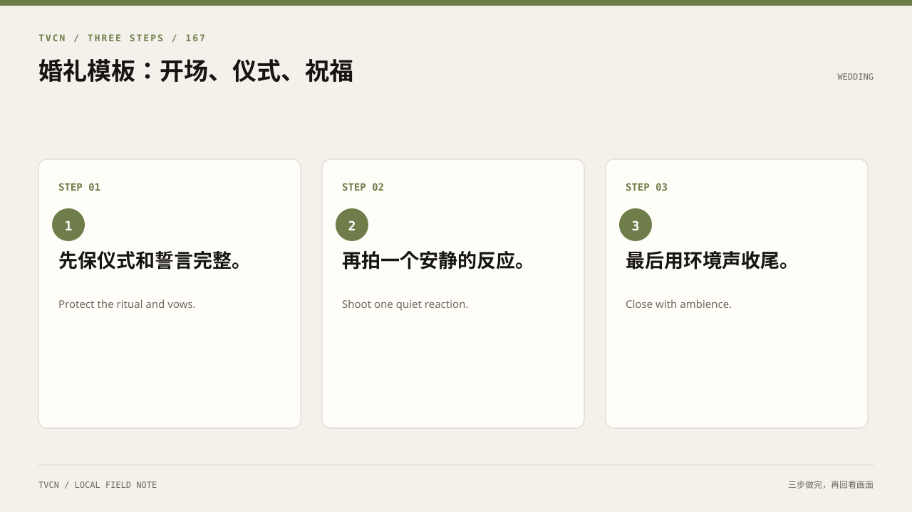

婚礼模板开场、仪式、祝福；开场给一天的感觉，不是给婚纱特写。

<!-- DIAGRAM_START -->
<h2>图解</h2>
<figure>
  
  <figcaption>把三步按顺序做完，再回看画面或文件。</figcaption>
</figure>
<!-- DIAGRAM_END -->
<h2>现场</h2>

开场给一天的感觉，仪式保完整，祝福留一句真话；不要只给婚纱特写。

<h2>怎么做</h2>

婚礼模板开场、仪式、祝福；开场给一天的感觉，不是给婚纱特写。
<ol><li>开场用一个动作给一天的感觉，比如早晨系领带。</li><li>仪式保完整，誓言不切碎。</li><li>祝福留一句真话，不要套话。</li></ol>
<h2>别踩</h2>

别只给婚纱特写；衣服不能说明这一天发生了什么。

<h2>验收</h2>
<ul><li>开场是一个动作或声音，不是婚纱静物。</li><li>仪式段完整，誓言没有被切碎。</li><li>结尾有一句具体真话，不是“永远幸福”这类套话。</li></ul>
