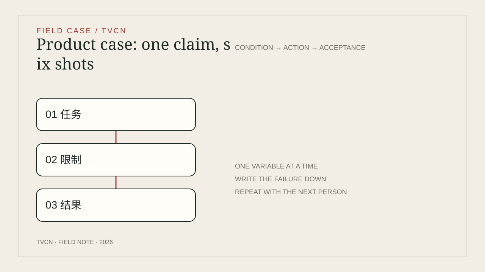

Anonymised composite review: A portable coffee maker for commuters; the client gives one claim, &amp;quot;92-degree coffee at your desk&amp;quot;, and 30 seconds to prove it. This is not one client&amp;#x27;s real project; it compresses constraints, decisions and failures that recur across field work into one reusable case.

Case note: an anonymised composite; there are no location photographs. The diagram is structural, not one client record.

<figure class="article-media case-path"><table><caption>Review path: four gates</caption><thead><tr><th>Stage</th><th>Question to answer</th><th>Failure signal</th></tr></thead><tbody><tr><td>Task</td><td>Can one selling point be proved on screen?</td><td>The point needs voice-over</td></tr><tr><td>Rehearsal</td><td>Can the product action be done right first time?</td><td>The actor waits for a cue</td></tr><tr><td>Shoot</td><td>Does each of six shots answer one question?</td><td>Shots repeat the same information</td></tr><tr><td>Review</td><td>Which step is irreversible?</td><td>Everything is fixed in post</td></tr></tbody></table><figcaption>Structural diagram, not a location still; use it to check the review order.TVCN diagram</figcaption></figure>
<!-- DIAGRAM_START -->
<h2>图解</h2>
<figure>
  
  <figcaption>Read &quot;No office wide shot; one desk and one table only.&quot; and &quot;Shot one is not the product beauty shot; it is the…&quot;: does the limit become an action?</figcaption>
</figure>
<!-- DIAGRAM_END -->

<section><h2 id="section-1">Task and limits</h2>
A composite review of a 30-second product ad: six shots, one claim, one real use, no spec dump.
<ul><li>No office wide shot; one desk and one table only.</li><li>The product cannot use mains power; battery only.</li><li>The actor is not a barista; the action must be learnable in one go.</li></ul></section>
<section><h2 id="section-2">Schedule</h2>
Half a day rehearsing the product action, half a day shooting six shots; each shot answers one question: can it, is it fast, is it hot, does it smell, is it clean, would you use it daily.

The schedule does not fill every hour; it puts the irreversible action where energy and light are most reliable, and leaves pickups only for hooks and continuity.
</section>
<section><h2 id="section-3">Budget</h2>
Total ¥18,000: product and props 3,000, location 4,000, camera and light 8,000, post 3,000; no cafe rental, one real office.

Protect three things first: the unrepeatable location, sound backup and post retries; gear upgrades come after.
</section>
<section><h2 id="section-4">Three decisions</h2>
Shot one is not the product beauty shot; it is the commuter&#x27;s cold coffee at the office door, establishing why.

Shot two is one action: fill, press, wait 90 seconds; a timer screen provides time evidence.

The last shot is not specs; it is the cup handed to a colleague, replacing the word good with a share action.
</section>
<section><h2 id="section-5">Three failures</h2>
The first cut used six product angles and looked like a product page; two angles made it an ad.

The actor pressed the wrong button and the light did not come on; rehearsal added a visible finger mark.

Office daylight was green and white balance drifted; the fix was killing the ceiling lights and bouncing one reflector.
</section>
<figure class="article-media case-failures" data-case-failure-table="1"><table><caption>Three failures and fixes</caption><thead><tr><th>What went wrong</th><th>Fix used</th></tr></thead><tbody><tr><td>The first cut used six product angles and looked like a product page</td><td>two angles made it an ad.</td></tr><tr><td>The actor pressed the wrong button and the light did not come on</td><td>rehearsal added a visible finger mark.</td></tr><tr><td>Office daylight was green and white balance drifted</td><td>the fix was killing the ceiling lights and bouncing one reflector.</td></tr></tbody></table><figcaption>Structural table, not a location still; the three fixes come from the same composite review.TVCN 图解</figcaption></figure>
<section><h2 id="section-6">Result</h2>
A 30-second film where each of six shots answers one question; the client changed one end card line. Lesson: proof is harder than beauty; get the use action right first.
</section>
<section><h2 id="section-7">Reuse list</h2><ul><li>Write six questions before six shots.</li><li>Rehearse the product action ten times and mark finger positions.</li><li>Measure white balance before adding light.</li><li>End on a person-to-person action, not a spec.</li></ul></section>
<section><h2 id="section-8">Field breakdown</h2>
Picture: No office wide shot; one desk and one table only. This decides where the first camera goes, not the other way round. Shot one is not the product beauty shot; it is the commuter's cold coffee at the office door, establishing why.

Sound: Shot two is one action: fill, press, wait 90 seconds; a timer screen provides time evidence. Record one clean pass on location and cut picture to it; do not cover the problem with music later.

Delivery: A 30-second film where each of six shots answers one question; the client changed one end card line. Lesson: proof is harder than beauty; get the use action right first. Check naming, duration and platform specs before handoff, or the content is right and the format still comes back.
</section><section><h2 id="section-9">Rejected option</h2>
The faster-looking option was to hand The product cannot use mains power; battery only. to the usual pipeline, shoot pretty images first and add story later. It was rejected for a concrete reason: The actor pressed the wrong button and the light did not come on; rehearsal added a visible finger mark. The saving was not time; it was the condition that makes the work repeatable.
</section><section><h2 id="section-10">If we did it again</h2>
Next time we would start with "Write six questions before six shots." and put "The first cut used six product angles and looked like a product page; two angles made it an ad." into the pre-shoot checklist; the budget would add a review hour before it adds gear. A case becomes a method only when the failure condition moves upstream.
</section>

<!-- SOURCES_START -->
## Experience note

Experience note: this page draws on an anonymised composite of 8 个产品广告项目的合并复盘，交付为 15/30/60 秒三版. Figures are ranges; people, places and clients are withheld; it does not represent one client job and no external laboratory test was run.
<!-- SOURCES_END -->

