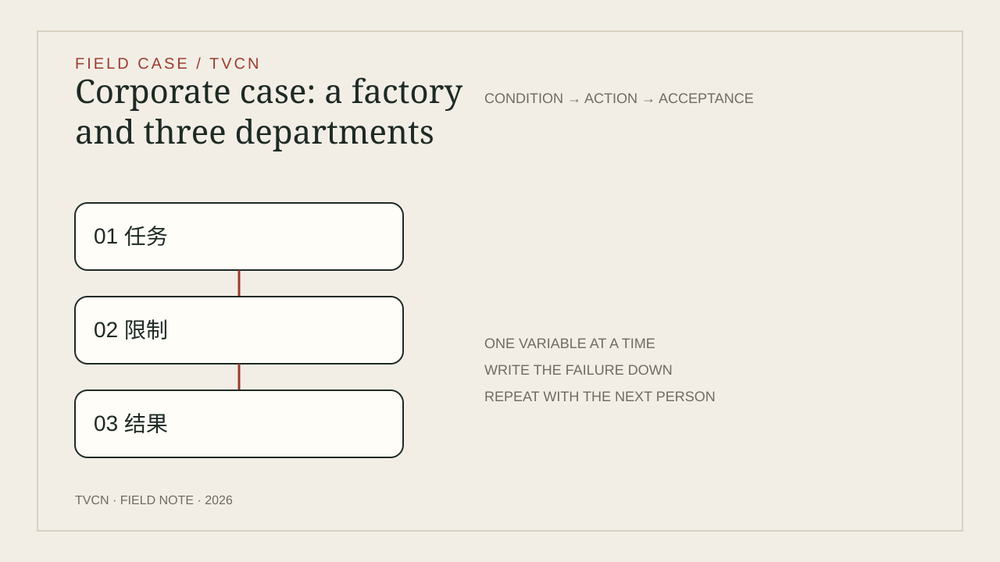

Anonymised composite review: A three-minute manufacturing corporate film covering factory, R&amp;amp;D, QA and after-sales; limited budget, two days. This is not one client&amp;#x27;s real project; it compresses constraints, decisions and failures that recur across field work into one reusable case.

<!-- DIAGRAM_START -->
<h2>图解</h2>
<figure>
  
  <figcaption>Read &quot;The line cannot stop; shooting cannot affect produ…&quot; and &quot;One order carries the film: R&amp;D sample, factory ru…&quot;: does the limit become an action?</figcaption>
</figure>
<!-- DIAGRAM_END -->

<section><h2 id="section-1">Task and limits</h2>
A composite review of a corporate film: a factory, three departments and one real action, not a department report.
<ul><li>The line cannot stop; shooting cannot affect production.</li><li>Four departments want screen time; the film is three minutes.</li><li>No actors; employees do their real jobs.</li></ul></section>
<section><h2 id="section-2">Schedule</h2>
Day 1 factory and R&amp;D; Day 2 QA and after-sales; one real action per department, no group photos; Day 3 plates and interviews.

The schedule does not fill every hour; it puts the irreversible action where energy and light are most reliable, and leaves pickups only for hooks and continuity.
</section>
<section><h2 id="section-3">Budget</h2>
Total ¥32,000: two days labour 12,000, gear 10,000, factory coordination 5,000, post 5,000.

Protect three things first: the unrepeatable location, sound backup and post retries; gear upgrades come after.
</section>
<section><h2 id="section-4">Three decisions</h2>
One order carries the film: R&amp;D sample, factory run, QA, after-sales; the audience follows one product.

No office sitting; each department is shown through hands and actions on the product, so the job is legible.

No slogan ending; the product is loaded and signed for, closing on delivery.
</section>
<section><h2 id="section-5">Three failures</h2>
The first cut followed departments and looked like a report; it was reordered by the order.

The line stopped for ten minutes and the floor manager objected; only real shift gaps were used.

After-sales wanted a call-centre shot full of screens; it became a home repair visit shot on hands.
</section>
<section><h2 id="section-6">Result</h2>
A three-minute film with one product crossing four departments; no employee acted and the client changed one subtitle. Lesson: a corporate film is not all departments; it is one action through all of them.
</section>
<section><h2 id="section-7">Reuse list</h2><ul><li>Choose one order or product as the spine.</li><li>One real action per department.</li><li>Never stop the line for a shot.</li><li>End on delivery, not a slogan.</li></ul></section>
<section><h2 id="section-8">Field breakdown</h2>
Picture: The line cannot stop; shooting cannot affect production. This decides where the first camera goes, not the other way round. One order carries the film: R&D sample, factory run, QA, after-sales; the audience follows one product.

Sound: No office sitting; each department is shown through hands and actions on the product, so the job is legible. Record one clean pass on location and cut picture to it; do not cover the problem with music later.

Delivery: A three-minute film with one product crossing four departments; no employee acted and the client changed one subtitle. Lesson: a corporate film is not all departments; it is one action through all of them. Check naming, duration and platform specs before handoff, or the content is right and the format still comes back.
</section><section><h2 id="section-9">Rejected option</h2>
The faster-looking option was to hand Four departments want screen time; the film is three minutes. to the usual pipeline, shoot pretty images first and add story later. It was rejected for a concrete reason: The line stopped for ten minutes and the floor manager objected; only real shift gaps were used. The saving was not time; it was the condition that makes the work repeatable.
</section><section><h2 id="section-10">If we did it again</h2>
Next time we would start with "Choose one order or product as the spine." and put "The first cut followed departments and looked like a report; it was reordered by the order." into the pre-shoot checklist; the budget would add a review hour before it adds gear. A case becomes a method only when the failure condition moves upstream.
</section><!-- SOURCES_START -->
