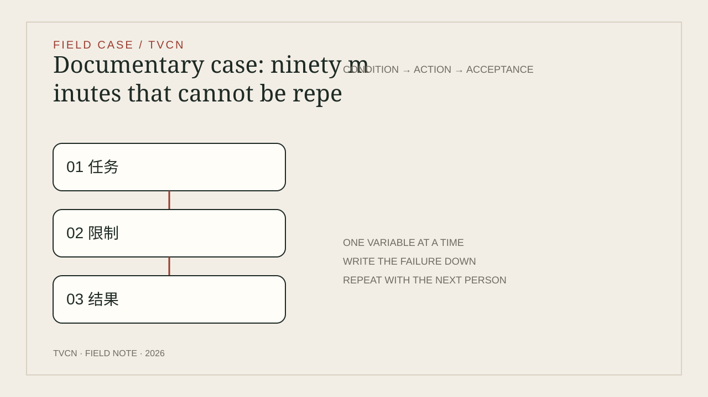

Anonymised composite review: An old watch repairer closes his shop and opens it one last time; the team has one 90-minute window and cannot restage. This is not one client&amp;#x27;s real project; it compresses constraints, decisions and failures that recur across field work into one reusable case.

Case note: an anonymised composite; there are no location photographs. The diagram is structural, not one client record.

<figure class="article-media case-path"><table><caption>Review path: four gates</caption><thead><tr><th>Stage</th><th>Question to answer</th><th>Failure signal</th></tr></thead><tbody><tr><td>Task</td><td>Can one selling point be proved on screen?</td><td>The point needs voice-over</td></tr><tr><td>Rehearsal</td><td>Can the product action be done right first time?</td><td>The actor waits for a cue</td></tr><tr><td>Shoot</td><td>Does each of six shots answer one question?</td><td>Shots repeat the same information</td></tr><tr><td>Review</td><td>Which step is irreversible?</td><td>Everything is fixed in post</td></tr></tbody></table><figcaption>Structural diagram, not a location still; use it to check the review order.TVCN diagram</figcaption></figure>
<!-- DIAGRAM_START -->
<h2>图解</h2>
<figure>
  
  <figcaption>Read &quot;A 12-square-metre shop; gear cannot block the path…&quot; and &quot;One camera and one prime lens; no lens swaps. Nine…&quot;: does the limit become an action?</figcaption>
</figure>
<!-- DIAGRAM_END -->

<section><h2 id="section-1">Task and limits</h2>
A composite review of a 90-minute documentary: one unrepeatable scene, two people, three ethical lines.
<ul><li>A 12-square-metre shop; gear cannot block the path.</li><li>The man will not repeat actions; one take only.</li><li>No staging and no asking him to perform again for emotion.</li></ul></section>
<section><h2 id="section-2">Schedule</h2>
The day before is observation and light testing only; on the day, rig 60 minutes early and never call cut; the last 15 minutes go to lights off and the lock.

The schedule does not fill every hour; it puts the irreversible action where energy and light are most reliable, and leaves pickups only for hooks and continuity.
</section>
<section><h2 id="section-3">Budget</h2>
Total ¥26,000: two days of labour 10,000, gear 8,000, post 6,000, insurance and travel 2,000; no studio.

Protect three things first: the unrepeatable location, sound backup and post retries; gear upgrades come after.
</section>
<section><h2 id="section-4">Three decisions</h2>
One camera and one prime lens; no lens swaps. Ninety minutes go to the person, not the gear.

Hands and tools first, face second; the audience learns him through action before a statement.

Do not ask why he closes; film the ten seconds after he locks the door, letting the gap carry the reason.
</section>
<section><h2 id="section-5">Three failures</h2>
Two cameras were planned; the second blocked the tool box in the small room and was removed before the hands were captured.

Someone suggested asking him to repeat why he was closing; the team refused and used room tone and the lock instead.

Window contrast clipped; no fill was added, the camera moved to side-backlight to keep the white outside.
</section>
<figure class="article-media case-failures" data-case-failure-table="1"><table><caption>Three failures and fixes</caption><thead><tr><th>What went wrong</th><th>Fix used</th></tr></thead><tbody><tr><td>Two cameras were planned</td><td>the second blocked the tool box in the small room and was removed before the hands were captured.</td></tr><tr><td>Someone suggested asking him to repeat why he was closing</td><td>the team refused and used room tone and the lock instead.</td></tr><tr><td>Window contrast clipped</td><td>no fill was added, the camera moved to side-backlight to keep the white outside.</td></tr></tbody></table><figcaption>Structural table, not a location still; the three fixes come from the same composite review.TVCN 图解</figcaption></figure>
<section><h2 id="section-6">Result</h2>
An 18-minute film from 90 minutes of material; the ratio is low but the key actions are intact. No restaging and no voice-over explanation. Lesson: restraint is not shooting less; it is knowing which second you cannot interrupt.
</section>
<section><h2 id="section-7">Reuse list</h2><ul><li>Do an observation day before locking camera.</li><li>One camera, one prime in a small room.</li><li>Never ask a person to repeat an emotional action.</li><li>Use room tone and silence instead of explanation.</li></ul></section>
<section><h2 id="section-8">Field breakdown</h2>
Picture: A 12-square-metre shop; gear cannot block the path. This decides where the first camera goes, not the other way round. One camera and one prime lens; no lens swaps. Ninety minutes go to the person, not the gear.

Sound: Hands and tools first, face second; the audience learns him through action before a statement. Record one clean pass on location and cut picture to it; do not cover the problem with music later.

Delivery: An 18-minute film from 90 minutes of material; the ratio is low but the key actions are intact. No restaging and no voice-over explanation. Lesson: restraint is not shooting less; it is knowing which second you cannot interrupt. Check naming, duration and platform specs before handoff, or the content is right and the format still comes back.
</section><section><h2 id="section-9">Rejected option</h2>
The faster-looking option was to hand The man will not repeat actions; one take only. to the usual pipeline, shoot pretty images first and add story later. It was rejected for a concrete reason: Someone suggested asking him to repeat why he was closing; the team refused and used room tone and the lock instead. The saving was not time; it was the condition that makes the work repeatable.
</section><section><h2 id="section-10">If we did it again</h2>
Next time we would start with "Do an observation day before locking camera." and put "Two cameras were planned; the second blocked the tool box in the small room and was removed before the hands were captured." into the pre-shoot checklist; the budget would add a review hour before it adds gear. A case becomes a method only when the failure condition moves upstream.
</section>

<!-- SOURCES_START -->
## Experience note

Experience note: this page draws on an anonymised composite of 5 个纪录短片的合并复盘，拍摄周期 1–3 天. Figures are ranges; people, places and clients are withheld; it does not represent one client job and no external laboratory test was run.
<!-- SOURCES_END -->

