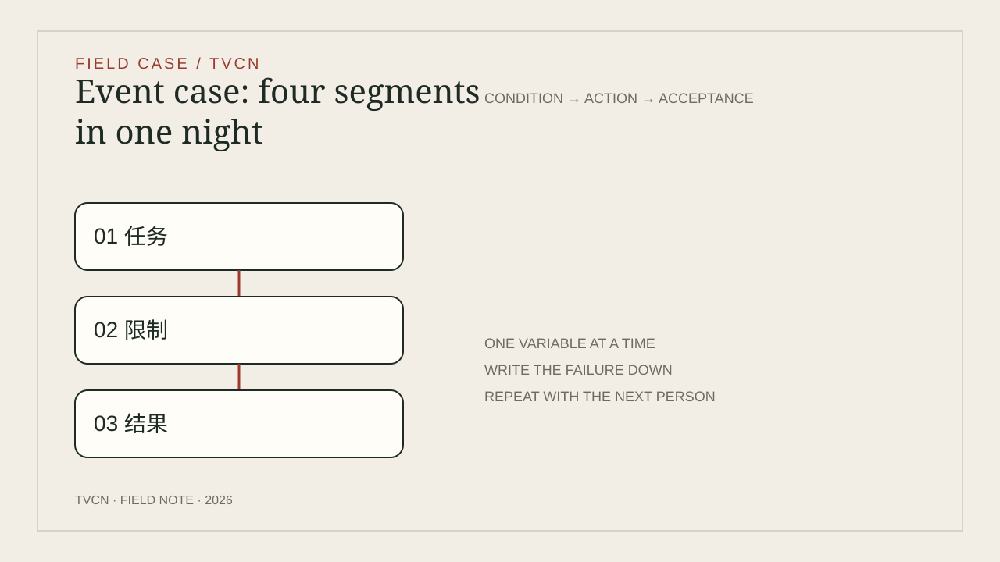

Anonymised composite review: A 300-person industry dinner with four segments: speech, awards, performance and networking; three cameras, two sound ops and one on-site editor. This is not one client&amp;#x27;s real project; it compresses constraints, decisions and failures that recur across field work into one reusable case.

Case note: an anonymised composite; there are no location photographs. The diagram is structural, not one client record.

<figure class="article-media case-path"><table><caption>Review path: four gates</caption><thead><tr><th>Stage</th><th>Question to answer</th><th>Failure signal</th></tr></thead><tbody><tr><td>Task</td><td>Can one selling point be proved on screen?</td><td>The point needs voice-over</td></tr><tr><td>Rehearsal</td><td>Can the product action be done right first time?</td><td>The actor waits for a cue</td></tr><tr><td>Shoot</td><td>Does each of six shots answer one question?</td><td>Shots repeat the same information</td></tr><tr><td>Review</td><td>Which step is irreversible?</td><td>Everything is fixed in post</td></tr></tbody></table><figcaption>Structural diagram, not a location still; use it to check the review order.TVCN diagram</figcaption></figure>
<!-- DIAGRAM_START -->
<h2>图解</h2>
<figure>
  
  <figcaption>Read &quot;No blocking audience views; cameras only at the si…&quot; and &quot;Fixed camera roles: A wide, B mid following the gu…&quot;: does the limit become an action?</figcaption>
</figure>
<!-- DIAGRAM_END -->

<section><h2 id="section-1">Task and limits</h2>
A composite review of a one-night event: four segments, three cameras, one timecode, complete coverage first.
<ul><li>No blocking audience views; cameras only at the side-back.</li><li>Award names change late; no pre-shot close-ups.</li><li>Live lighting changes colour; white balance cannot be locked once.</li></ul></section>
<section><h2 id="section-2">Schedule</h2>
16:00 load-in, 17:00 timecode sync across three cameras, 18:00 plates and room, 19:00 speech, 19:40 awards, 20:20 performance, 21:00 networking, 22:00 backup and wrap.

The schedule does not fill every hour; it puts the irreversible action where energy and light are most reliable, and leaves pickups only for hooks and continuity.
</section>
<section><h2 id="section-3">Budget</h2>
Total ¥16,000: three cameras 6,000, sound 3,000, lighting 2,000, on-site editor 3,000, backup media 2,000.

Protect three things first: the unrepeatable location, sound backup and post retries; gear upgrades come after.
</section>
<section><h2 id="section-4">Three decisions</h2>
Fixed camera roles: A wide, B mid following the guest of honour, C side for reactions; no two cameras chase the same action.

No pre-shot award close-ups; B follows the list, C catches the walk-up, close-ups come after names are confirmed.

The on-site editor backs up and marks, not hero cuts; first make one complete timeline per segment.
</section>
<section><h2 id="section-5">Three failures</h2>
B and C both followed the guest and no reaction shots existed; roles were reset the next day.

A late award name was added and C missed it; one person was assigned to track list changes.

Live lights went purple and camera A was locked; auto white balance plus a unified grade fixed it.
</section>
<figure class="article-media case-failures" data-case-failure-table="1"><table><caption>Three failures and fixes</caption><thead><tr><th>What went wrong</th><th>Fix used</th></tr></thead><tbody><tr><td>B and C both followed the guest and no reaction shots existed</td><td>roles were reset the next day.</td></tr><tr><td>A late award name was added and C missed it</td><td>one person was assigned to track list changes.</td></tr><tr><td>Live lights went purple and camera A was locked</td><td>auto white balance plus a unified grade fixed it.</td></tr></tbody></table><figcaption>Structural table, not a location still; the three fixes come from the same composite review.TVCN 图解</figcaption></figure>
<section><h2 id="section-6">Result</h2>
Each segment has a complete timeline; award close-ups were cut the next day; the client received one three-minute recap and four segment films. Lesson: complete first, highlights second.
</section>
<section><h2 id="section-7">Reuse list</h2><ul><li>Write camera roles before positions.</li><li>Assign one person to track list changes.</li><li>On-site editing starts with backup and marks.</li><li>Do not lock white balance under changing lights.</li></ul></section>
<section><h2 id="section-8">Field breakdown</h2>
Picture: No blocking audience views; cameras only at the side-back. This decides where the first camera goes, not the other way round. Fixed camera roles: A wide, B mid following the guest of honour, C side for reactions; no two cameras chase the same action.

Sound: No pre-shot award close-ups; B follows the list, C catches the walk-up, close-ups come after names are confirmed. Record one clean pass on location and cut picture to it; do not cover the problem with music later.

Delivery: Each segment has a complete timeline; award close-ups were cut the next day; the client received one three-minute recap and four segment films. Lesson: complete first, highlights second. Check naming, duration and platform specs before handoff, or the content is right and the format still comes back.
</section><section><h2 id="section-9">Rejected option</h2>
The faster-looking option was to hand Award names change late; no pre-shot close-ups. to the usual pipeline, shoot pretty images first and add story later. It was rejected for a concrete reason: A late award name was added and C missed it; one person was assigned to track list changes. The saving was not time; it was the condition that makes the work repeatable.
</section><section><h2 id="section-10">If we did it again</h2>
Next time we would start with "Write camera roles before positions." and put "B and C both followed the guest and no reaction shots existed; roles were reset the next day." into the pre-shoot checklist; the budget would add a review hour before it adds gear. A case becomes a method only when the failure condition moves upstream.
</section>

<!-- SOURCES_START -->
## Experience note

Experience note: this page draws on an anonymised composite of 7 场线下活动的合并复盘，单机位与双机位各半. Figures are ranges; people, places and clients are withheld; it does not represent one client job and no external laboratory test was run.
<!-- SOURCES_END -->

