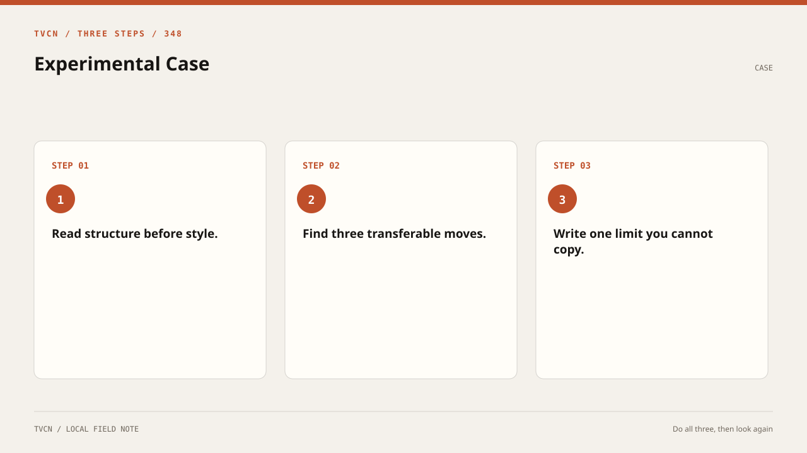

An experimental case starts with rules: what it limits, and what the limit produces.

<!-- DIAGRAM_START -->
<h2>Diagram</h2>
<figure>
  
  <figcaption>Do the three steps in order, then look again at the image or file.</figcaption>
</figure>
<!-- DIAGRAM_END -->
<h2>On set</h2>

Write the rule first: locked camera, repeated action, one color. Then find where it breaks.

<h2>Do this</h2>

An experimental case starts with the rule: what it limited and what the limit produced.
<ol><li>Write the rule: locked camera, repeated action, single color.</li><li>Find where it breaks the rule.</li><li>Judge whether the break produces new information.</li></ol>
<h2>Avoid</h2>

Do not treat “I did not get it” as value; without a rule, there is nothing to learn.

<h2>Check</h2>
<ul><li>The case's rule fits one sentence.</li><li>The exact break point is identified.</li><li>The break produces new information rather than a mistake.</li></ul>
