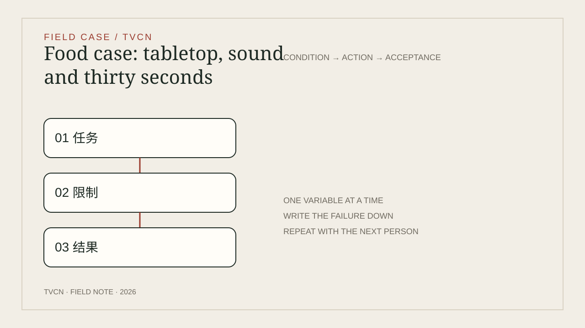

Anonymised composite review: A 30-second film for a handmade sauce, shot on a real kitchen table with one window. This is not one client&amp;#x27;s real project; it compresses constraints, decisions and failures that recur across field work into one reusable case.

Case note: an anonymised composite; there are no location photographs. The diagram is structural, not one client record.

<figure class="article-media case-path"><table><caption>Review path: four gates</caption><thead><tr><th>Stage</th><th>Question to answer</th><th>Failure signal</th></tr></thead><tbody><tr><td>Task</td><td>Can one selling point be proved on screen?</td><td>The point needs voice-over</td></tr><tr><td>Rehearsal</td><td>Can the product action be done right first time?</td><td>The actor waits for a cue</td></tr><tr><td>Shoot</td><td>Does each of six shots answer one question?</td><td>Shots repeat the same information</td></tr><tr><td>Review</td><td>Which step is irreversible?</td><td>Everything is fixed in post</td></tr></tbody></table><figcaption>Structural diagram, not a location still; use it to check the review order.TVCN diagram</figcaption></figure>
<!-- DIAGRAM_START -->
<h2>图解</h2>
<figure>
  
  <figcaption>Read &quot;The kitchen window stays open and the light moves.&quot; and &quot;Three actions only: pour, stir, plate; one camera …&quot;: does the limit become an action?</figcaption>
</figure>
<!-- DIAGRAM_END -->

<section><h2 id="section-1">Task and limits</h2>
A composite review of a 30-second food tabletop: one window light, two mics, three actions, no slow-motion pile-up.
<ul><li>The kitchen window stays open and the light moves.</li><li>The sauce is dark and easily becomes a black mass.</li><li>No food stylist; ingredients are prepared once.</li></ul></section>
<section><h2 id="section-2">Schedule</h2>
09:00 window test, 10:00 three actions, 11:00 finished dish and pack, 11:30 wrap; no waiting for noon hard light.

The schedule does not fill every hour; it puts the irreversible action where energy and light are most reliable, and leaves pickups only for hooks and continuity.
</section>
<section><h2 id="section-3">Budget</h2>
Total ¥6,000: ingredients 1,000, location 1,000, gear 2,000, post 2,000.

Protect three things first: the unrepeatable location, sound backup and post retries; gear upgrades come after.
</section>
<section><h2 id="section-4">Three decisions</h2>
Three actions only: pour, stir, plate; one camera position per action, no meaningless orbit.

Dark sauce gets side-backlight and a white card for shadow detail, not more exposure; a pale board holds the colour.

Sound first: sticky stir, spoon on bowl, pour; picture is cut to it, not covered by music.
</section>
<section><h2 id="section-5">Three failures</h2>
Top light turned the sauce into a white flare; side-backlight fixed it.

Stirring five times released water; one complete action was kept.

Camera mic was too far from the stir; a close mic was added.
</section>
<figure class="article-media case-failures" data-case-failure-table="1"><table><caption>Three failures and fixes</caption><thead><tr><th>What went wrong</th><th>Fix used</th></tr></thead><tbody><tr><td>Top light turned the sauce into a white flare</td><td>side-backlight fixed it.</td></tr><tr><td>Stirring five times released water</td><td>one complete action was kept.</td></tr><tr><td>Camera mic was too far from the stir</td><td>a close mic was added.</td></tr></tbody></table><figcaption>Structural table, not a location still; the three fixes come from the same composite review.TVCN 图解</figcaption></figure>
<section><h2 id="section-6">Result</h2>
A 30-second film with three actions and one sound pass; colour and texture remain. Lesson: appetite comes from action and sound, not the number of slow-motion shots.
</section>
<section><h2 id="section-7">Reuse list</h2><ul><li>Test window light before preparing food.</li><li>Side-backlight dark food; no top light.</li><li>One complete take per action.</li><li>Record sound separately and sync in post.</li></ul></section>
<section><h2 id="section-8">Field breakdown</h2>
Picture: The kitchen window stays open and the light moves. This decides where the first camera goes, not the other way round. Three actions only: pour, stir, plate; one camera position per action, no meaningless orbit.

Sound: Dark sauce gets side-backlight and a white card for shadow detail, not more exposure; a pale board holds the colour. Record one clean pass on location and cut picture to it; do not cover the problem with music later.

Delivery: A 30-second film with three actions and one sound pass; colour and texture remain. Lesson: appetite comes from action and sound, not the number of slow-motion shots. Check naming, duration and platform specs before handoff, or the content is right and the format still comes back.
</section><section><h2 id="section-9">Rejected option</h2>
The faster-looking option was to hand The sauce is dark and easily becomes a black mass. to the usual pipeline, shoot pretty images first and add story later. It was rejected for a concrete reason: Stirring five times released water; one complete action was kept. The saving was not time; it was the condition that makes the work repeatable.
</section><section><h2 id="section-10">If we did it again</h2>
Next time we would start with "Test window light before preparing food." and put "Top light turned the sauce into a white flare; side-backlight fixed it." into the pre-shoot checklist; the budget would add a review hour before it adds gear. A case becomes a method only when the failure condition moves upstream.
</section>

<!-- SOURCES_START -->
## Experience note

Experience note: this page draws on an anonymised composite of 9 个美食短片项目的合并复盘，桌面拍摄与现场同期声. Figures are ranges; people, places and clients are withheld; it does not represent one client job and no external laboratory test was run.
<!-- SOURCES_END -->

