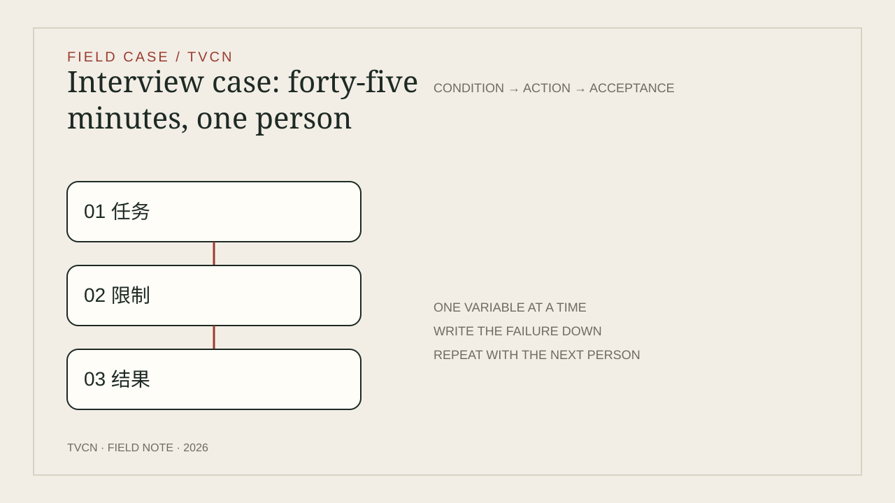

Anonymised composite review: A 45-minute interview with an independent designer in his studio; two crew, one main camera and one side camera. This is not one client&amp;#x27;s real project; it compresses constraints, decisions and failures that recur across field work into one reusable case.

Case note: an anonymised composite; there are no location photographs. The diagram is structural, not one client record.

<figure class="article-media case-path"><table><caption>Review path: four gates</caption><thead><tr><th>Stage</th><th>Question to answer</th><th>Failure signal</th></tr></thead><tbody><tr><td>Task</td><td>Can one selling point be proved on screen?</td><td>The point needs voice-over</td></tr><tr><td>Rehearsal</td><td>Can the product action be done right first time?</td><td>The actor waits for a cue</td></tr><tr><td>Shoot</td><td>Does each of six shots answer one question?</td><td>Shots repeat the same information</td></tr><tr><td>Review</td><td>Which step is irreversible?</td><td>Everything is fixed in post</td></tr></tbody></table><figcaption>Structural diagram, not a location still; use it to check the review order.TVCN diagram</figcaption></figure>
<!-- DIAGRAM_START -->
<h2>图解</h2>
<figure>
  
  <figcaption>Read &quot;Many studio windows and high daytime contrast.&quot; and &quot;A large soft source from the window side, not kill…&quot;: does the limit become an action?</figcaption>
</figure>
<!-- DIAGRAM_END -->

<section><h2 id="section-1">Task and limits</h2>
A composite review of a 45-minute interview: two people, three lights, one backup, make the subject comfortable first.
<ul><li>Many studio windows and high daytime contrast.</li><li>The subject will not repeat answers; no stop and restart.</li><li>One 45-minute window; gear cannot fail.</li></ul></section>
<section><h2 id="section-2">Schedule</h2>
Rig and test 90 minutes early; 45 minutes uninterrupted; the last 10 minutes for hands, desk and plates; two backups the same day.

The schedule does not fill every hour; it puts the irreversible action where energy and light are most reliable, and leaves pickups only for hooks and continuity.
</section>
<section><h2 id="section-3">Budget</h2>
Total ¥8,000: labour 3,000, gear 3,000, location 1,000, post 1,000.

Protect three things first: the unrepeatable location, sound backup and post retries; gear upgrades come after.
</section>
<section><h2 id="section-4">Three decisions</h2>
A large soft source from the window side, not killing the window; keep the studio clutter so the person has a place.

Main camera 35mm medium, side camera 50mm close; no lens changes to avoid interrupting.

Questions follow what are you doing now, why this way, which failure; not a CV order.
</section>
<section><h2 id="section-5">Three failures</h2>
The first version killed the window to white and looked like a studio; the second kept the window and only filled the face.

The side camera started at 85mm, too tight, and the subject tightened; 50mm fixed it.

Air-conditioning entered the track and over-denoising thinned the voice; room tone stayed and only low end was controlled.
</section>
<figure class="article-media case-failures" data-case-failure-table="1"><table><caption>Three failures and fixes</caption><thead><tr><th>What went wrong</th><th>Fix used</th></tr></thead><tbody><tr><td>The first version killed the window to white and looked like a studio</td><td>the second kept the window and only filled the face.</td></tr><tr><td>The side camera started at 85mm, too tight, and the subject tightened</td><td>50mm fixed it.</td></tr><tr><td>Air-conditioning entered the track and over-denoising thinned the voice</td><td>room tone stayed and only low end was controlled.</td></tr></tbody></table><figcaption>Structural table, not a location still; the three fixes come from the same composite review.TVCN 图解</figcaption></figure>
<section><h2 id="section-6">Result</h2>
One 45-minute take, an eight-minute cut; no repeated answers, window and studio kept. Lesson: the technical goal of an interview is don&#x27;t interrupt, not cleanest.
</section>
<section><h2 id="section-7">Reuse list</h2><ul><li>Test light before the subject enters.</li><li>Medium main, close side, no lens changes.</li><li>Ask now, why, failure.</li><li>Keep room tone; do not over-denoise.</li></ul></section>
<section><h2 id="section-8">Field breakdown</h2>
Picture: Many studio windows and high daytime contrast. This decides where the first camera goes, not the other way round. A large soft source from the window side, not killing the window; keep the studio clutter so the person has a place.

Sound: Main camera 35mm medium, side camera 50mm close; no lens changes to avoid interrupting. Record one clean pass on location and cut picture to it; do not cover the problem with music later.

Delivery: One 45-minute take, an eight-minute cut; no repeated answers, window and studio kept. Lesson: the technical goal of an interview is don't interrupt, not cleanest. Check naming, duration and platform specs before handoff, or the content is right and the format still comes back.
</section><section><h2 id="section-9">Rejected option</h2>
The faster-looking option was to hand The subject will not repeat answers; no stop and restart. to the usual pipeline, shoot pretty images first and add story later. It was rejected for a concrete reason: The side camera started at 85mm, too tight, and the subject tightened; 50mm fixed it. The saving was not time; it was the condition that makes the work repeatable.
</section><section><h2 id="section-10">If we did it again</h2>
Next time we would start with "Test light before the subject enters." and put "The first version killed the window to white and looked like a studio; the second kept the window and only filled the face." into the pre-shoot checklist; the budget would add a review hour before it adds gear. A case becomes a method only when the failure condition moves upstream.
</section>

<!-- SOURCES_START -->
## Experience note

Experience note: this page draws on an anonymised composite of 6 个访谈项目的合并复盘，单人或双人、45 分钟素材. Figures are ranges; people, places and clients are withheld; it does not represent one client job and no external laboratory test was run.
<!-- SOURCES_END -->

