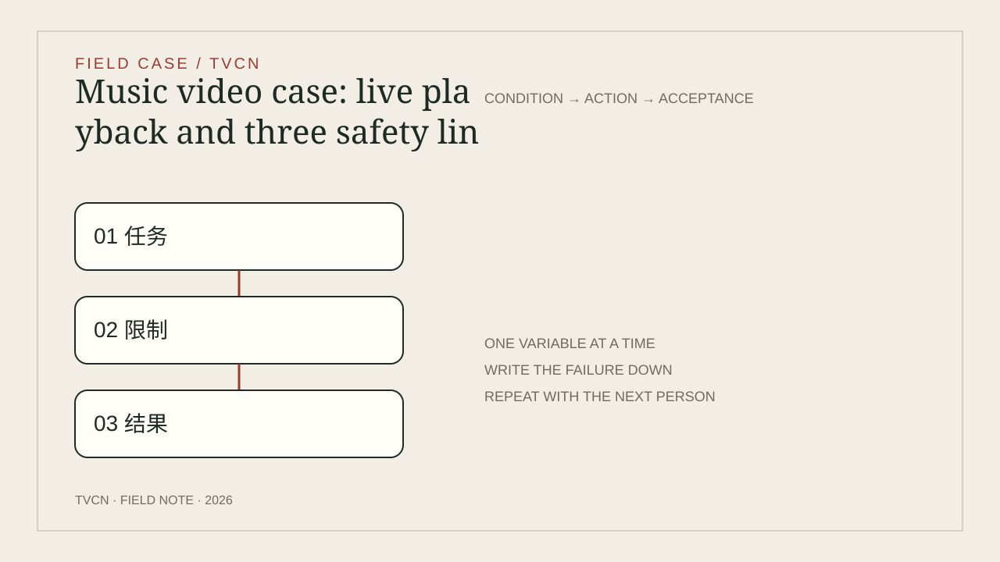

Anonymised composite review: A band shoots a three-minute video in an old warehouse with drums, bass, singer and 20 extras; one night only. This is not one client&amp;#x27;s real project; it compresses constraints, decisions and failures that recur across field work into one reusable case.

Case note: an anonymised composite; there are no location photographs. The diagram is structural, not one client record.

<figure class="article-media case-path"><table><caption>Review path: four gates</caption><thead><tr><th>Stage</th><th>Question to answer</th><th>Failure signal</th></tr></thead><tbody><tr><td>Task</td><td>Can one selling point be proved on screen?</td><td>The point needs voice-over</td></tr><tr><td>Rehearsal</td><td>Can the product action be done right first time?</td><td>The actor waits for a cue</td></tr><tr><td>Shoot</td><td>Does each of six shots answer one question?</td><td>Shots repeat the same information</td></tr><tr><td>Review</td><td>Which step is irreversible?</td><td>Everything is fixed in post</td></tr></tbody></table><figcaption>Structural diagram, not a location still; use it to check the review order.TVCN diagram</figcaption></figure>
<!-- DIAGRAM_START -->
<h2>图解</h2>
<figure>
  
  <figcaption>Read &quot;No air conditioning and a drummer with limited sta…&quot; and &quot;One full playback track, no section-by-section lip…&quot;: does the limit become an action?</figcaption>
</figure>
<!-- DIAGRAM_END -->

<section><h2 id="section-1">Task and limits</h2>
A composite review of a live music video: playback, camera sync and performer safety; if one line breaks, stop.
<ul><li>No air conditioning and a drummer with limited stamina.</li><li>Twenty extras cannot all be in frame; blocking must layer.</li><li>The singer jumps onto a speaker; the landing must be safe.</li></ul></section>
<section><h2 id="section-2">Schedule</h2>
19:00 light and playback test; 21:00 extras and band wide; 23:00 singer close-ups and speaker jump; 01:00 plates; 02:00 wrap, no all-nighter.

The schedule does not fill every hour; it puts the irreversible action where energy and light are most reliable, and leaves pickups only for hooks and continuity.
</section>
<section><h2 id="section-3">Budget</h2>
Total ¥38,000: location 6,000, band 10,000, extras 4,000, lighting 10,000, camera 6,000, post 2,000.

Protect three things first: the unrepeatable location, sound backup and post retries; gear upgrades come after.
</section>
<section><h2 id="section-4">Three decisions</h2>
One full playback track, no section-by-section lip sync; all cameras lock to one timecode and align by waveform.

Extras in three layers: back row ambient, middle row singing, front row two clear actions; no everyone-looks-at-camera.

Three empty jumps before the speaker jump; two coloured tapes mark the landing; only two takes, the second with a wide safety.
</section>
<section><h2 id="section-5">Three failures</h2>
Playback started mid-song and the lip sync failed; the fix was play the whole track from the top.

Extras rushed forward and it looked like a concert; they were reset into three layers.

Oil on the warehouse floor made the landing slip; production stopped, cleaned and taped before continuing.
</section>
<figure class="article-media case-failures" data-case-failure-table="1"><table><caption>Three failures and fixes</caption><thead><tr><th>What went wrong</th><th>Fix used</th></tr></thead><tbody><tr><td>Playback started mid-song and the lip sync failed</td><td>the fix was play the whole track from the top.</td></tr><tr><td>Extras rushed forward and it looked like a concert</td><td>they were reset into three layers.</td></tr><tr><td>Oil on the warehouse floor made the landing slip</td><td>production stopped, cleaned and taped before continuing.</td></tr></tbody></table><figcaption>Structural table, not a location still; the three fixes come from the same composite review.TVCN 图解</figcaption></figure>
<section><h2 id="section-6">Result</h2>
A 3:12 cut; the speaker jump uses the second wide take; band and extras each have one complete editable pass. Lesson: safety lines belong in the shot order, not on paper.
</section>
<section><h2 id="section-7">Reuse list</h2><ul><li>Always play the full track from the top.</li><li>Lock timecode before discussing movement.</li><li>Layer extras; do not give everyone an action.</li><li>Rehearse dangerous actions empty before the take.</li></ul></section>
<section><h2 id="section-8">Field breakdown</h2>
Picture: No air conditioning and a drummer with limited stamina. This decides where the first camera goes, not the other way round. One full playback track, no section-by-section lip sync; all cameras lock to one timecode and align by waveform.

Sound: Extras in three layers: back row ambient, middle row singing, front row two clear actions; no everyone-looks-at-camera. Record one clean pass on location and cut picture to it; do not cover the problem with music later.

Delivery: A 3:12 cut; the speaker jump uses the second wide take; band and extras each have one complete editable pass. Lesson: safety lines belong in the shot order, not on paper. Check naming, duration and platform specs before handoff, or the content is right and the format still comes back.
</section><section><h2 id="section-9">Rejected option</h2>
The faster-looking option was to hand Twenty extras cannot all be in frame; blocking must layer. to the usual pipeline, shoot pretty images first and add story later. It was rejected for a concrete reason: Extras rushed forward and it looked like a concert; they were reset into three layers. The saving was not time; it was the condition that makes the work repeatable.
</section><section><h2 id="section-10">If we did it again</h2>
Next time we would start with "Always play the full track from the top." and put "Playback started mid-song and the lip sync failed; the fix was play the whole track from the top." into the pre-shoot checklist; the budget would add a review hour before it adds gear. A case becomes a method only when the failure condition moves upstream.
</section>

<!-- SOURCES_START -->
## Experience note

Experience note: this page draws on an anonymised composite of 5 个 MV 项目的合并复盘，现场 Playback 与三条安全线. Figures are ranges; people, places and clients are withheld; it does not represent one client job and no external laboratory test was run.
<!-- SOURCES_END -->

