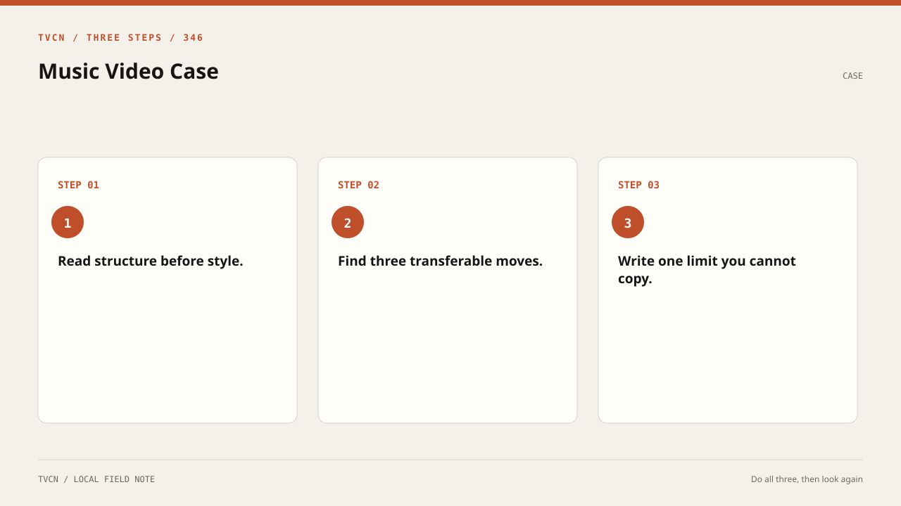

A music video maps song structure to image: verse gives space, chorus gives a memory.

<!-- DIAGRAM_START -->
<h2>Diagram</h2>
<figure>
  
  <figcaption>Do the three steps in order, then look again at the image or file.</figcaption>
</figure>
<!-- DIAGRAM_END -->
<h2>On set</h2>

Read the song: verse space, chorus memory, bridge turn. One visual motif per section.

<h2>Do this</h2>

An MV case reads how song structure becomes picture structure: verse gives space, chorus gives a hook.
<ol><li>Map verse, chorus, and bridge to picture sections.</li><li>Check whether each section holds one visual motif.</li><li>Write the chorus hook and how the bridge turns.</li></ol>
<h2>Avoid</h2>

Do not break an MV case into a shot collage; if song structure does not map, beauty scatters.

<h2>Check</h2>
<ul><li>Verse, chorus, and bridge each map to a picture section.</li><li>Each section holds one main visual motif.</li><li>The chorus hook and bridge turn are both nameable.</li></ul>
