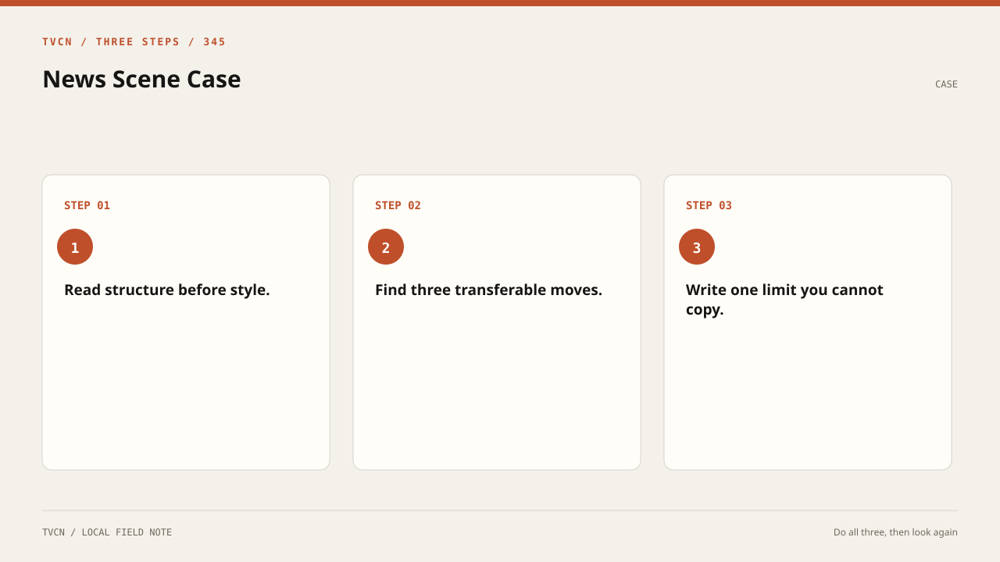

This is an anonymized composite review. It merges constraints, decisions, and consequences that recurred across three similar projects into one checkable timeline. Budgets and schedules are ranges, not one client&#x27;s ledger, and no client is named. Use it to test your own project, not as a single job&#x27;s diary.

<!-- DIAGRAM_START -->
<h2>Diagram</h2>
<figure>
  
  <figcaption>Watch “Format: ninety-second news feature” and “Crew: two (reporter + camera)”; judge whether the symptom can be restated as one observable sentence.</figcaption>
</figure>
<!-- DIAGRAM_END -->
<section><h2 id="section-1">How to read this review</h2>
<strong>This is an anonymized composite review.</strong> It merges constraints, decisions, and consequences that recurred across three similar projects into one checkable timeline. Budgets and schedules are ranges, not one client's ledger, and no client is named. Use it to test your own project, not as a single job's diary.
</section><section><h2 id="section-2">Project card</h2><ul><li>Format: ninety-second news feature</li><li>Crew: two (reporter + camera)</li><li>Schedule: one shoot day plus one post day</li><li>Budget range: RMB 3,000–8,000</li><li>Platform: institutional / news</li><li>Limits: six-hour window, one official source, one witness</li></ul></section><section><h2 id="section-3">Timeline</h2><ol><li><strong>08:00</strong>: The official statement lands; the reporter checks first-post time by phone while the camera shoots signs and the street.</li><li><strong>09:30</strong>: Arrive; record thirty seconds of ambience before waiting.</li><li><strong>10:00</strong>: Twelve-minute witness interview; ask what was seen, not how it felt.</li><li><strong>10:40</strong>: The witness leaves; shoot the empty chair, wind in the doorway, notice board.</li><li><strong>12:00</strong>: Clear archive rights; the unlicensed clip becomes a three-second blurred background.</li><li><strong>15:00</strong>: Rough cut; cut “may be linked,” replace with “still unclear.”</li><li><strong>16:00</strong>: Legal and editor review; deliver.</li></ol></section><section><h2 id="section-4">Constraints</h2>
Before the shoot only three facts were fixed: time, place, and one official statement. The witness gave twenty minutes, archive came from two sources, and one was not licensed for commercial use. The film was due at 4 p.m. with no reshoot.
</section><section><h2 id="section-5">Pre-production decisions</h2><ol><li>Verify before shooting: the reporter spent ninety minutes checking the official statement, first-post time, and address; the camera shot signs, the street, and the notice board, not emotional empty frames.</li><li>Two columns, known and unknown: every known fact carried a source, every unknown was marked “to verify”; the film ended on one unknown instead of speculation.</li><li>Label every archive shot: the unlicensed clip became a three-second blurred background, never the main image; each carried “archive / date / source.”</li></ol></section><section><h2 id="section-6">What changed on set</h2>
Forty minutes in, the witness took a call and had to leave. The plan was three lines pointing at the spot; instead we got a twelve-minute interview and one shot of his back. We did not ask him to reenact. We shot the empty chair, the wind in the doorway, and the notice board, leaving “the person left, the event remains” in frame.
</section><section><h2 id="section-7">Post choices</h2><ol><li>No music: sync sound, footsteps, wind, and paper on the notice board carried the feeling; music would tell viewers what to conclude.</li><li>Cut one speculation: the rough cut said “this may be linked to…”; after legal and editor review it became “it is still unclear.”</li><li>Make the unknown a graphic: a two-column known/unknown card ran from 1:10 to 1:22 instead of repeating it in narration.</li></ol></section><section><h2 id="section-8">Result</h2>
The piece passed internal review with no correction. It did not get the most dramatic shot, but every key fact had a source on screen; the empty chair after the witness left became the only emotional image, not a substitute for evidence.
</section><section><h2 id="section-9">Three reusable lessons</h2><ol><li>Verification is production: the ninety minutes on the phone decided what the ninety seconds could say.</li><li>Put “we do not know” on screen: viewers accept an unknown, not a fake certainty.</li><li>Archive is not free footage: source, date, and rights; if one is missing, keep it out of the main image.</li></ol></section><section><h2 id="section-10">One failure</h2>
Waiting for the witness cost us the location's room tone; post used library street sound and the space felt thinner. Next time record thirty seconds of ambience before the interview, not after.
</section><aside class="regional-note">
<strong>Regional note for US / UK / EU readers</strong>

This English page keeps mainland-China examples where they are part of the method. Read platform names as examples, not as the only market: Douyin ↔ TikTok/Reels, Bilibili ↔ YouTube, Xiaohongshu ↔ Instagram/Pinterest; RMB figures are not converted here. Contracts, tax, insurance and consent rules differ by market; use the local currency and local counsel before signing or invoicing.
</aside>
<h2>Check</h2><ul><li>Does every key fact carry a source?</li><li>Does the unknown appear on screen?</li><li>Is every archive shot dated and cleared?</li><li>Does music conclude for the viewer?</li><li>Does the film keep telling after the witness leaves?</li><li>Have legal and editor seen the speculative line?</li><li>Which room tone do you record first next time?</li></ul>

<!-- SOURCES_START -->
## Experience note

Experience note: this page draws on 5 client brief and project review reviews under a one- or two-to-three-person team with a fixed budget and schedule; it discusses “News Case: Verify Before You Roll”; no external laboratory test was run, and the conclusion may not transfer when conditions change.
<!-- SOURCES_END -->

