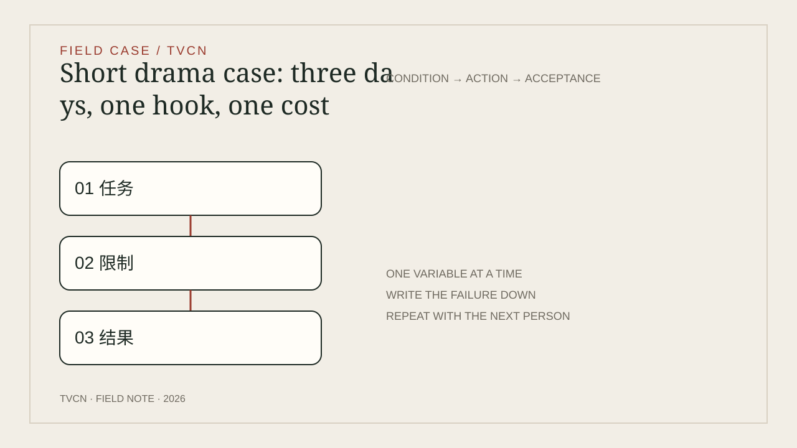

Anonymised composite review: A 12-episode vertical short drama, 90 seconds each, one old apartment, two actors and one rainy night; the client wants the first three episodes to be bingeable. This is not one client&amp;#x27;s real project; it compresses constraints, decisions and failures that recur across field work into one reusable case.

Case note: an anonymised composite; there are no location photographs. The diagram is structural, not one client record.

<figure class="article-media case-path"><table><caption>Review path: four gates</caption><thead><tr><th>Stage</th><th>Question to answer</th><th>Failure signal</th></tr></thead><tbody><tr><td>Task</td><td>Can one selling point be proved on screen?</td><td>The point needs voice-over</td></tr><tr><td>Rehearsal</td><td>Can the product action be done right first time?</td><td>The actor waits for a cue</td></tr><tr><td>Shoot</td><td>Does each of six shots answer one question?</td><td>Shots repeat the same information</td></tr><tr><td>Review</td><td>Which step is irreversible?</td><td>Everything is fixed in post</td></tr></tbody></table><figcaption>Structural diagram, not a location still; use it to check the review order.TVCN diagram</figcaption></figure>
<!-- DIAGRAM_START -->
<h2>图解</h2>
<figure>
  
  <figcaption>Read &quot;Twelve episodes in one location; wardrobe and prop…&quot; and &quot;Every episode opens on someone about to lose somet…&quot;: does the limit become an action?</figcaption>
</figure>
<!-- DIAGRAM_END -->

<section><h2 id="section-1">Task and limits</h2>
A composite review of a three-person, three-day vertical short drama: get the 30-second hook before the twist.
<ul><li>Twelve episodes in one location; wardrobe and prop continuity cannot break.</li><li>Two actors for three days only; the rain night cannot wait for real rain.</li><li>The platform gives three seconds; the first cost must land within 30 seconds.</li></ul></section>
<section><h2 id="section-2">Schedule</h2>
Day 1 for the reusable main set and every hook; Day 2 for rain night and reversals; Day 3 for inserts, plates and key art; five post days, with the first three days only for the first three episodes.

The schedule does not fill every hour; it puts the irreversible action where energy and light are most reliable, and leaves pickups only for hooks and continuity.
</section>
<section><h2 id="section-3">Budget</h2>
Total ¥45,000: talent 12,000, location 8,000, gear 9,000, rain and props 6,000, post 10,000. Ten percent is held only for hook pickups.

Protect three things first: the unrepeatable location, sound backup and post retries; gear upgrades come after.
</section>
<section><h2 id="section-4">Three decisions</h2>
Every episode opens on someone about to lose something, not on an establishing shot; context moves to shot two.

No real rain: a backlit spray bottle and one wet floor; actors get wet hair once and continuity is held by wardrobe and light position.

The first three episodes are cut to 75 seconds, leaving 15 seconds for the platform hook; episode four returns to the 90-second rhythm.
</section>
<section><h2 id="section-5">Three failures</h2>
Day one started with wide shots, so every episode opened like a travel film; half a day was lost reshooting hooks.

Real rain made the floor unsafe and an actor slipped; the next day used local wet patches only.

All three episodes went to post at once, so no one compared hooks; the fix was one episode first, then review.
</section>
<figure class="article-media case-failures" data-case-failure-table="1"><table><caption>Three failures and fixes</caption><thead><tr><th>What went wrong</th><th>Fix used</th></tr></thead><tbody><tr><td>Day one started with wide shots, so every episode opened like a travel film</td><td>half a day was lost reshooting hooks.</td></tr><tr><td>Real rain made the floor unsafe and an actor slipped</td><td>the next day used local wet patches only.</td></tr><tr><td>All three episodes went to post at once, so no one compared hooks</td><td>the fix was one episode first, then review.</td></tr></tbody></table><figcaption>Structural table, not a location still; the three fixes come from the same composite review.TVCN 图解</figcaption></figure>
<section><h2 id="section-6">Result</h2>
Twelve episodes delivered: the first three at 75 seconds, the remaining nine at 90. The client changed two subtitles and one sound effect. Lesson: short-drama money belongs in hooks and continuity, not in more locations.
</section>
<section><h2 id="section-7">Reuse list</h2><ul><li>Write a loss action before dialogue in every episode.</li><li>Keep the continuity sheet next to the monitor, not in the car.</li><li>Post the first three episodes separately from the rest of the season.</li><li>Test rain effects locally before putting them on actors.</li></ul></section>
<section><h2 id="section-8">Field breakdown</h2>
Picture: Twelve episodes in one location; wardrobe and prop continuity cannot break. This decides where the first camera goes, not the other way round. Every episode opens on someone about to lose something, not on an establishing shot; context moves to shot two.

Sound: No real rain: a backlit spray bottle and one wet floor; actors get wet hair once and continuity is held by wardrobe and light position. Record one clean pass on location and cut picture to it; do not cover the problem with music later.

Delivery: Twelve episodes delivered: the first three at 75 seconds, the remaining nine at 90. The client changed two subtitles and one sound effect. Lesson: short-drama money belongs in hooks and continuity, not in more locations. Check naming, duration and platform specs before handoff, or the content is right and the format still comes back.
</section><section><h2 id="section-9">Rejected option</h2>
The faster-looking option was to hand Two actors for three days only; the rain night cannot wait for real rain. to the usual pipeline, shoot pretty images first and add story later. It was rejected for a concrete reason: Real rain made the floor unsafe and an actor slipped; the next day used local wet patches only. The saving was not time; it was the condition that makes the work repeatable.
</section><section><h2 id="section-10">If we did it again</h2>
Next time we would start with "Write a loss action before dialogue in every episode." and put "Day one started with wide shots, so every episode opened like a travel film; half a day was lost reshooting hooks." into the pre-shoot checklist; the budget would add a review hour before it adds gear. A case becomes a method only when the failure condition moves upstream.
</section>

> Intent split: this page covers the practical details of “Short drama case: three days, one hook, one cost”; start with <a href="https://formats.tvcn.org/article/vertical-drama/">Vertical Drama: A Want in the First Three Seconds</a> for the cluster-level judgement, then return here.

<!-- INTENT_SCOPE -->

<!-- SOURCES_START -->
## Experience note

Experience note: this page draws on an anonymised composite of 4 部竖屏短剧的合并复盘，三天拍摄、单场景为主. Figures are ranges; people, places and clients are withheld; it does not represent one client job and no external laboratory test was run.
<!-- SOURCES_END -->

