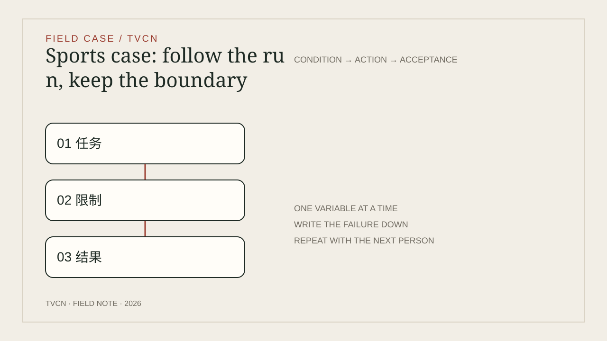

Anonymised composite review: A four-minute trail-running film on an eight-kilometre mountain route; three crew, one stabiliser and one drone. This is not one client&amp;#x27;s real project; it compresses constraints, decisions and failures that recur across field work into one reusable case.

<!-- DIAGRAM_START -->
<h2>图解</h2>
<figure>
  
  <figcaption>Read &quot;Narrow trail; camera cannot run beside the athlete…&quot; and &quot;No running beside the athlete; three fixed positio…&quot;: does the limit become an action?</figcaption>
</figure>
<!-- DIAGRAM_END -->

<section><h2 id="section-1">Task and limits</h2>
A composite review of a trail-running shoot: follow, weather and wrap boundaries; safety before the shot.
<ul><li>Narrow trail; camera cannot run beside the athlete.</li><li>Changeable weather; the drone may be grounded at any time.</li><li>The runner follows a training plan, not the shot.</li></ul></section>
<section><h2 id="section-2">Schedule</h2>
05:30 scout, 06:30 start and warm-up, 07:00 three fixed positions for passes, 08:30 summit, 09:00 descend; no night trail.

The schedule does not fill every hour; it puts the irreversible action where energy and light are most reliable, and leaves pickups only for hooks and continuity.
</section>
<section><h2 id="section-3">Budget</h2>
Total ¥14,000: labour 6,000, gear 4,000, transport and insurance 3,000, post 1,000.

Protect three things first: the unrepeatable location, sound backup and post retries; gear upgrades come after.
</section>
<section><h2 id="section-4">Three decisions</h2>
No running beside the athlete; three fixed positions at start, ridge and switchback, one pass each.

Drone only in open sections; ground it above five metres per second; aerial is not the main narrative.

The runner follows the training plan; the crew calls positions 30 seconds ahead by radio, no stopping, no chasing.
</section>
<section><h2 id="section-5">Three failures</h2>
The first follow run nearly tripped the athlete on a narrow trail; fixed positions replaced it.

Wind delayed the drone return and a ridge section was lost; a ground camera covered it.

The runner slowed for the camera and lost rhythm; the crew stopped asking him to accommodate.
</section>
<section><h2 id="section-6">Result</h2>
A four-minute film; the runner completed the plan; aerial is only 20 seconds and ground cameras carry the story. Lesson: safety boundaries belong in the plan, not in on-site improvisation.
</section>
<section><h2 id="section-7">Reuse list</h2><ul><li>Use fixed positions on narrow trails; do not run alongside.</li><li>Check wind before launching the drone.</li><li>Do not ask an athlete to change rhythm for a shot.</li><li>Call positions 30 seconds ahead.</li></ul></section>
<section><h2 id="section-8">Field breakdown</h2>
Picture: Narrow trail; camera cannot run beside the athlete. This decides where the first camera goes, not the other way round. No running beside the athlete; three fixed positions at start, ridge and switchback, one pass each.

Sound: Drone only in open sections; ground it above five metres per second; aerial is not the main narrative. Record one clean pass on location and cut picture to it; do not cover the problem with music later.

Delivery: A four-minute film; the runner completed the plan; aerial is only 20 seconds and ground cameras carry the story. Lesson: safety boundaries belong in the plan, not in on-site improvisation. Check naming, duration and platform specs before handoff, or the content is right and the format still comes back.
</section><section><h2 id="section-9">Rejected option</h2>
The faster-looking option was to hand Changeable weather; the drone may be grounded at any time. to the usual pipeline, shoot pretty images first and add story later. It was rejected for a concrete reason: Wind delayed the drone return and a ridge section was lost; a ground camera covered it. The saving was not time; it was the condition that makes the work repeatable.
</section><section><h2 id="section-10">If we did it again</h2>
Next time we would start with "Use fixed positions on narrow trails; do not run alongside." and put "The first follow run nearly tripped the athlete on a narrow trail; fixed positions replaced it." into the pre-shoot checklist; the budget would add a review hour before it adds gear. A case becomes a method only when the failure condition moves upstream.
</section><!-- SOURCES_START -->
