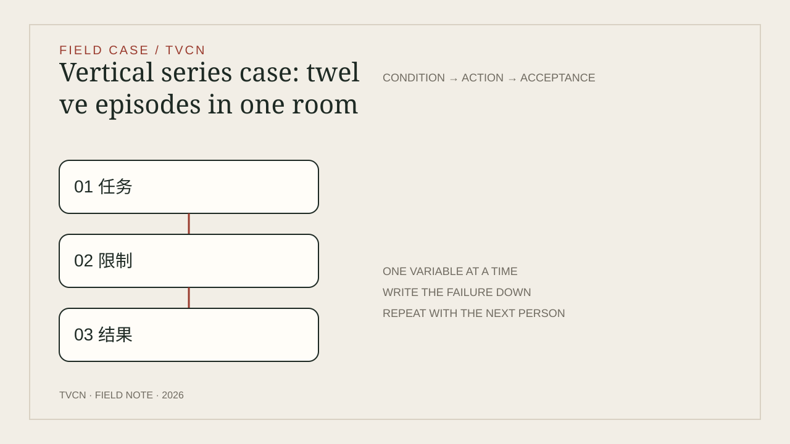

Anonymised composite review: An emotional vertical series, 12 episodes of two minutes, all in one rented room; two actors, four days. This is not one client&amp;#x27;s real project; it compresses constraints, decisions and failures that recur across field work into one reusable case.

<!-- DIAGRAM_START -->
<h2>图解</h2>
<figure>
  
  <figcaption>Read &quot;No structural change; soft dressing only.&quot; and &quot;Three soft-dressing stages: warm cohabitation, col…&quot;: does the limit become an action?</figcaption>
</figure>
<!-- DIAGRAM_END -->

<section><h2 id="section-1">Task and limits</h2>
A composite review of a single-location vertical series: one room, two lights and three wardrobe sets for twelve episodes.
<ul><li>No structural change; soft dressing only.</li><li>Three episodes a day maximum; actors cannot be drained.</li><li>Every episode states a relationship change in the first five seconds.</li></ul></section>
<section><h2 id="section-2">Schedule</h2>
Day 1 episodes 1–3, establish room and people; Day 2 episodes 4–6, change soft dressing and wardrobe; Day 3 episodes 7–9 with night; Day 4 episodes 10–12 plus all key-art frames.

The schedule does not fill every hour; it puts the irreversible action where energy and light are most reliable, and leaves pickups only for hooks and continuity.
</section>
<section><h2 id="section-3">Budget</h2>
Total ¥22,000: location 6,000, talent 8,000, lighting and gear 4,000, soft dressing 2,000, post 2,000.

Protect three things first: the unrepeatable location, sound backup and post retries; gear upgrades come after.
</section>
<section><h2 id="section-4">Three decisions</h2>
Three soft-dressing stages: warm cohabitation, cold war, empty room; time is carried by design, not dialogue.

One key light per episode, one practical for night; change the light position between episodes, not the whole rig.

Every episode opens on a relationship action: hand over keys, pack clothes, close the door; dialogue starts at second two.
</section>
<section><h2 id="section-5">Three failures</h2>
The first cut started every episode on dialogue, so the relationship was unclear; action came first.

Relighting between episodes limited day one to two episodes; a fixed key position and one moving lamp solved it.

Soft dressing changed too cleanly and looked like different rooms; one wall-paper tear stayed as a continuity mark.
</section>
<section><h2 id="section-6">Result</h2>
Twelve two-minute episodes; one room carries three stages through dressing, light position and relationship actions. Lesson: a single-location series is not cheap; it concentrates change where it can be controlled.
</section>
<section><h2 id="section-7">Reuse list</h2><ul><li>Lock three visual stages before writing twelve episodes.</li><li>Fix the key light and move one lamp.</li><li>Open every episode on a relationship action.</li><li>Keep one continuity mark to prove it is the same room.</li></ul></section>
<section><h2 id="section-8">Field breakdown</h2>
Picture: No structural change; soft dressing only. This decides where the first camera goes, not the other way round. Three soft-dressing stages: warm cohabitation, cold war, empty room; time is carried by design, not dialogue.

Sound: One key light per episode, one practical for night; change the light position between episodes, not the whole rig. Record one clean pass on location and cut picture to it; do not cover the problem with music later.

Delivery: Twelve two-minute episodes; one room carries three stages through dressing, light position and relationship actions. Lesson: a single-location series is not cheap; it concentrates change where it can be controlled. Check naming, duration and platform specs before handoff, or the content is right and the format still comes back.
</section><section><h2 id="section-9">Rejected option</h2>
The faster-looking option was to hand Three episodes a day maximum; actors cannot be drained. to the usual pipeline, shoot pretty images first and add story later. It was rejected for a concrete reason: Relighting between episodes limited day one to two episodes; a fixed key position and one moving lamp solved it. The saving was not time; it was the condition that makes the work repeatable.
</section><section><h2 id="section-10">If we did it again</h2>
Next time we would start with "Lock three visual stages before writing twelve episodes." and put "The first cut started every episode on dialogue, so the relationship was unclear; action came first." into the pre-shoot checklist; the budget would add a review hour before it adds gear. A case becomes a method only when the failure condition moves upstream.
</section><!-- SOURCES_START -->
