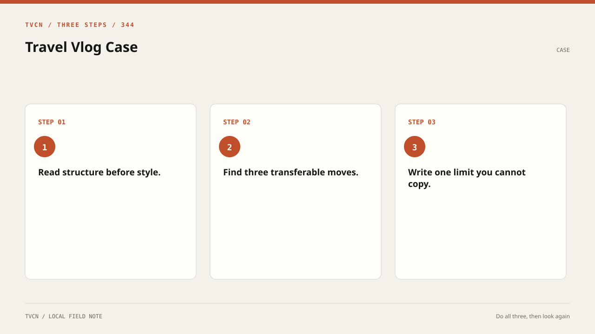

A travel vlog needs a discovery; travel without discovery is moving scenery.

<!-- DIAGRAM_START -->
<h2>Diagram</h2>
<figure>
  
  <figcaption>Do the three steps in order, then look again at the image or file.</figcaption>
</figure>
<!-- DIAGRAM_END -->
<h2>On set</h2>

Look for a discovery: what changed in the person because of this. Without it, it is scenery.

<h2>Do this</h2>

A vlog case starts with whether it has a discovery; travel without discovery is moving scenery.
<ol><li>Find the discovery: what changed in the person because of this.</li><li>Read structure, not filter or transition style.</li><li>Write three transferable actions and one limitation you cannot copy.</li></ol>
<h2>Avoid</h2>

Do not treat the case as a template; its budget and people are not yours.

<h2>Check</h2>
<ul><li>The change in the person is identifiable.</li><li>Analysis focuses on structure, not visual style alone.</li><li>Three transferable actions and one non-copyable limit are written.</li></ul>
