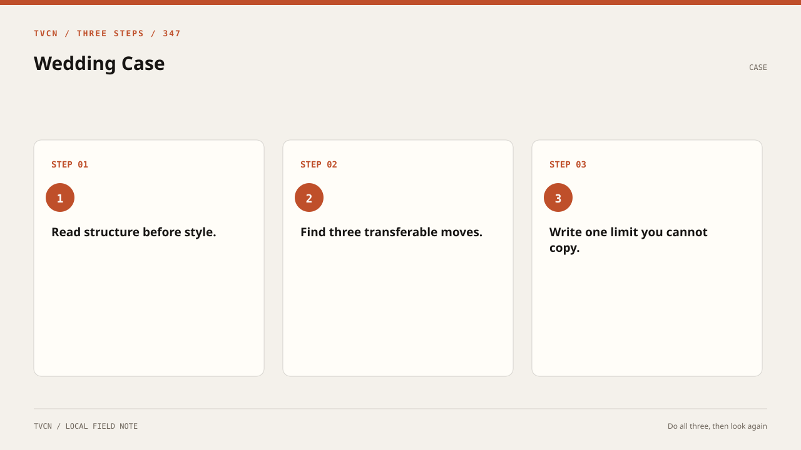

<!-- DIAGRAM_START -->
<h2>Diagram</h2>
<figure>
  
  <figcaption>Do the three steps in order, then look again at the image or file.</figcaption>
</figure>
<!-- DIAGRAM_END -->
<h2>How to read this review</h2>
<strong>This is an anonymized composite review.</strong> It merges constraints, decisions, and consequences that recurred across three similar projects into one checkable timeline. Budgets and schedules are ranges, not one client's ledger, and no client is named. Use it to test your own project, not as a single job's diary.
<h2>Project card</h2><ul><li>Format: six-minute wedding film</li><li>Crew: two (two cameras + sound)</li><li>Schedule: one shoot day plus four post days</li><li>Budget range: RMB 8,000–20,000</li><li>Platform: private / RED</li><li>Limits: ceremony cannot repeat, low light, 120 guests</li></ul><h2>Timeline</h2><ol><li><strong>07:00</strong>: Prep; shoot hands, clothing, doorway, no staging.</li><li><strong>10:00</strong>: Confirm three unmissable beats; check lav and independent recorder.</li><li><strong>10:30</strong>: Entrance; A holds the aisle wide, B holds faces close.</li><li><strong>10:45</strong>: Vows; the lav is knocked off, the recorder saves the whole passage.</li><li><strong>11:00</strong>: Rings and announcement; A holds hands, B holds guests.</li><li><strong>12:00</strong>: Reception; keep two tables with specific reactions.</li><li><strong>16:00</strong>: Back up before wrap; confirm vow track syncs.</li></ol><h2>Constraints</h2>
The ceremony happens once; vows cannot be reshot. The hall has only ceiling light and two warm wall fixtures; no big light. One hundred twenty guests; cameras cannot block the aisle. Two people: A camera holds the wide, B holds close and sound.
<h2>Pre-production decisions</h2><ol><li>List three unmissable beats: entrance, rings, vows; each gets a safe camera, no improvisation.</li><li>Two audio sources: B camera takes the lav, a separate recorder sits near the officiant; vows lead, music steps back.</li><li>No big light: use the warm practicals plus one small LED for faces; keep the hall dark. Dark is fine; a black face is not.</li></ol><h2>What changed on set</h2>
Thirty seconds before the vows, the lav was knocked off by the dress strap and the signal dropped. B camera kept rolling close; the nearby recorder saved the whole vow. Post replaced the track from the recorder; lip sync held.
<h2>Post choices</h2><ol><li>No music under the vows: sync, breath, and guests' small laughter; music only before the entrance and after the exit.</li><li>Cut four minutes of table shots: every table's toast looked the same; keep two with specific reactions.</li><li>Grade for consistent temperature only: keep the warm hall, do not cool faces to white; do not lift shadows hard.</li></ol><h2>Result</h2>
The couple could point to the grandparents' reaction and one line from the vows, not just the schedule. No reshoot, no slow motion hiding a missed moment; the lav failure did not become the film's failure.
<h2>Three reusable lessons</h2><ol><li>Ritual before emotion: entrance, rings, vows; slow motion only matters after coverage.</li><li>Two audio sources are not backup; one is the master: a lav falls, a recorder does not.</li><li>Dark is fine; a black face is not: practicals first, a small light for faces, not the whole hall.</li></ol><h2>One failure</h2>
We forgot a dedicated mic for the officiant and relied on the room mic; a few opening lines were buried by guests. Next time put the officiant's mic on the ritual checklist beside rings and vows.

<h2>Check</h2><ul><li>Do entrance, rings, and vows each have a safe camera?</li><li>Are vows on an independent recorder?</li><li>Is the officiant mic'd?</li><li>Did a big light flatten the room?</li><li>Do table shots run over two minutes?</li><li>Are shadows lifted hard?</li><li>Can the couple name one specific person?</li></ul>
