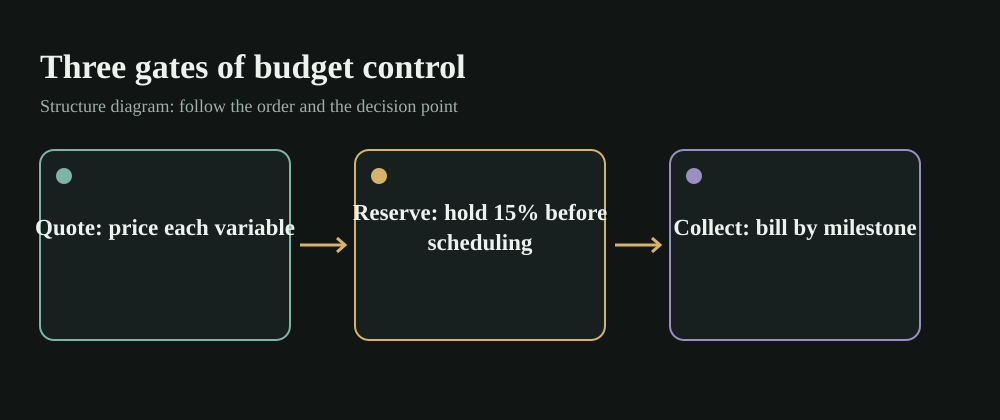

Budgets rarely fail because one line is expensive. They fail because the quote turned several variables into a single total. On day three the client adds a location, money moves out of post, and nobody can reconstruct what the original number was meant to cover.

<!-- DIAGRAM_START -->
<h2 id="diagram">Diagram</h2>
<figure class="diagram">
  
  <figcaption>Check whether quote, reserve and collection are separate gates. If one is swallowed by a single total, the overrun moves somewhere you cannot see.</figcaption>
</figure>
<!-- DIAGRAM_END -->

<section><h2 id="section-1">On location</h2>
A small team takes a three-minute brand film: four delivery versions, two shoot days, one actor and one location. The producer quotes a flat 80,000 and writes zero reserve. On day three the client adds a night scene; 12,000 comes out of post. The film ships, one grade is skipped, and everyone still says they did not lose money.
</section>
<section><h2 id="section-2">What to look for</h2><ul><li><strong>Variables have no unit price:</strong> actor reschedule, extra location and extra versions have no number, so they become “we will figure it out later”.</li><li><strong>Reserve below 10%:</strong> the problem is not thin margin; there is no slot for change, so the first change eats post.</li><li><strong>Payment and delivery milestones do not match:</strong> if 70% is collected only after delivery, the team has no leverage by the third revision.</li></ul></section>
<section><h2 id="section-3">What to do</h2><ol><li>Split the budget into four blocks: controlled cost, variable unit prices, risk reserve and management fee. Keep them separate; do not merge them into one total.</li><li>Price every variable: extra location 8,000, extra version 2,000, actor reschedule 3,000. State what is included and excluded.</li><li>Set the reserve at 15% first, then work backwards to shoot days. The reserve is not profit; do not touch it before wrap.</li><li>Bill by milestone: 30% on signing, 30% on first call, 25% on rough cut, 15% on delivery. Tie each milestone to an inspectable deliverable.</li><li>Put every addition on a change order: what changes, what it costs, how many days it adds, who approves. Verbal approval does not count.</li></ol></section>
<section><h2 id="section-4">Failure modes</h2><ul><li><strong>Sealing everything into one total:</strong> it feels simple to the client and professional to the team; the first change becomes a favour, the second becomes free work.</li><li><strong>Spending the reserve:</strong> if the 15% is scheduled away, the real change can only borrow time from post.</li><li><strong>Shooting before the paper exists:</strong> once the scene is shot and the client says it was not included, the team has no evidence and concedes.</li></ul></section>
<section><h2 id="section-5">Limits</h2>
This works for custom projects with changes and multiple deliverables. It is not for fixed-price catalogue work, and it does not replace a contract, tax advice or insurance. If the client budget is fixed, cut scope before cutting the reserve; if scope cannot be cut, state in writing that changes are billed separately.
</section>
<section><h2 id="section-6">Check</h2><ul><li>Every variable on the quote has a unit price and a clear included/excluded note.</li><li>The risk reserve is at least 15% and has not been scheduled away.</li><li>There are at least three payment milestones, each tied to an inspectable deliverable.</li><li>The most recent change has a signed change order.</li></ul></section>
<!-- DEEP_DIVE_START -->
## Deep dive

<strong>About 8 minutes.</strong> This section places the same judgement in two different conditions, then gives a counterexample and a reusable model. It does not repeat the page; it decides when to change the method.

### Condition A: fixed client budget

When the budget is fixed, do not squeeze the reserve out of the same quote. Split scope into three layers: must shoot, can cut, can add. Lock cost on the must-shoot layer, write the cut layer as options, and price the add layer separately. Then a negotiation cuts options, not the reserve.

Schedule the same way: the must-shoot layer owns the core days, and options sit in a floating half-day. The floating half-day is not empty; it absorbs change. If no change arrives, shoot B-roll, but do not pre-fill it.

### Condition B: open budget

When the budget is open, the risk is not lack of money but unlimited scope. Put a scope ceiling on the quote: number of scenes, versions and shoot days. Crossing the ceiling triggers a change order instead of another “make it better” pass. List the management fee separately so the client sees coordination as a cost.

Open budgets usually overrun in post because every department wants one more improvement. The producer needs a stop point: on rough-cut day, comments are limited to three kinds, missing information, structural error and technical fault. Taste notes go into the next budget.

### Counterexample: 15% reserve still overruns

One project held 15% and still overran by 20,000. The reserve was not too small; it was treated as spendable budget. The director added a shot for 8,000, the client added a version for 7,000, both came out of the reserve, and neither was logged. By the third change the reserve was empty.

The fix is not 25%. Put a gate on the reserve: every change paid from it must name the risk it was originally held for. If nobody can name it, the change is not approved. A reserve is insurance, not a pool; insurance does not pay out on request.

### Reusable model

<strong>Quote = controlled cost + variable unit price × expected count + risk reserve + management fee.</strong> Controlled cost is spent whether or not the shoot happens; variable unit price rises when the client changes something; reserve covers the unknown; management fee covers coordination, scheduling, communication and wrap. Keep the four visible so the client knows what they are cutting and the team knows what cannot move.

Review monthly: number of changes, average change value, reserve usage. If reserve usage exceeds 80% on two projects in a row, the quote structure needs fixing, not more effort from the team.

<!-- DEEP_DIVE_END -->
<!-- SOURCES_START -->
## Further reading

- [S38] [State Taxation Administration: Official site](https://www.chinatax.gov.cn/) — accessed 2026-11-26. Used to check the terms, method or rule in the “What to look for” section; not the page's field numbers, gear models or conclusions, and not a substitute for a test or contract.
- [S41] [Writers Guild of America: WGA contract and credit resources](https://www.wga.org/) — accessed 2026-11-26. Used to check the terms, method or rule in the “Limits” section; not the page's field numbers, gear models or conclusions, and not a substitute for a test or contract.
<!-- SOURCES_END -->
