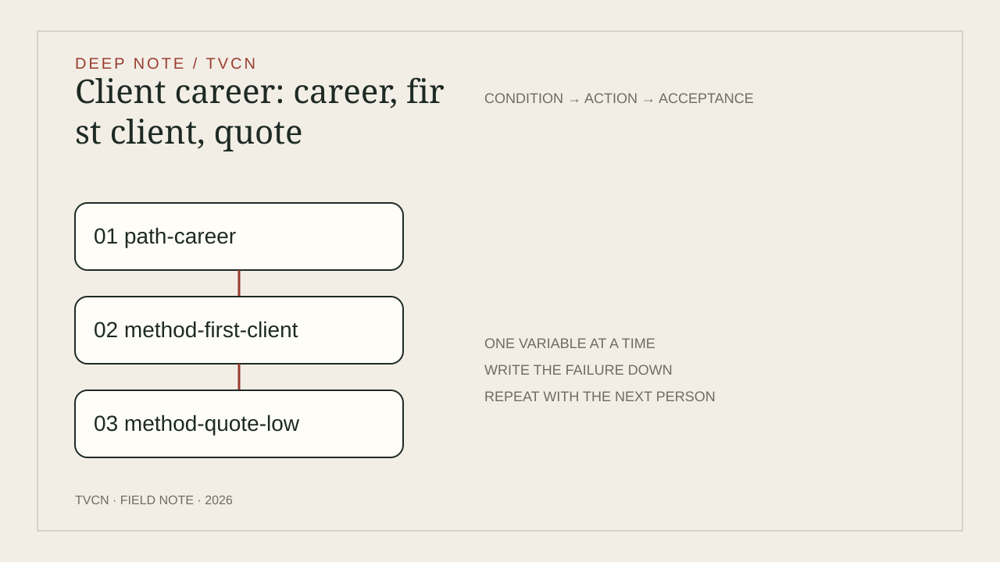

A client is not won by the lowest quote; scope, delivery and revisions decide whether it is a sustainable business. One page of &amp;quot;Career &amp;amp; Clients&amp;quot; solves one local problem; joining &amp;quot;Career &amp;amp; Clients&amp;quot;, &amp;quot;How to Get the First Client&amp;quot; and &amp;quot;Your Quote Is Too Low&amp;quot; exposes the real failure: conditions are missing, too many variables move, and the result cannot be reproduced.

<!-- DEEP_DIVE_START -->
<!-- DIAGRAM_START -->
<h2>图解</h2>
<figure>
  
  <figcaption>Read &quot;Career &amp; Clients&quot; and &quot;How to Get the First Client&quot;: write the condition first, then check whether the failure can be recorded.</figcaption>
</figure>
<!-- DIAGRAM_END -->

<section><h2 id="section-1">Problem</h2>
The problem is not a lack of methods; each step works alone, but together they fail because the condition was not written, too many variables moved and the result cannot be reproduced.

The order is condition, judgement, one variable and evidence. A step is complete only when the next person can repeat it.
</section>
<section><h2 id="section-2">Judgement</h2><ul><li>First gate in &quot;Career &amp; Clients&quot;: The client profile names industry, budget range, and cadence.</li><li>Second gate in &quot;How to Get the First Client&quot;: The portfolio reads in thirty seconds.</li><li>Third gate in &quot;Your Quote Is Too Low&quot;: The showreel uses only your shots and does not inflate roles.</li></ul>
If one gate fails, return to its single page; do not hide an unsolved point inside a longer chain.
</section>
<section><h2 id="section-3">Method</h2><ol><li>Write the condition first: turn &quot;List ten people or shops you might know; pick one with a real need.&quot; from &quot;Career &amp; Clients&quot; into three rows: material, environment, acceptance.</li><li>Run one minimal action: follow &quot;Career &amp; Clients&quot; for 30 seconds and do not add the second page yet.</li><li>Attach the second page: Give them a one-page plan: what, how long, what they get, what it costs..</li><li>Use the third page as a control: Do one small job, deliver on time, then ask for a quote or referral..</li><li>Change one variable at a time; write the other conditions down instead of remembering them.</li><li>Film the failure too: put failure and success side by side to see which step cannot be skipped.</li><li>Ask the next person to reproduce from the record; if they cannot, the record is not finished.</li></ol></section>
<section><h2 id="section-4">Field test</h2>
A reproducible test, not a client case: take 30 seconds of material, make version A using &quot;The client profile names industry, budget range, and cadence.&quot; from &quot;Career &amp; Clients&quot;, then version B using &quot;The portfolio reads in thirty seconds.&quot; from &quot;How to Get the First Client&quot;; only one variable may differ. Put them side by side and record what breaks first in &quot;Your Quote Is Too Low&quot;: condition, action or acceptance. If it works on the first try, add one real constraint and run it again.
</section>
<section><h2 id="section-5">Failure table</h2>
<table class="data-table"><thead><tr><th>Symptom</th><th>Cause</th><th>Replacement action</th></tr></thead><tbody><tr><td>Do not mass-message “I make videos”; a specific plan beats a self…</td><td>Condition was not written</td><td>Return to page one and rewrite the three rows</td></tr><tr><td>Do not say “let me win it first”; the low price becomes the new s…</td><td>Condition was not written</td><td>Return to page one and rewrite the three rows</td></tr><tr><td>Only the result is kept, not the condition</td><td>Condition was not written</td><td>Return to page one and rewrite the three rows</td></tr></tbody></table>
</section>
<section><h2 id="section-6">Acceptance</h2><ul><li>The client profile names industry, budget range, and cadence.</li><li>The portfolio reads in thirty seconds.</li><li>The showreel uses only your shots and does not inflate roles.</li><li>The quote has four parts and a numeric revision count.</li><li>The contract has six clauses and payment dates.</li><li>Every delivery item is ticked; out-of-scope work is re-quoted.</li><li>The follow-up asks specific questions; the next plan has timing and scope.</li><li>Ten people or shops were listed and one with a real need was chosen.</li><li>A one-page plan states what, how long, what they get, and the price.</li><li>The small job was delivered on time and earned a quote or referral.</li></ul></section>
<section><h2 id="section-7">Alternatives</h2><ul><li>For a single-point problem in "Career & Clients", go back to <a href="https://tvcn.org/en/article/path-career/">Career & Clients</a>; do not use the whole chain.</li><li>To compare two actions, read <a href="https://tvcn.org/en/article/method-first-client/">How to Get the First Client</a> and leave the third page alone.</li><li>For acceptance only, use <a href="https://tvcn.org/en/article/method-quote-low/">Your Quote Is Too Low</a> as a self-test sheet.</li></ul></section>

<!-- SOURCES_START -->
## References and further reading

- [S19] [Generative Adversarial Nets (2014)](https://arxiv.org/abs/1406.2661) — Accessed 2026-11-26. Used to check the terminology/method/rule in the “Problem” section against the original GAN paper, not a product review; it does not verify numbers, model choices or on-set conclusions derived from this page, and is not a substitute for a test.
- [S20] [Denoising Diffusion Probabilistic Models (2020)](https://arxiv.org/abs/2006.11239) — Accessed 2026-11-26. Used to check the terminology/method/rule in the “Judgement” section against the original DDPM paper, not a product review; it does not verify numbers, model choices or on-set conclusions derived from this page, and is not a substitute for a test.
- [S04] [CAC: Interim Measures for Generative AI Services](https://www.cac.gov.cn/2023-07/13/c_1690898327029107.htm) — Accessed 2026-11-26. Used to check the terminology/method/rule in the “Failure table” section against China's generative-AI service rules, not technical implementation; it does not verify numbers, model choices or on-set conclusions derived from this page, and is not a substitute for a test.
<!-- SOURCES_END -->

