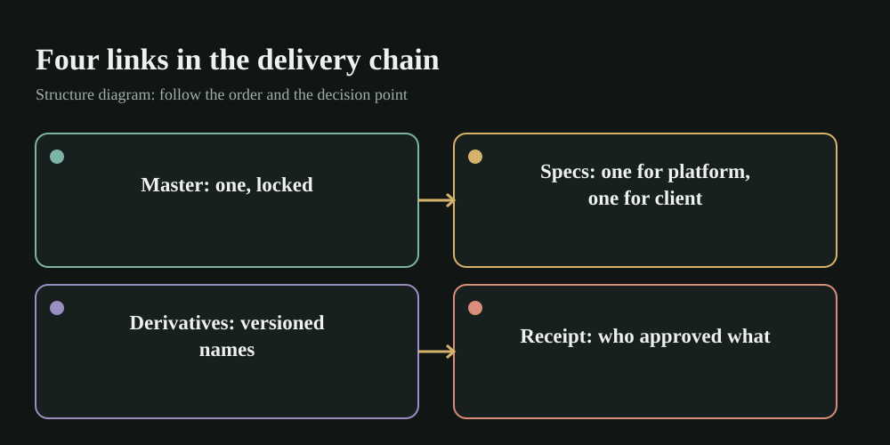

The team relaxes when the cut is done; risk starts exactly there. Who holds the master, which version the platform wants, and whether “received” means approved — if any one is vague, rework lands in the last hour.

<!-- DIAGRAM_START -->
<h2 id="diagram">Diagram</h2>
<figure class="diagram">
  
  <figcaption>Check whether master, specs, derivatives and receipt are separate. If any link depends on chat history, delivery is not complete.</figcaption>
</figure>
<!-- DIAGRAM_END -->

<section><h2 id="section-1">On location</h2>
An eight-minute film needs four versions: landscape master, vertical 60-second cut, platform 4K and a 1080p internal copy. The editor names the file `final_v3_ok.mp4` and sends it by chat; the client replies “received”. Two weeks later the platform rejects the vertical safe area, and the client says they approved content, not dimensions. The team re-exports and discovers the colourist has already changed the master.
</section>
<section><h2 id="section-2">What to look for</h2><ul><li><strong>The master is not unique:</strong> the project still holds `final_v4` and `final_v4_really`; nobody knows which is the delivery source.</li><li><strong>Specs live only in chat:</strong> resolution, bitrate, safe area and loudness have no sheet, so a platform rejection turns into guesswork.</li><li><strong>The receipt has no scope:</strong> the client says “received/OK” without saying whether they approved picture, dimensions, subtitles or music.</li></ul></section>
<section><h2 id="section-3">What to do</h2><ol><li>Lock the master: tag the only version that passed QC with date, resolution, gamut, loudness and filename; label everything else as a derivative.</li><li>Build a spec sheet: one row for platform, client and internal each, with resolution, frame rate, bitrate, gamut, safe area, loudness and subtitle format.</li><li>Derive from the master, never from an old project; name each file with version, language, platform and date, for example `film_v1_zh_4k_20261126.mp4`.</li><li>Send a package manifest: files, matching specs, checksums, review link and expiry; the manifest also gets a version number.</li><li>Scope the receipt: ask the client to confirm or change picture, dimensions, subtitles, music and credit line item by item; do not accept one “OK”.</li></ol></section>
<section><h2 id="section-4">Failure modes</h2><ul><li><strong>Sending only a link:</strong> the link points to a folder that will be overwritten, so what the client saw yesterday is not what they download today.</li><li><strong>Treating chat as approval:</strong> “received” becomes “approved”, and there is no quotable confirmation when something fails.</li><li><strong>Re-uploading after rejection:</strong> if the spec sheet is not fixed first, the same error repeats on the next platform.</li></ul></section>
<section><h2 id="section-5">Limits</h2>
This applies to projects with a platform, a client and multiple versions. It does not replace the acceptance clause in the contract or the platform review. If the client insists on seeing it first, send a low-resolution review copy, label it as not for delivery, and include timecode and a watermark.
</section>
<section><h2 id="section-6">Check</h2><ul><li>There is one master tag; every other file traces back to it.</li><li>The spec sheet covers every delivery target and matches the actual files.</li><li>The client receipt names each approved item, not just “received”.</li><li>The package has a manifest, checksums and an expiry.</li></ul></section>
<!-- DEEP_DIVE_START -->
## Deep dive

<strong>About 8 minutes.</strong> This section places the same judgement in two different conditions, then gives a counterexample and a reusable model. It does not repeat the page; it decides when to change the method.

### Condition A: direct platform delivery

For direct platform delivery, the spec sheet is the gate. Copy the current platform spec into your own sheet instead of trusting last time; every field needs a source and date. Check the export with tools, not eyes: resolution, frame rate, bitrate, gamut, loudness, subtitles and filename. Put the results in the package so a rejection points to a field.

Platform review time is not controllable, so hold a rejection window on the delivery day. Not a spare day, but time for one fix and one re-upload. If no rejection comes, use the window for archive.

### Condition B: client uploads

When the client uploads, the team is not delivering a file; it is delivering the client's ability to deliver. Add a one-page runbook: which dashboard, which category, cover dimensions, title length and whether a subtitle file is needed. Have the client's operator do it once while the team watches, and confirm every step.

The most common failure is not a bad file but the wrong version uploaded. Put platform and version in the filename and the email subject; when the client forwards it, that record becomes part of the receipt.

### Counterexample: after the client says received

A team got two words, “received”, and closed the project. Three months later the client wanted a credit change. The old link had been overwritten by a new project. No master tag, no checksum, no scoped receipt; the team had to reverse-engineer from a platform-compressed download.

The client did not fail; the team treated “received” as acceptance. Make the receipt a five-item table: picture, dimensions, subtitles, music and credit. Each item gets “confirm” or “change”. Delivery is complete only when all five are confirmed; confirming picture alone completes only picture.

### Reusable model

<strong>Master → spec sheet → derivatives → manifest → receipt.</strong> One master; specs in rows by target; derivatives from the master; a manifest that makes files verifiable; a receipt that scopes approval. If one link is missing, delivery was sent, not completed.

At wrap, put the manifest, receipt and master tag into the archive package. Open that package before opening chat history on the next delivery. The most valuable item is not the video; it is the reusable spec sheet and receipt template.

<!-- DEEP_DIVE_END -->
<!-- SOURCES_START -->
## Further reading

- [S28] [Netflix Partner Help: Netflix Partner Help](https://partnerhelp.netflixstudios.com/) — accessed 2026-11-26. Used to check the terms, method or rule in the “What to look for” section; not the page's field numbers, gear models or conclusions, and not a substitute for a test or contract.
- [S29] [YouTube Upload Specs: YouTube Upload Specs](https://support.google.com/youtube/answer/1722171) — accessed 2026-11-26. Used to check the terms, method or rule in the “Limits” section; not the page's field numbers, gear models or conclusions, and not a substitute for a test or contract.
<!-- SOURCES_END -->
