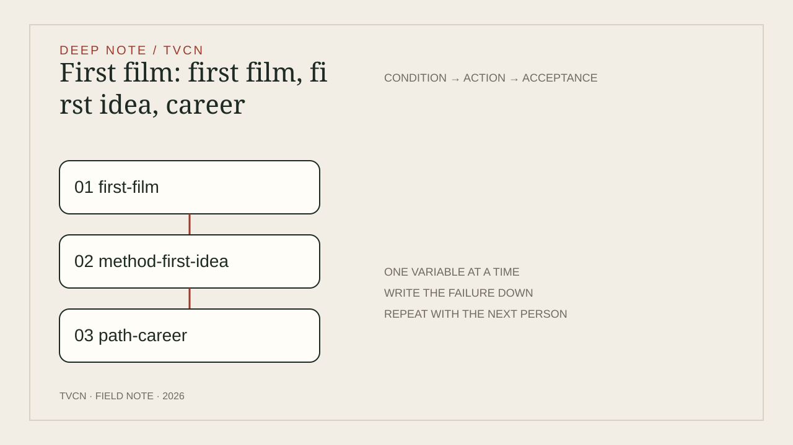

A first film is not proof that you can shoot; it is one finishable project that earns the next chance. One page of &amp;quot;first-film&amp;quot; solves one local problem; joining &amp;quot;first-film&amp;quot;, &amp;quot;You Only Have a Vague Idea&amp;quot; and &amp;quot;Career &amp;amp; Clients&amp;quot; exposes the real failure: conditions are missing, too many variables move, and the result cannot be reproduced.

<!-- DEEP_DIVE_START -->
<!-- DIAGRAM_START -->
<h2>图解</h2>
<figure>
  
  <figcaption>Read &quot;first-film&quot; and &quot;You Only Have a Vague Idea&quot;: write the condition first, then check whether the failure can be recorded.</figcaption>
</figure>
<!-- DIAGRAM_END -->

<section><h2 id="section-1">Problem</h2>
The problem is not a lack of methods; each step works alone, but together they fail because the condition was not written, too many variables moved and the result cannot be reproduced.

The order is condition, judgement, one variable and evidence. A step is complete only when the next person can repeat it.
</section>
<section><h2 id="section-2">Judgement</h2><ul><li>First gate in &quot;first-film&quot;: One sentence names who wants what and what blocks them.</li><li>Second gate in &quot;You Only Have a Vague Idea&quot;: The three test shots cut together without voice-over.</li><li>Third gate in &quot;Career &amp; Clients&quot;: Unshootable settings are gone; what remains fits one location.</li></ul>
If one gate fails, return to its single page; do not hide an unsolved point inside a longer chain.
</section>
<section><h2 id="section-3">Method</h2><ol><li>Write the condition first: turn &quot;Write three sentences, twenty words or fewer, each with a verb and a concrete ob…&quot; from &quot;first-film&quot; into three rows: material, environment, acceptance.</li><li>Run one minimal action: follow &quot;first-film&quot; for 30 seconds and do not add the second page yet.</li><li>Attach the second page: Pick the one you can finish in one room or one street; cut what needs a built se….</li><li>Use the third page as a control: Shoot three tests: a wide for context, a medium for action, a close-up for the r….</li><li>Change one variable at a time; write the other conditions down instead of remembering them.</li><li>Film the failure too: put failure and success side by side to see which step cannot be skipped.</li><li>Ask the next person to reproduce from the record; if they cannot, the record is not finished.</li></ol></section>
<section><h2 id="section-4">Field test</h2>
A reproducible test, not a client case: take 30 seconds of material, make version A using &quot;One sentence names who wants what and what blocks them.&quot; from &quot;first-film&quot;, then version B using &quot;The three test shots cut together without voice-over.&quot; from &quot;You Only Have a Vague Idea&quot;; only one variable may differ. Put them side by side and record what breaks first in &quot;Career &amp; Clients&quot;: condition, action or acceptance. If it works on the first try, add one real constraint and run it again.
</section>
<section><h2 id="section-5">Failure table</h2>
<table class="data-table"><thead><tr><th>Symptom</th><th>Cause</th><th>Replacement action</th></tr></thead><tbody><tr><td>Do not start with backstory and world-building; a setting you can…</td><td>Condition was not written</td><td>Return to page one and rewrite the three rows</td></tr><tr><td>Only the result is kept, not the condition</td><td>Condition was not written</td><td>Return to page one and rewrite the three rows</td></tr><tr><td>Only the result is kept, not the condition</td><td>Condition was not written</td><td>Return to page one and rewrite the three rows</td></tr></tbody></table>
</section>
<section><h2 id="section-6">Acceptance</h2><ul><li>One sentence names who wants what and what blocks them.</li><li>The three test shots cut together without voice-over.</li><li>Unshootable settings are gone; what remains fits one location.</li><li>The client profile names industry, budget range, and cadence.</li><li>The portfolio reads in thirty seconds.</li><li>The showreel uses only your shots and does not inflate roles.</li><li>The quote has four parts and a numeric revision count.</li><li>The contract has six clauses and payment dates.</li><li>Every delivery item is ticked; out-of-scope work is re-quoted.</li><li>The follow-up asks specific questions; the next plan has timing and scope.</li></ul></section>
<section><h2 id="section-7">Alternatives</h2><ul><li>For a single-point problem in "first-film", go back to <a href="https://tvcn.org/en/article/first-film/">first-film</a>; do not use the whole chain.</li><li>To compare two actions, read <a href="https://tvcn.org/en/article/method-first-idea/">You Only Have a Vague Idea</a> and leave the third page alone.</li><li>For acceptance only, use <a href="https://tvcn.org/en/article/path-career/">Career & Clients</a> as a self-test sheet.</li></ul></section>
