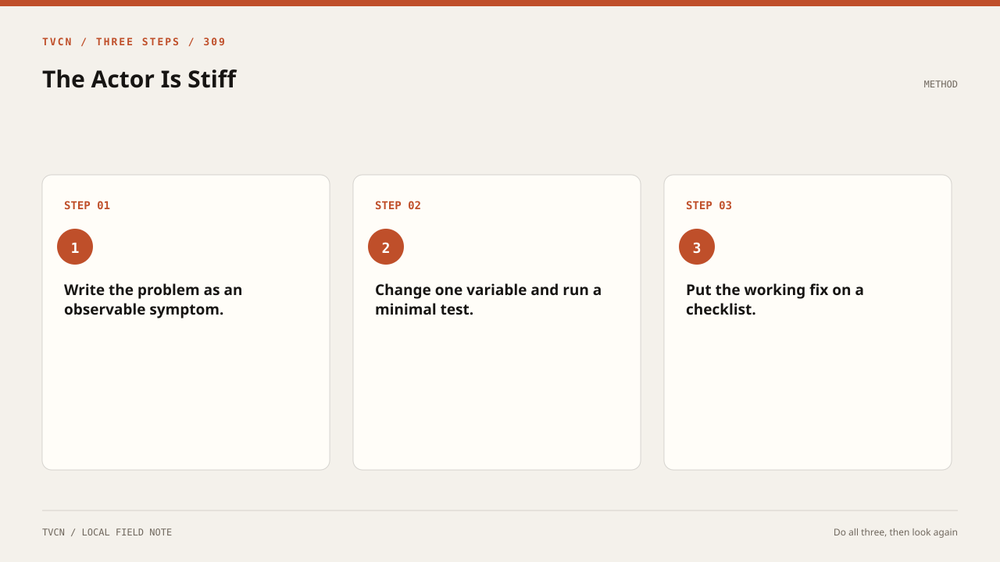

A stiff actor needs a concrete task and a reason to move. Once the body works, the lines loosen.

<!-- DIAGRAM_START -->
<h2>Diagram</h2>
<figure>
  
  <figcaption>Watch “Turn the line into an action: look for” and “Have them actually do it, not perform the”; judge whether the symptom can be restated as one observable sentence.</figcaption>
</figure>
<!-- DIAGRAM_END -->
<section><h2 id="section-1">On set</h2>
Give a task: put the cup on the table, then turn. Make them walk one step and the lines loosen.
</section><section><h2 id="section-2">Do this</h2><ol><li>Turn the line into an action: look for someone, open a door, hand something over.</li><li>Have them actually do it, not perform the idea of doing it.</li><li>Walk it twice before rolling and shoot the most natural rhythm.</li></ol></section><section><h2 id="section-3">Avoid</h2>
Do not tell them to relax; the more you say it, the stiffer they get.
</section><section><h2 id="section-4">Three causes</h2>
For “The Actor Is Stiff”, check three directions first. Change one variable, record a 30-second comparison, and see which link the change follows.

<table class="data-table"><thead><tr><th>Cause</th><th>Signal on set</th><th>Five-minute test</th></tr></thead><tbody><tr><td>Lines before action</td><td>The actor stands still and only moves the mouth; the hands have no job</td><td>Remove the lines and give one physical task</td></tr><tr><td>Abstract direction</td><td>“Just relax” makes the body stiffer</td><td>Replace it with a verb: open, hand over, find</td></tr><tr><td>Camera fear</td><td>The eyes hunt for the lens and the action lands half a beat late</td><td>Ask for one take facing away, then turn back</td></tr></tbody></table>
</section><section><h2 id="section-5">On-set diagnosis</h2><ol><li>Shoot one silent action take and watch whether hands and feet do the same job.</li><li>Then add the lines after the action and compare breathing and pauses.</li><li>Shoot one wide and one close. If only the close works, the action has not built a space.</li></ol></section><section><h2 id="section-6">Fix</h2>
Replace “play the feeling” with “finish the task”. The actor does not need to feel relaxed first; he needs something that must be done.
<ol><li>Turn lines into actions: find someone, open a door, hand over an object, hide something.</li><li>Give the action an obstacle: a stuck door, an overfull cup, a missing key.</li><li>Walk it twice before rolling: first silent, then with lines.</li><li>Shoot a wide for space, then a close for reaction; do not start with faces only.</li></ol></section><section><h2 id="section-7">Failure cases</h2>
With “The Actor Is Stiff”, these three moves make it worse. Pick one replacement action and do not change three variables at once.

<table class="data-table"><thead><tr><th>Failure</th><th>Why it gets worse</th><th>Replace with</th></tr></thead><tbody><tr><td>Repeat “relax”</td><td>The actor performs relaxation; shoulders and hands become less believable</td><td>Name a concrete action and obstacle</td></tr><tr><td>Ask for “nervous”</td><td>Shaking hands and shoulders become a generic trick</td><td>Give a real deadline or consequence</td></tr><tr><td>Ten takes in a row</td><td>Energy drops and the last takes repeat</td><td>Stop at two different rhythms and review</td></tr></tbody></table>
</section><section><h2 id="section-8">Acceptance table</h2>
Acceptance is not “it feels better”; all four must be identifiable, playable and logged.

<table class="data-table"><thead><tr><th>Check</th><th>Pass line</th><th>Log</th></tr></thead><tbody><tr><td>Body task</td><td>Hands and feet do one job, not a pose</td><td>Review the silent take</td></tr><tr><td>Line placement</td><td>Lines follow the action instead of replacing it</td><td>Check take two</td></tr><tr><td>Space</td><td>The wide shows who is where and what they do</td><td>Keep one wide</td></tr><tr><td>Rhythm</td><td>Two takes have different pauses and both are usable</td><td>Log the difference</td></tr></tbody></table>
</section><section><h2>Boundary</h2>
It does not guarantee a story. The template only orders structure; the person, obstacle and cost still need writing.
</section><section><h2>Alternative</h2>
If “Turn the line into an action: look for” is not the main problem, start with the basic move behind “Have them actually do it, not perform the”. Upgrade only after both hold.
</section><section><h2>60-second test</h2>
Run a 60-second test with the gear you own, focused on “Turn the line into an action: look for”, and record one number. If the number does not change, do not add budget.
</section><section><h2>When not to use</h2>
Do not use the template when “Turn the line into an action: look for” is still unclear or “Have them actually do it, not perform the” is only filler. Go back to the person and the problem.
</section><section><h2>Three failures</h2><ul><li>Every beat exists, but no one makes a decision.</li><li>The middle changes location, not information.</li><li>The ending is narrated, with no visible change.</li></ul></section>
<h2>Check</h2><ul><li>The line is now a concrete action.</li><li>The actor actually does it rather than performing the idea.</li><li>Two walk-throughs happened before rolling and the rhythm is natural.</li></ul>
