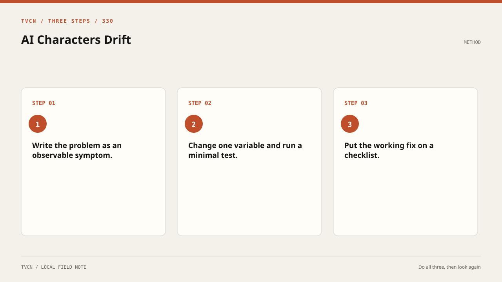

Generate front, profile and looking-down views and compare them in one image. If cheekbones, nose bridge, hairline and wardrobe do not align, do not start batch generation. Fix the references, then the prompt. When not to force it For long dialogue, complex expressions or sharing the frame with a real actor, shoot a live reference first and use generation for wides and inserts. Do not hide drift with “we&#x27;ll match it in post.”

<!-- DIAGRAM_START -->
<h2>Diagram</h2>
<figure>
  
  <figcaption>Watch “Lock ten traits: age, hair, face shape, brows,” and “Generate front, side, and back views; choose one”; judge whether the symptom can be restated as one observable sentence.</figcaption>
</figure>
<!-- DIAGRAM_END -->

<section><h2 id="section-1">Lock four things</h2>
<ul><li><strong>Face:</strong> one front, one profile and one three-quarter reference; fix hair and brow shape. Do not rely on a text description each time.</li><li><strong>Wardrobe:</strong> material, color, collar and buttons in the character sheet; do not switch to a near-match color in the same scene.</li><li><strong>Light:</strong> key direction, color temperature and softness in the shot card; change the light before changing the face.</li><li><strong>Lens:</strong> focal length and shot size change the face. The same character on a wide and a tele looks like two people; lock the lens first.</li></ul>
<h2 id="section-2">Three-angle test</h2>

Generate front, profile and looking-down views and compare them in one image. If cheekbones, nose bridge, hairline and wardrobe do not align, do not start batch generation. Fix the references, then the prompt.

<h2 id="section-3">When not to force it</h2>

For long dialogue, complex expressions or sharing the frame with a real actor, shoot a live reference first and use generation for wides and inserts. Do not hide drift with “we'll match it in post.”
</section><section><h2 id="section-4">On set</h2>
Use a character sheet, three views, and one reference. Compare face, wardrobe, and hair shot by shot.
</section><section><h2 id="section-5">Do this</h2>
AI character drift: build a character sheet and three views, then carry the same reference into every shot.
<ol><li>Lock ten traits: age, hair, face shape, brows, nose, wardrobe, shoes, accessories, build, skin tone.</li><li>Generate front, side, and back views; choose one as the master.</li><li>Every shot carries the same reference and the same description; change only action and camera.</li></ol></section><section><h2 id="section-6">Avoid</h2>
Do not rewrite the adjectives for every shot; each one grows a different person.
</section><section><h2 id="section-7">Boundary</h2>
It does not guarantee a story. The template only orders structure; the person, obstacle and cost still need writing.
</section><section><h2 id="section-8">Alternative</h2>
If “Lock ten traits: age, hair, face shape, brows,” is not the main problem, start with the basic move behind “Generate front, side, and back views; choose one”. Upgrade only after both hold.
</section><section><h2 id="section-9">60-second test</h2>
Run a 60-second test with the gear you own, focused on “Lock ten traits: age, hair, face shape, brows,”, and record one number. If the number does not change, do not add budget.
</section><section><h2 id="section-10">When not to use</h2>
Do not use the template when “Lock ten traits: age, hair, face shape, brows,” is still unclear or “Generate front, side, and back views; choose one” is only filler. Go back to the person and the problem.
</section><section><h2 id="section-11">Three failures</h2><ul><li>Every beat exists, but no one makes a decision.</li><li>The middle changes location, not information.</li><li>The ending is narrated, with no visible change.</li></ul></section>
<h2 id="section-12">Check</h2><ul><li>Ten traits are locked and one three-view master is chosen.</li><li>Every shot carries the same reference and the same description.</li><li>Only action and camera change; the adjectives are not rewritten.</li></ul>

> Intent split: this page covers the practical details of “AI Characters Drift”; start with <a href="https://tools.tvcn.org/article/deep-ai-toolchain/">AI toolchain: generation, voice, render</a> for the cluster-level judgement, then return here.

<!-- INTENT_SCOPE -->

<!-- SOURCES_START -->
## References and further reading

- [S22] [National People's Congress: Civil Code](http://www.npc.gov.cn/npc/c2/c30834/202006/t20200602_306457.html) — Accessed 2026-11-26. Used to check the terminology and public context in the opening paragraph (“Build a character sheet and carry one reference into every s”) against Statutory text on portrait rights, privacy, contracts and location rights; not a substitute for an on-set test.
- [S23] [SMPTE Standards](https://www.smpte.org/standards) — Accessed 2026-11-26. Used to check the terminology and public context in the opening paragraph (“Build a character sheet and carry one reference into every s”) against Entry point for timecode, color, cinema and signal-chain standards; not a substitute for an on-set test.
- [S02] [Copyright FAQ](https://www.wipo.int/en/web/copyright/faq-copyright) — Accessed 2026-11-26. Used to check the terminology and public context in the opening paragraph (“Build a character sheet and carry one reference into every s”) against What copyright protects, economic rights and moral rights; not a substitute for an on-set test.
- [S38] [State Taxation Administration: Official site](https://www.chinatax.gov.cn/) — Accessed 2026-11-26. Used to check the terminology and public context in the opening paragraph (“Build a character sheet and carry one reference into every s”) against Official entry for VAT, cross-border services and withholding; not a substitute for an on-set test.
<!-- SOURCES_END -->

