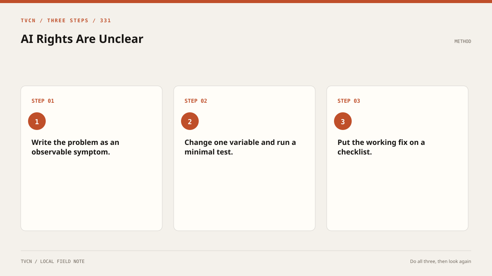

For every generated asset, log model and version, prompt, input references, output file, rights source and where it is used. Without all six, it does not go into a paid delivery. When not to use it News, documentary, testimony, real-person endorsement and projects that explicitly require live action must not use generated images. Never publish an uncleared asset and fix the rights later.

<!-- DIAGRAM_START -->
<h2>Diagram</h2>
<figure>
  
  <figcaption>Watch “Read the model terms: commercial use, modification, credit,” and “Get written permission for real people, celebrities, or”; judge whether the symptom can be restated as one observable sentence.</figcaption>
</figure>
<!-- DIAGRAM_END -->
<section><h2 id="section-1">Separate four rights</h2>
<ul><li><strong>Model terms:</strong> commercial use, output ownership, whether training a derivative is allowed. Read the current version and save a dated screenshot.</li><li><strong>Input assets:</strong> do you have the right to use reference images, video or voice for generation? Do not use a client's uncleared asset as a style reference.</li><li><strong>Personality:</strong> real face, voice, name and likeness. AI generation does not bypass consent.</li><li><strong>Output similarity:</strong> existing characters, trademarks, music or artwork. Run a similarity check before delivery.</li></ul>
<h2 id="section-2">A five-minute record</h2>

For every generated asset, log model and version, prompt, input references, output file, rights source and where it is used. Without all six, it does not go into a paid delivery.

<h2 id="section-3">When not to use it</h2>

News, documentary, testimony, real-person endorsement and projects that explicitly require live action must not use generated images. Never publish an uncleared asset and fix the rights later.
</section><section><h2 id="section-4">On set</h2>
Check training sources, commercial terms, and likeness permission. If unclear, do not deliver.
</section><section><h2 id="section-5">Do this</h2>
Unclear AI rights: check training source, commercial terms, and likeness permission. If it is unclear, do not deliver.
<ol><li>Read the model terms: commercial use, modification, credit, prohibited uses.</li><li>Get written permission for real people, celebrities, or brands.</li><li>Keep prompts, references, generation logs, and licenses; label the AI content on delivery.</li></ol></section><section><h2 id="section-6">Avoid</h2>
Do not gamble on “nobody will sue”; rights problems travel with the work.
</section><section><h2>Boundary</h2>
It does not guarantee a story. The template only orders structure; the person, obstacle and cost still need writing.
</section><section><h2>Alternative</h2>
If “Read the model terms: commercial use, modification, credit,” is not the main problem, start with the basic move behind “Get written permission for real people, celebrities, or”. Upgrade only after both hold.
</section><section><h2>60-second test</h2>
Run a 60-second test with the gear you own, focused on “Read the model terms: commercial use, modification, credit,”, and record one number. If the number does not change, do not add budget.
</section><section><h2>When not to use</h2>
Do not use the template when “Read the model terms: commercial use, modification, credit,” is still unclear or “Get written permission for real people, celebrities, or” is only filler. Go back to the person and the problem.
</section><section><h2>Three failures</h2><ul><li>Every beat exists, but no one makes a decision.</li><li>The middle changes location, not information.</li><li>The ending is narrated, with no visible change.</li></ul></section>
<h2>Check</h2><ul><li>The model terms for commercial use, modification, credit, and prohibited uses are checked.</li><li>Real people, celebrities, or brands have written permission.</li><li>Prompts, references, generation logs, and licenses are kept; delivery is labeled AI.</li></ul>
