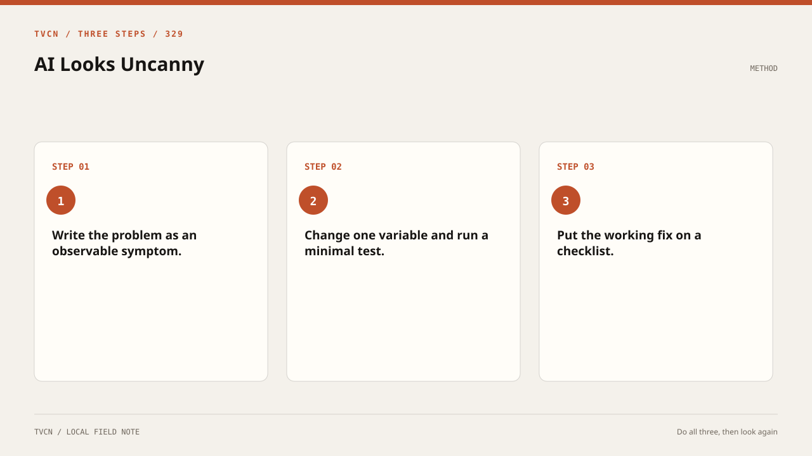

Check eyes, hands, lip sync, and motion; any one breaks the illusion.

<!-- DIAGRAM_START -->
<h2>Diagram</h2>
<figure>
  
  <figcaption>Do the three steps in order, then look again at the image or file.</figcaption>
</figure>
<!-- DIAGRAM_END -->
<h2>On set</h2>

Check eyes, hands, lips, and motion. If any one breaks, regenerate or change the shot.

<h2>Do this</h2>

An AI image feels fake: check eyes, hands, lip sync, and motion. When one of these breaks, the audience leaves.
<ol><li>Zoom into eye highlights, finger joints, teeth, and ears.</li><li>Check lip closure and motion direction, especially turns and walks.</li><li>Reframe the failure: hands out of frame, face in profile, shorter shot.</li></ol>
<h2>Avoid</h2>

Do not hide it with filters or skin smoothing; the more you polish, the faker it gets.

<h2>Check</h2>
<ul><li>Eye highlights, finger joints, teeth, and ears were checked at full size.</li><li>Lip closure and motion direction were checked.</li><li>Failures were reframed: hands out, profile, or a shorter shot.</li></ul>
