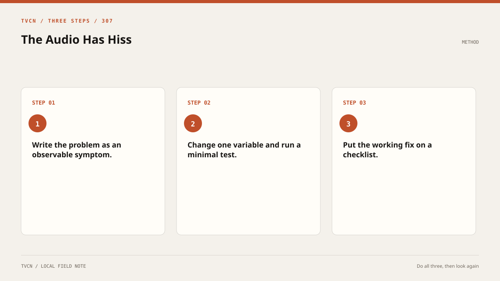

Check room, air conditioning, cables, and gain; replace the mic last.

<!-- DIAGRAM_START -->
<h2>Diagram</h2>
<figure>
  
  <figcaption>Do the three steps in order, then look again at the image or file.</figcaption>
</figure>
<!-- DIAGRAM_END -->
<h2>On set</h2>

Turn off the air conditioning, change cables, and lower gain to -12 dB. Change the mic last.

<h2>Do this</h2>

Hiss starts with the room, air conditioning, cables, and gain. The microphone is the last thing to replace.
<ol><li>Turn off AC, fridge, and lights; record thirty seconds of silence and listen for the source.</li><li>Change outlets and cables; put gain on the recorder, not the microphone.</li><li>Move the subject closer to the mic and record room tone for a post bed.</li></ol>
<h2>Avoid</h2>

Do not buy a new mic first; the noise may be the room.

<h2>Check</h2>
<ul><li>Thirty seconds of silence was recorded with AC, fridge, and lights off.</li><li>Outlets and cables were changed and gain sits on the recorder.</li><li>The subject is close to the mic, dialogue is clear, and room tone exists.</li></ul>
