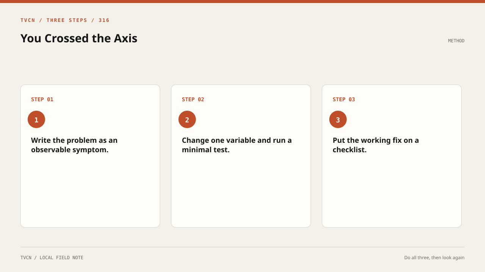

Return to a wide or add a neutral shot; do not hard-cut reversed faces.

<!-- DIAGRAM_START -->
<h2>Diagram</h2>
<figure>
  
  <figcaption>Do the three steps in order, then look again at the image or file.</figcaption>
</figure>
<!-- DIAGRAM_END -->
<h2>On set</h2>

Return to a wide or add a neutral shot. Do not cut between two opposite-facing faces.

<h2>Do this</h2>

A line jump: return to a wide or add a neutral shot. Do not hard-cut two faces looking in opposite directions.
<ol><li>Shoot a wide or neutral shot between the two people to re-establish the line.</li><li>Keep the next setup on the same side; do not cross to the other side.</li><li>If you already crossed, bridge with an insert or a moving shot.</li></ol>
<h2>Avoid</h2>

Do not gamble that the audience will not notice; once direction breaks, the space falls apart.

<h2>Check</h2>
<ul><li>A wide or neutral shot sits between the two people.</li><li>The next setup stays on the same side; the line is not crossed.</li><li>Any crossing is bridged with an insert or a moving shot.</li></ul>
