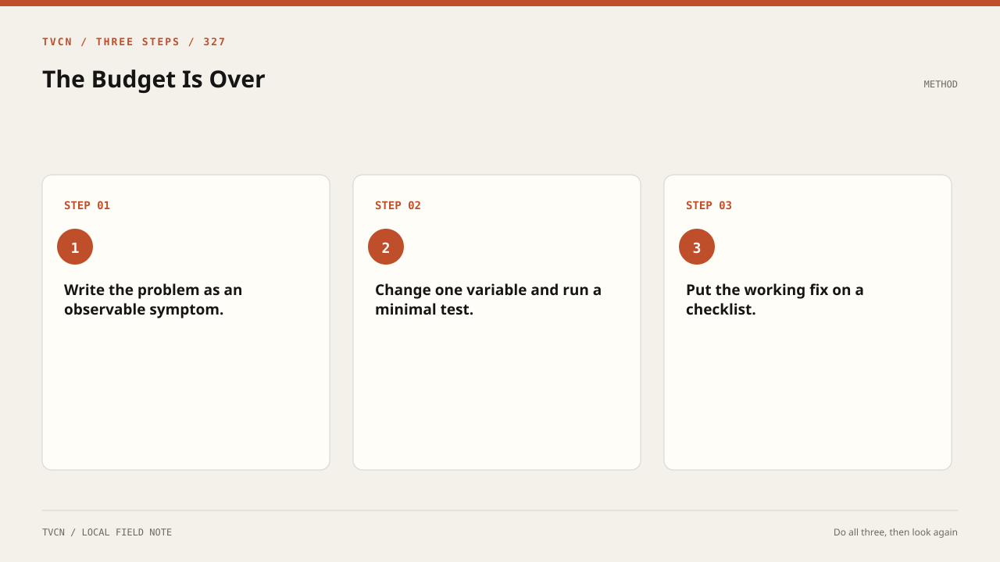

Stop nonessential gear first; overruns usually come from scope, not unit price.

<!-- DIAGRAM_START -->
<h2>Diagram</h2>
<figure>
  
  <figcaption>Do the three steps in order, then look again at the image or file.</figcaption>
</figure>
<!-- DIAGRAM_END -->
<h2>On set</h2>

Stop nonessential gear and change scope. Overruns usually come from scope, not unit price.

<h2>Do this</h2>

Over budget: stop optional gear first, then talk about people. Overruns usually come from scope, not unit price.
<ol><li>List spending as incurred and pending; cut pending nonessentials first.</li><li>Compare with the original budget and name the scope change: extra locations, days, revision rounds.</li><li>Quote the addition to the client; do not absorb it silently.</li></ol>
<h2>Avoid</h2>

Do not fill the hole with a lower price; the next job gets harder.

<h2>Check</h2>
<ul><li>Spending is split into incurred and pending; pending nonessentials are cut.</li><li>The scope change is named: locations, days, or revision rounds.</li><li>The addition is quoted to the client, not absorbed.</li></ul>
